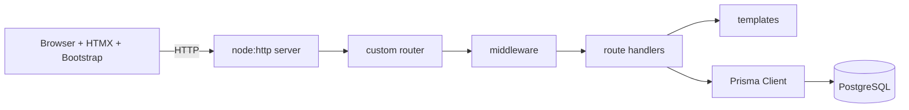

# Requirements

### Overview & Goals
A complete course, "Web Development without Frameworks", written in English: 30h of lectures (15 × 2h), 30h of labs (15 × 2h) and a 15h project. The stack is Node.js `node:http` (no Express etc.), Prisma ORM, PostgreSQL (already installed in the lab, no Docker), server-side HTML templates, Bootstrap 5 and HTMX.

### Scope
**In scope:** syllabus, lecture notes with Mermaid diagrams and code examples, lab instructions with tasks and checkpoints, a runnable reference example app built step by step, project brief with grading rubric.
**Out of scope:** slides in pptx format, an LMS export, SPA frameworks (React/Vue).

### Lecture plan (2h each)
1. How the Web works: HTTP, URLs, DNS, the request/response cycle
2. HTML5 semantics, forms, accessibility
3. CSS basics + Bootstrap 5 (grid, components)
4. Browser JavaScript: DOM, events, fetch
5. Node.js: event loop, modules, npm
6. The `node:http` server: routing, parsing the body/query, static files
7. Building a mini-framework: router, middleware chain, error handling
8. Server-side templating (template literals / a small engine), escaping, XSS
9. Relational databases & SQL in PostgreSQL, using `pg` directly
10. ORM concepts + Prisma: schema, client, migrations
11. Relations, transactions, N+1, seeding
12. HTMX: hypermedia, hx-get/post/swap/target, partials
13. Sessions, cookies, auth (password hashing), CSRF
14. Validation, security (OWASP Top 10), testing with `node:test`
15. Deployment, configuration, logging, performance, recap

### Labs
Each lab mirrors its lecture and moves the reference app (a "Task board") forward incrementally. Every lab has goals, steps, code, checkpoint tasks and extra tasks.

### Project (15h)
Teams of 2–3 build their own CRUD app with auth, at least 3 related Prisma models, HTMX interactions and a Bootstrap UI, without any web framework. Includes milestones (proposal, data model, MVP, final), a rubric and the required deliverables.

# Technical Design

### Key Decisions
- Node.js ≥ 20 with ESM. Only `node:http` is used, plus small libraries: `@prisma/client`, `pg` (lab 9 only), `bcrypt`/`node:crypto` scrypt.
- PostgreSQL connection through `DATABASE_URL` in `.env`.
- Students build their own router/middleware in lab 7, so the framework internals stay visible.
- Bootstrap and HTMX are loaded from a CDN (with a local copy as an option).

### File Structure
```
README.md                 # course overview, links
syllabus.md               # hours, outcomes, grading
lectures/01-how-the-web-works.md ... 15-deployment.md
labs/01-...md ... 15-...md
project/README.md         # brief, milestones, rubric
project/ideas.md
examples/task-board/      # reference app
  package.json, .env.example
  prisma/schema.prisma, seed.js
  src/server.js, router.js, middleware/, views/, routes/
  test/
resources/setup.md        # Node, PostgreSQL in the lab, VS Code
```

### Reference app architecture

Every lecture contains at least one Mermaid diagram (sequence diagrams for HTTP/HTMX flows, ER diagrams for the schemas).

# Testing

### Validation Approach
- Run `npm install`, `npx prisma migrate dev` and `node --test` in `examples/task-board` against a local PostgreSQL, if one is available.
- Check that all Mermaid blocks parse and that the links between files are valid.

# Delivery Steps

### ✓ Step 1: Course skeleton and syllabus
The repository holds the course structure, the syllabus and the setup guide.
- Update `README.md` and add `syllabus.md` (hours, learning outcomes, grading)
- Add `resources/setup.md`
- Create the `lectures/`, `labs/` and `project/` directories

### ✓ Step 2: Lectures 1–8 (web fundamentals, Node http, templating)
Lectures 1–8 are written, each with diagrams and examples.
- Notes, Mermaid diagrams and code samples for every lecture
- Recap questions at the end of each lecture

### ✓ Step 3: Lectures 9–15 (DB, Prisma, HTMX, security, deployment)
Lectures 9–15 are written.
- Includes ER diagrams and HTMX sequence diagrams

### ✓ Step 4: Reference app examples/task-board
A runnable app built with Node http, Prisma, PostgreSQL, Bootstrap and HTMX.
- Custom router and middleware, Prisma schema and seed, views, auth, tests

### ✓ Step 5: Labs 1–15
Step-by-step lab instructions that track the reference app.
- Each lab has goals, steps, checkpoints and extra tasks

### ✓ Step 6: Project materials
`project/README.md` (brief, milestones, rubric) and `project/ideas.md` are written.