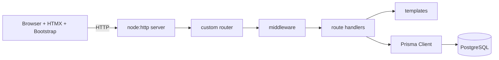

# Web Development without Frameworks

The attempt to start working with Web Development, but not using web frameworks too much :)

A complete university course: **30 h lectures (15 × 2 h)**, **30 h labs (15 × 2 h)** and a **15 h team project**.

**Stack:** Node.js (`node:http` only — no Express/Fastify/Koa), PostgreSQL, Prisma ORM, server-side HTML templates, Bootstrap 5, HTMX.

### Contents

| Part | Location |
|------|----------|
| Syllabus (outcomes, schedule, grading) | [syllabus.md](syllabus.md) |
| Environment setup | [resources/setup.md](resources/setup.md) |
| **New to web dev? Start here** | [Glossary](resources/glossary.md), [Command line primer](resources/primer-command-line.md), [JavaScript primer](resources/primer-javascript.md), [Debugging primer](resources/primer-debugging.md) |
| Lectures 1–15 | [lectures/](lectures/) |
| Labs 1–15 | [labs/](labs/) |
| Project brief & rubric | [project/README.md](project/README.md), [project/ideas.md](project/ideas.md) |
| Reference app "Task board" | [examples/task-board/](examples/task-board/) |

### Schedule

| # | Lecture | Lab |
|---|---------|-----|
| 1 | [How the Web works](lectures/01-how-the-web-works.md) | [HTTP by hand](labs/01-http-by-hand.md) |
| 2 | [HTML5 semantics, forms, a11y](lectures/02-html-forms-accessibility.md) | [Static task board pages](labs/02-static-pages.md) |
| 3 | [CSS & Bootstrap 5](lectures/03-css-bootstrap.md) | [Styling with Bootstrap](labs/03-bootstrap.md) |
| 4 | [Browser JavaScript](lectures/04-browser-javascript.md) | [DOM & fetch](labs/04-dom-fetch.md) |
| 5 | [Node.js fundamentals](lectures/05-nodejs.md) | [Node project setup](labs/05-node-setup.md) |
| 6 | [The node:http server](lectures/06-node-http.md) | [First HTTP server](labs/06-http-server.md) |
| 7 | [Building a mini-framework](lectures/07-mini-framework.md) | [Router & middleware](labs/07-router-middleware.md) |
| 8 | [Server-side templating & XSS](lectures/08-templating.md) | [Views](labs/08-views.md) |
| 9 | [SQL & PostgreSQL with pg](lectures/09-sql-postgresql.md) | [Raw SQL](labs/09-raw-sql.md) |
| 10 | [ORM & Prisma](lectures/10-orm-prisma.md) | [Prisma schema & CRUD](labs/10-prisma.md) |
| 11 | [Relations, transactions, N+1](lectures/11-relations-transactions.md) | [Relations & seeding](labs/11-relations.md) |
| 12 | [HTMX](lectures/12-htmx.md) | [HTMX interactions](labs/12-htmx.md) |
| 13 | [Sessions, auth, CSRF](lectures/13-auth-sessions.md) | [Login & sessions](labs/13-auth.md) |
| 14 | [Validation, security, testing](lectures/14-security-testing.md) | [Validation & tests](labs/14-testing.md) |
| 15 | [Deployment & recap](lectures/15-deployment.md) | [Production readiness](labs/15-deployment.md) |

### License
See [LICENSE](LICENSE).
