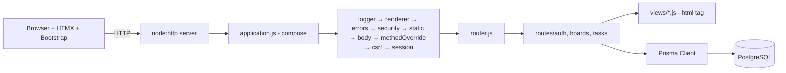
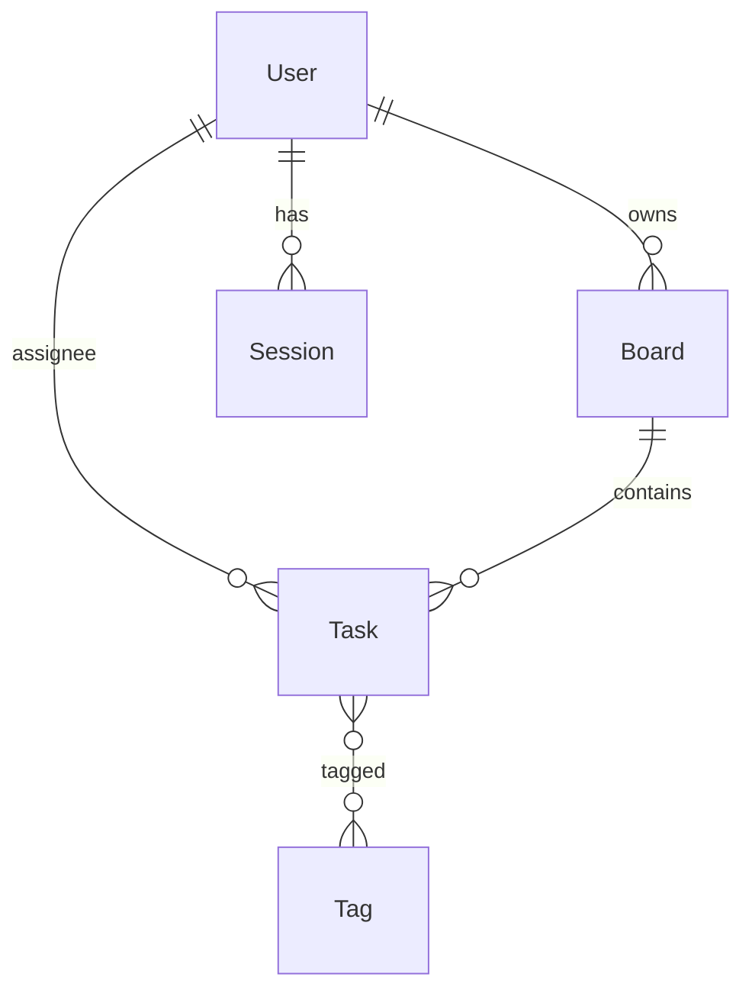

# Task board — reference application

A Kanban-style task board built **without a web framework**: Node.js `node:http`, a hand-written router and middleware chain, safe tagged-template views, Prisma + PostgreSQL, Bootstrap 5 and HTMX. The labs build this app step by step.

### Run it
```bash
cp .env.example .env            # set DATABASE_URL to your lab PostgreSQL database
npm install
npx prisma generate             # needed if npm skipped Prisma's install scripts
npx prisma migrate dev          # applies prisma/migrations
npm run seed                    # demo@example.com / password123
npm run dev                     # http://localhost:3000 (auto-restart)
npm test                        # unit + HTTP tests (no database required)
```

### Architecture




### Files
| Path | Lecture | Purpose |
|------|---------|---------|
| `src/server.js` | 6, 15 | starts the server, graceful shutdown |
| `src/application.js`, `src/router.js`, `src/context.js` | 7 | the mini-framework |
| `src/middleware/body.js`, `static.js` | 6 | body parsing with limit, static files with ETag |
| `src/middleware/errors.js`, `logger.js` | 7, 15 | error pages, JSON request logs |
| `src/views/html.js` + views | 8 | escaping-by-default templates, layout, partials |
| `prisma/schema.prisma`, `prisma/seed.js` | 10, 11 | data model, migrations, seed |
| `src/routes/boards.js`, `tasks.js` | 11, 12 | Prisma queries, HTMX fragments, OOB swaps |
| `src/middleware/session.js`, `src/lib/password.js`, `src/routes/auth.js` | 13 | scrypt, DB sessions, login/logout |
| `src/middleware/security.js`, `src/validation.js` | 13, 14 | CSRF (double submit), CSP, rate limit, validation |
| `test/` | 14 | `node:test` unit and integration tests |

### Routes
| Method | Path | Response |
|--------|------|----------|
| GET | `/health` | JSON |
| GET/POST | `/login`, `/register` | pages / 303 |
| POST | `/logout` | 303 |
| GET/POST | `/boards` | page / list item + OOB form (HTMX) |
| GET/DELETE | `/boards/:id` | page / 303 (DELETE via `_method`) |
| GET | `/boards/:id/tasks?q=` | `#columns` fragment (active search) |
| POST | `/boards/:id/tasks` | task card + OOB form |
| GET | `/tasks/:id`, `/tasks/:id/edit` | card / edit form fragment |
| PUT | `/tasks/:id` | card fragment |
| PATCH | `/tasks/:id/status` | `#columns` fragment |
| DELETE | `/tasks/:id` | empty 200 |
