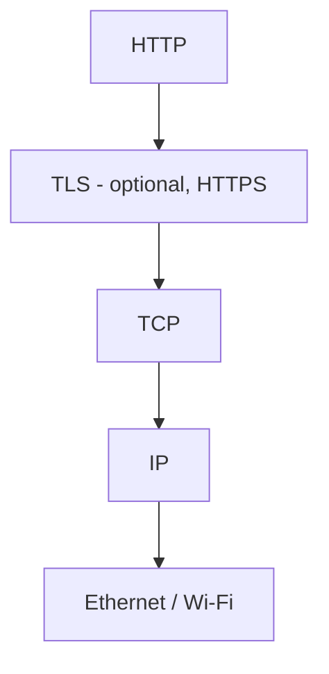
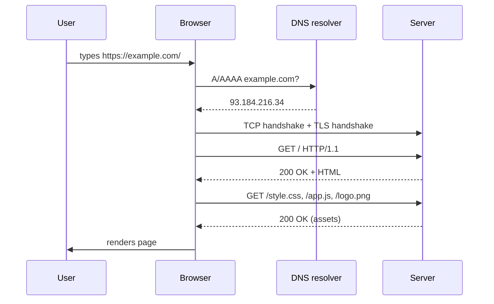
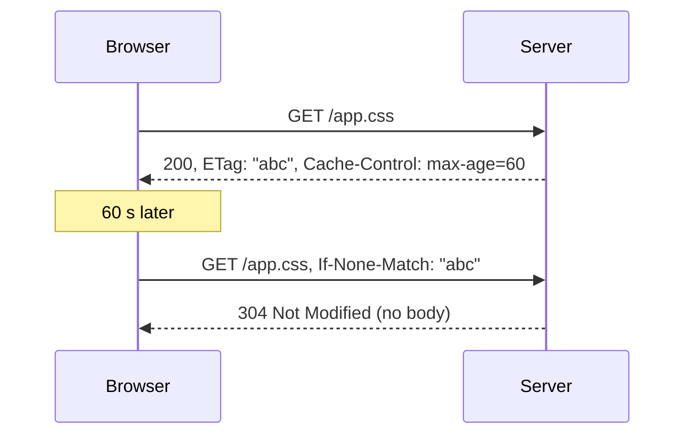
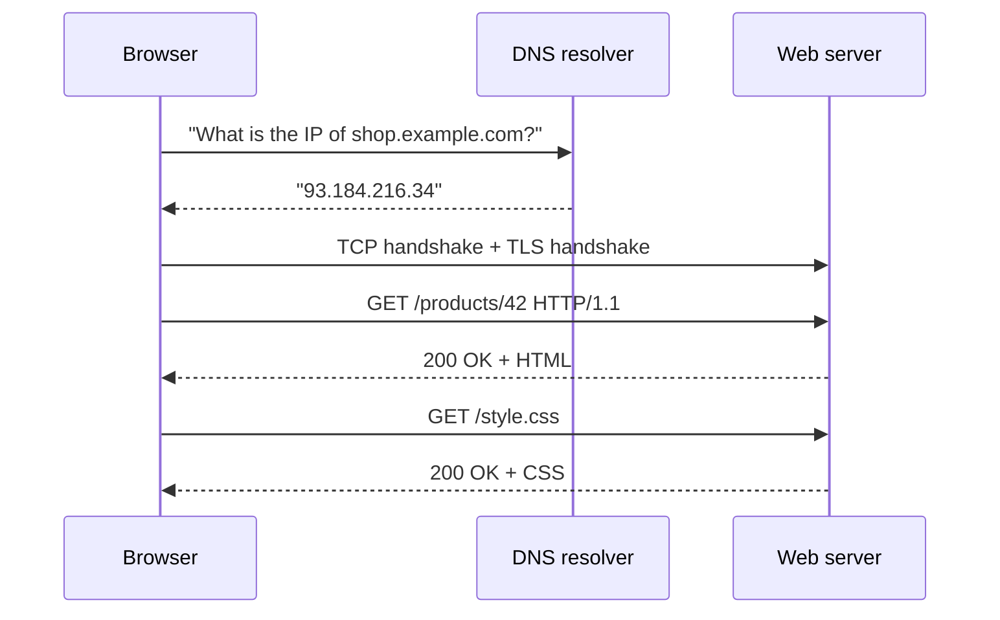
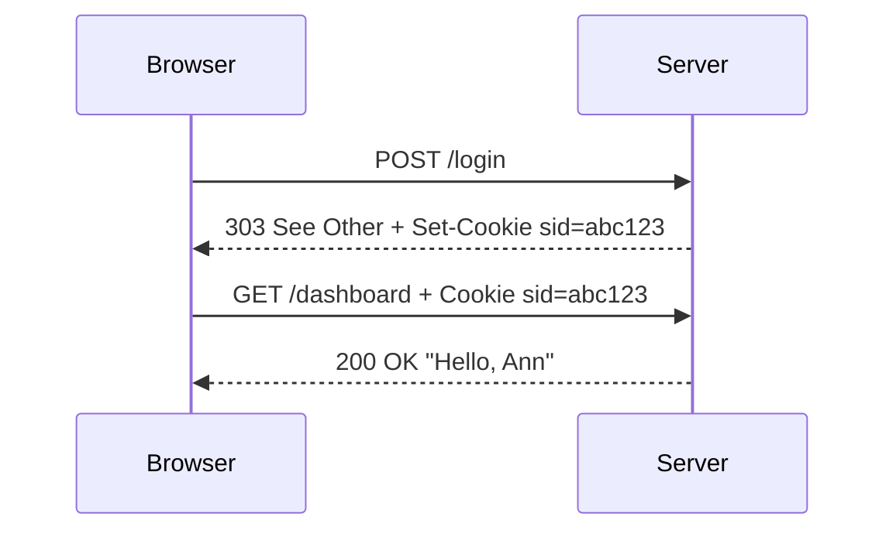
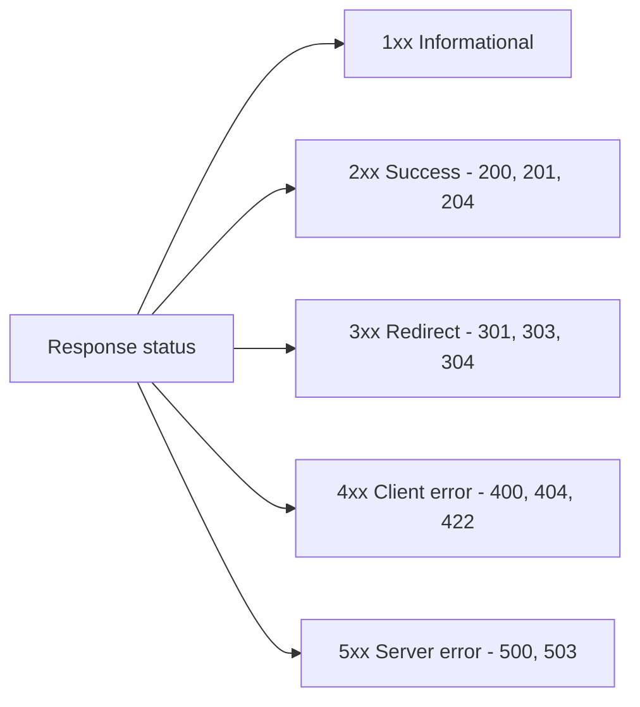
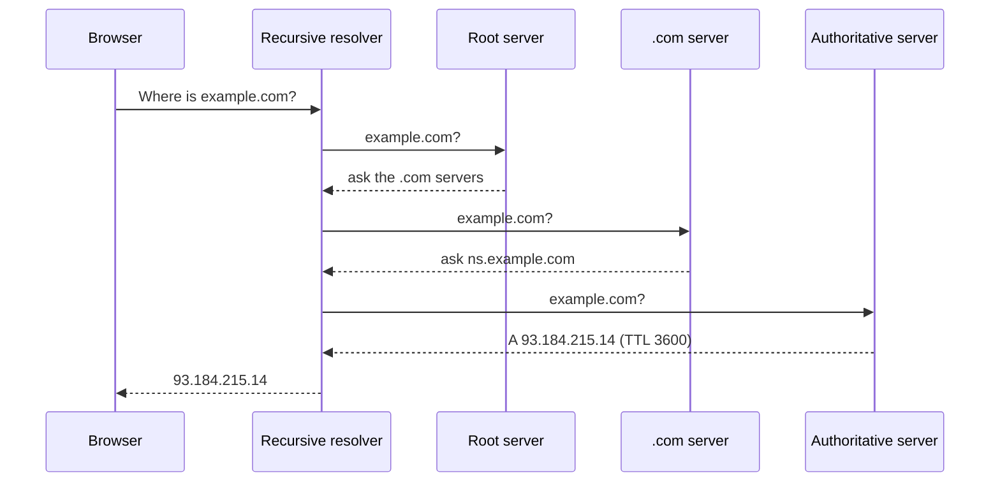
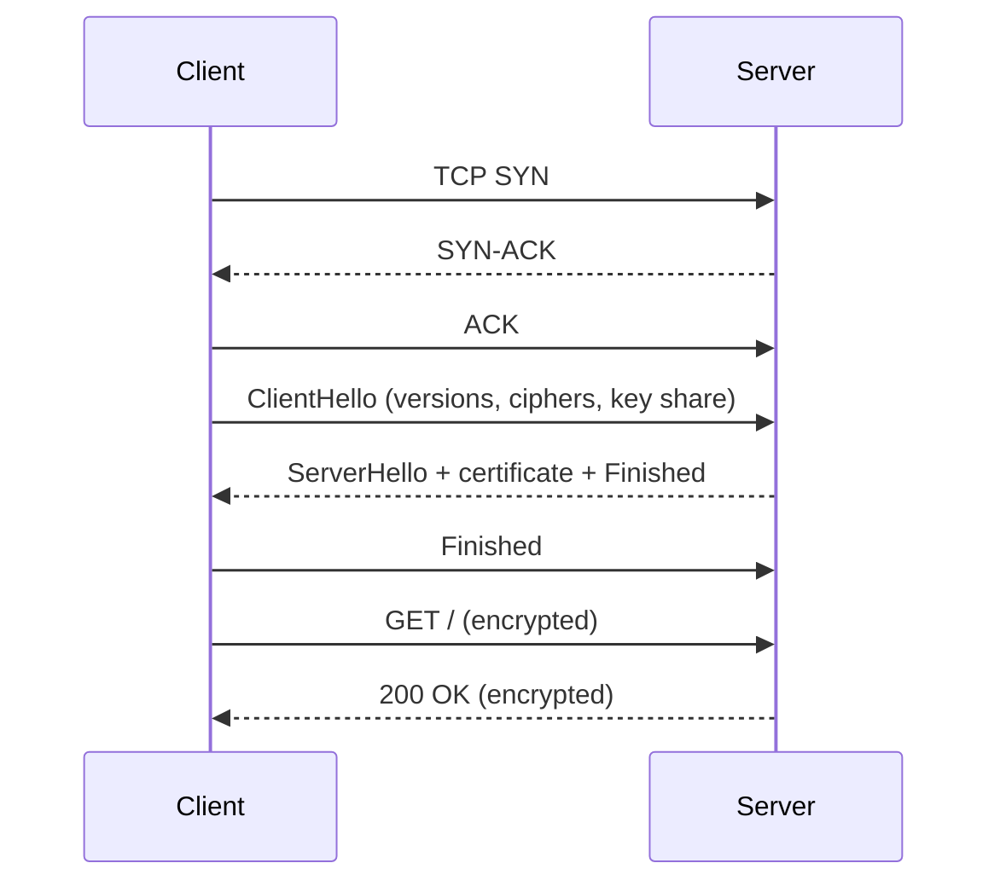
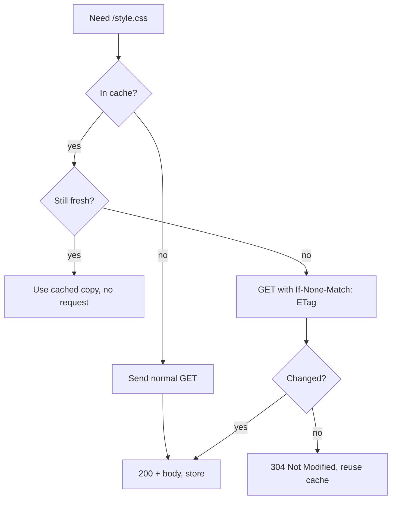

# Lecture 1 — How the Web works

**Goals:** understand what happens between typing a URL and seeing a page; read and write raw HTTP.

### In plain words
Think of the Web as a **restaurant**. You (the *browser*) are a customer, the waiter carries your **order** (the *HTTP request*) to the kitchen (the *server*), and comes back with a **dish** (the *HTTP response*). The menu address — "Table 7, Main Street Restaurant" — is the **URL**. The road network that gets the waiter there is **TCP/IP**, and HTTPS is the waiter carrying your order in a **sealed envelope** so nobody can read it on the way.

The important idea: the kitchen **does not remember you** between orders (HTTP is *stateless*). If you want the waiter to recognise you, you show a **loyalty card** each time — that is a **cookie**. Words you will meet are explained in the [glossary](../resources/glossary.md).

### 1. Clients, servers and protocols
The Web is a **client–server** system. A *user agent* (browser, `curl`) sends a **request**; a server returns a **response**. [HTTP](https://developer.mozilla.org/en-US/docs/Web/HTTP) is a text-based (HTTP/1.1) application protocol on top of [TCP](https://www.rfc-editor.org/rfc/rfc9293) (or [QUIC](https://www.rfc-editor.org/rfc/rfc9000) for HTTP/3).



### 2. Anatomy of a URL
```
https://user@shop.example.com:8443/products/42?sort=price&dir=asc#reviews
\___/   \__/ \______________/ \__/\__________/ \_________________/ \_____/
scheme  user      host        port    path            query         fragment
```
- The **fragment** is never sent to the server.
- Query values must be **percent-encoded** (`space` → `%20` or `+` in forms).

### 3. From URL to page


### 4. HTTP messages
Request:
```http
POST /tasks HTTP/1.1
Host: localhost:3000
Content-Type: application/x-www-form-urlencoded
Content-Length: 24

title=Buy+milk&done=false
```
Response:
```http
HTTP/1.1 303 See Other
Location: /tasks
Set-Cookie: flash=Created; HttpOnly; Path=/
Content-Length: 0
```

**Methods:** `GET` (safe, idempotent), `HEAD`, `POST` (create/action), `PUT` (replace, idempotent), `PATCH` (partial), `DELETE` (idempotent), `OPTIONS`.

**Status classes:**
| Class | Meaning | Examples |
|-------|---------|----------|
| 1xx | informational | 101 Switching Protocols |
| 2xx | success | 200 OK, 201 Created, 204 No Content |
| 3xx | redirection | 301, 302, 303 See Other, 304 Not Modified |
| 4xx | client error | 400, 401, 403, 404, 405, 409, 422, 429 |
| 5xx | server error | 500, 502, 503 |

**Important headers:** `Host`, `Content-Type`, `Content-Length`, `Accept`, `Cookie`/`Set-Cookie`, `Cache-Control`, `ETag`/`If-None-Match`, `Location`, `Authorization`.

### 5. Statelessness and cookies
HTTP itself keeps no state between requests. State is added with **cookies**: the server sends `Set-Cookie`, the browser echoes `Cookie` on later requests to the same site (more in lecture 13).

### 6. Caching (preview)


### 7. Try it
```bash
curl -v http://example.com/
curl -i -X POST -d 'title=Test' https://httpbin.org/post
printf 'GET / HTTP/1.1\r\nHost: example.com\r\nConnection: close\r\n\r\n' | nc example.com 80
```

### 8. HTTP versions
- **HTTP/1.1** — text, one request at a time per connection (keep-alive).
- **HTTP/2** — binary framing, multiplexing, header compression.
- **HTTP/3** — over QUIC (UDP), faster handshakes.
Semantics (methods, status codes, headers) are the same in all of them.

### Deeper dive: what happens when you press Enter
1. **Parse the URL** — the browser splits it into scheme, host, port, path, query.
2. **DNS lookup** — the host name `shop.example.com` is translated into an IP address, like looking up a phone number in a contact list.
3. **TCP connection** — a "phone call" is opened to that IP and port (three-way handshake).
4. **TLS handshake** (HTTPS only) — both sides agree on encryption keys and the browser checks the server's certificate.
5. **Send the request** — method, path, headers, optional body.
6. **Server processes** it and returns a status line, headers and a body.
7. **Browser renders** the HTML, then discovers CSS, JS and images and sends **more requests** for each of them.



### Worked example: talking HTTP by hand
Step 1 — start any tiny server (we build our own in lecture 6). Here we use Node's one-liner:
```js
// server.mjs — run with: node server.mjs
import { createServer } from 'node:http'; // built-in module, no npm install needed

createServer((req, res) => {
  // req.method and req.url come from the request line, e.g. "GET /hello"
  console.log(req.method, req.url, req.headers['user-agent']);
  // writeHead sets the status code and response headers
  res.writeHead(200, { 'Content-Type': 'text/plain; charset=utf-8' });
  // end() sends the body and finishes the response
  res.end(`You asked for ${req.url}\n`);
}).listen(3000, () => console.log('http://localhost:3000'));
```
Step 2 — send a request with `curl -v` and read **every** line:
```bash
curl -v "http://localhost:3000/hello?name=Ann"
# > GET /hello?name=Ann HTTP/1.1      <- request line: method, target, version
# > Host: localhost:3000              <- required header in HTTP/1.1
# > User-Agent: curl/8.5.0
# > Accept: */*
# >                                   <- empty line = end of headers
# < HTTP/1.1 200 OK                   <- status line
# < Content-Type: text/plain; charset=utf-8
# < Content-Length: 27
# <
# You asked for /hello?name=Ann
```
Step 3 — try a POST with a form body:
```bash
curl -v -X POST -d "title=Buy milk" http://localhost:3000/tasks
# Note the extra header: Content-Type: application/x-www-form-urlencoded
```

### Worked example: a cookie round trip

The browser stores the cookie and **automatically** attaches it to every later request to the same site.

### Status code families at a glance


### Common beginner mistakes
- **Thinking the fragment `#reviews` reaches the server.** It never does — it is only for the browser.
- **Using GET for actions that change data** (e.g. `GET /delete/5`). Crawlers and prefetchers may "click" it. Use POST.
- **Confusing 401 and 403.** 401 = "who are you?" (not logged in); 403 = "I know you, but no".
- **Returning 200 for errors** with an error message in the body. Clients and caches rely on the status code.
- **Forgetting that HTTP is stateless** and expecting the server to "remember" the previous request without a cookie/session.
- **Not encoding query values** — `?q=a&b` means two parameters; you need `?q=a%26b`.

### Try it yourself
1. Run `curl -v https://example.com` and label each line: request line, header, status line, body.
2. Open DevTools → Network, reload any site and count how many requests one page makes.
3. Use `new URL('https://a.com:8080/x?y=1#z')` in the browser console and print `host`, `port`, `search`, `hash`.
4. Make the worked-example server return `404` for every path except `/`.
5. Find a site that sets cookies; inspect `HttpOnly`, `Secure` and `SameSite` flags in DevTools → Application.

### Recap questions
1. Which part of a URL is not sent to the server, and why?
2. What is the difference between *safe* and *idempotent* methods? Give examples.
3. Why does a successful form `POST` usually answer with `303 See Other`?
4. What does DNS return and when is it consulted?
5. How does a `304 Not Modified` response save bandwidth?
6. HTTP is stateless — how do websites remember logged-in users?


### Extra theory: DNS in more detail
Before any HTTP happens, the browser must turn a name like `example.com` into an IP address. This is the job of the [Domain Name System](https://developer.mozilla.org/en-US/docs/Glossary/DNS) (defined in [RFC 1034](https://www.rfc-editor.org/rfc/rfc1034) and [RFC 1035](https://www.rfc-editor.org/rfc/rfc1035)). In plain words, DNS is the **phone book** of the Internet. The answer is cached at several levels (browser, operating system, resolver), each for the record's **TTL** (time to live).



| Record type | Meaning | Example |
|---|---|---|
| `A` | IPv4 address | `93.184.215.14` |
| `AAAA` | IPv6 address | `2606:2800::1` |
| `CNAME` | alias to another name | `www` → `example.com` |
| `MX` | mail server | `mail.example.com` |
| `TXT` | free text (verification, SPF) | `"v=spf1 ..."` |

### Extra theory: TLS and HTTPS
[HTTPS](https://developer.mozilla.org/en-US/docs/Glossary/HTTPS) is simply HTTP sent inside a [TLS](https://developer.mozilla.org/en-US/docs/Web/Security/Transport_Layer_Security) tunnel ([TLS 1.3 is RFC 8446](https://www.rfc-editor.org/rfc/rfc8446)). TLS gives three guarantees: **confidentiality** (nobody can read it), **integrity** (nobody can change it unnoticed) and **authentication** (the server proves its identity with a certificate signed by a trusted authority).



### Extra theory: request methods and their properties
The [HTTP semantics RFC 9110](https://www.rfc-editor.org/rfc/rfc9110) defines what each [method](https://developer.mozilla.org/en-US/docs/Web/HTTP/Methods) means. Two properties matter a lot: **safe** (it should not change anything on the server) and **idempotent** (doing it twice has the same effect as doing it once).

| Method | Typical use | Safe | Idempotent | Has body |
|---|---|---|---|---|
| `GET` | read a resource | yes | yes | no |
| `HEAD` | like GET, headers only | yes | yes | no |
| `POST` | create / submit a form | no | no | yes |
| `PUT` | replace a resource | no | yes | yes |
| `PATCH` | partly change a resource | no | no | yes |
| `DELETE` | remove a resource | no | yes | optional |
| `OPTIONS` | ask what is allowed (CORS preflight) | yes | yes | optional |

### Extra theory: important headers
Headers are metadata about the message ([MDN header reference](https://developer.mozilla.org/en-US/docs/Web/HTTP/Headers)).

| Header | Direction | Purpose |
|---|---|---|
| [`Host`](https://developer.mozilla.org/en-US/docs/Web/HTTP/Headers/Host) | request | which site on this server |
| [`Content-Type`](https://developer.mozilla.org/en-US/docs/Web/HTTP/Headers/Content-Type) | both | the format of the body |
| [`Accept`](https://developer.mozilla.org/en-US/docs/Web/HTTP/Headers/Accept) | request | formats the client prefers (content negotiation) |
| [`Cache-Control`](https://developer.mozilla.org/en-US/docs/Web/HTTP/Headers/Cache-Control) | both | caching rules |
| [`Set-Cookie`](https://developer.mozilla.org/en-US/docs/Web/HTTP/Headers/Set-Cookie) | response | store a cookie in the browser |
| [`Location`](https://developer.mozilla.org/en-US/docs/Web/HTTP/Headers/Location) | response | where to go for a redirect (3xx) |
| [`ETag`](https://developer.mozilla.org/en-US/docs/Web/HTTP/Headers/ETag) | response | version tag used for revalidation |

### Extra theory: caching and revalidation
[HTTP caching](https://developer.mozilla.org/en-US/docs/Web/HTTP/Caching) ([RFC 9111](https://www.rfc-editor.org/rfc/rfc9111)) lets the browser reuse a response. While a response is **fresh** (`max-age`), it is used without asking. When it becomes **stale**, the browser asks "has it changed?" with `If-None-Match`; the server answers `304 Not Modified` with no body if it did not.



### HTTP/1.1 vs HTTP/2 vs HTTP/3
| Feature | HTTP/1.1 ([RFC 9112](https://www.rfc-editor.org/rfc/rfc9112)) | HTTP/2 ([RFC 9113](https://www.rfc-editor.org/rfc/rfc9113)) | HTTP/3 ([RFC 9114](https://www.rfc-editor.org/rfc/rfc9114)) |
|---|---|---|---|
| Format | text | binary frames | binary frames |
| Transport | TCP | TCP | QUIC over UDP |
| Many requests on one connection | one at a time | multiplexed streams | multiplexed, no head-of-line blocking |
| Header compression | none | HPACK | QPACK |
| Encryption | optional | in practice always | always (built in) |

### Extra theory: same-origin policy and CORS
An **origin** is scheme + host + port. The browser's [same-origin policy](https://developer.mozilla.org/en-US/docs/Web/Security/Same-origin_policy) stops a script from one origin reading responses from another. A server can relax this with [CORS](https://developer.mozilla.org/en-US/docs/Web/HTTP/CORS) headers such as `Access-Control-Allow-Origin` (specified in the [WHATWG Fetch Standard](https://fetch.spec.whatwg.org/)).

| URL compared with `https://app.example.com` | Same origin? | Why |
|---|---|---|
| `https://app.example.com/tasks` | yes | only path differs |
| `http://app.example.com` | no | scheme differs |
| `https://api.example.com` | no | host differs |
| `https://app.example.com:8443` | no | port differs |

### Further reading / documentation
- [MDN: An overview of HTTP](https://developer.mozilla.org/en-US/docs/Web/HTTP/Overview)
- [MDN: HTTP messages](https://developer.mozilla.org/en-US/docs/Web/HTTP/Messages)
- [MDN: HTTP response status codes](https://developer.mozilla.org/en-US/docs/Web/HTTP/Status)
- [MDN: Using HTTP cookies](https://developer.mozilla.org/en-US/docs/Web/HTTP/Cookies)
- [MDN: HTTP caching](https://developer.mozilla.org/en-US/docs/Web/HTTP/Caching)
- [MDN: CORS](https://developer.mozilla.org/en-US/docs/Web/HTTP/CORS)
- [RFC 9110 — HTTP Semantics](https://www.rfc-editor.org/rfc/rfc9110)
- [RFC 9111 — HTTP Caching](https://www.rfc-editor.org/rfc/rfc9111)
- [RFC 9112 — HTTP/1.1](https://www.rfc-editor.org/rfc/rfc9112)
- [RFC 9113 — HTTP/2](https://www.rfc-editor.org/rfc/rfc9113)
- [RFC 9114 — HTTP/3](https://www.rfc-editor.org/rfc/rfc9114)
- [RFC 6265 — HTTP State Management (cookies)](https://www.rfc-editor.org/rfc/rfc6265)
- [RFC 3986 — URI Generic Syntax](https://www.rfc-editor.org/rfc/rfc3986)
- [RFC 8446 — TLS 1.3](https://www.rfc-editor.org/rfc/rfc8446)
- [WHATWG URL Standard](https://url.spec.whatwg.org/)
- [WHATWG Fetch Standard](https://fetch.spec.whatwg.org/)
- [curl documentation](https://curl.se/docs/)
