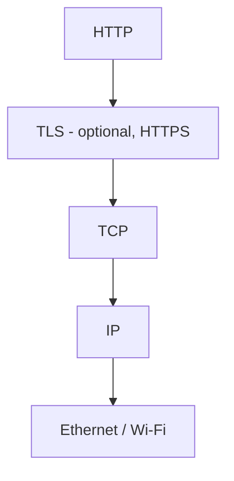
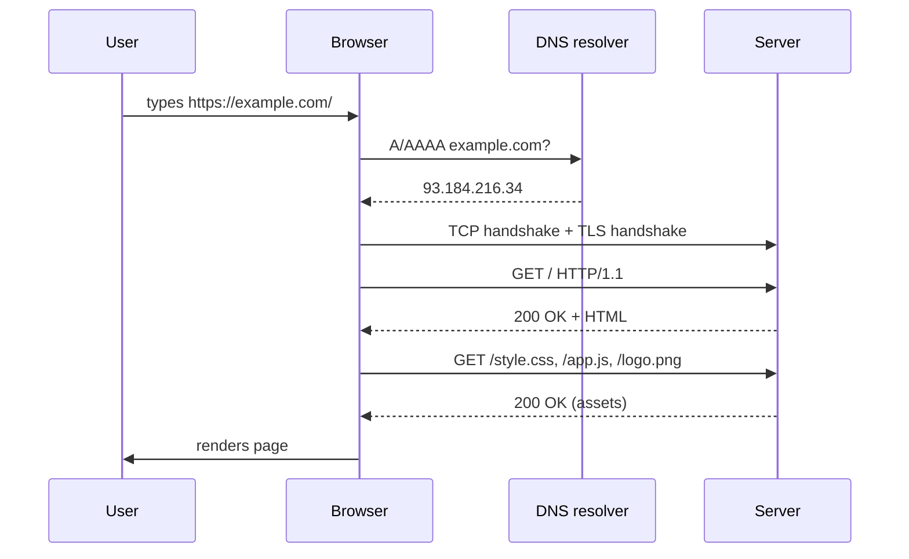
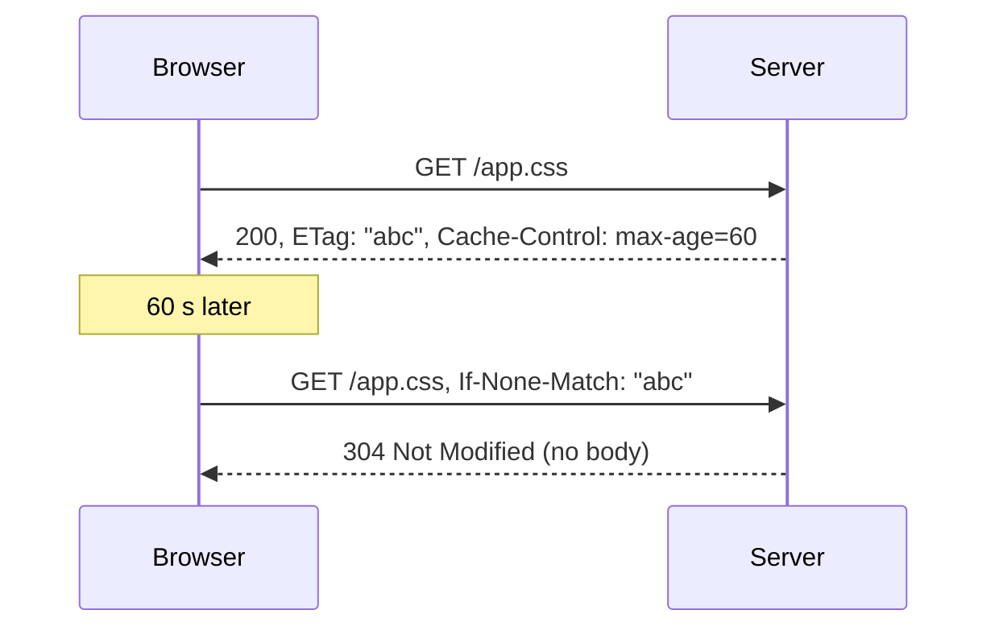

# Lecture 1 — How the Web works

**Goals:** understand what happens between typing a URL and seeing a page; read and write raw HTTP.

### 1. Clients, servers and protocols
The Web is a **client–server** system. A *user agent* (browser, `curl`) sends a **request**; a server returns a **response**. HTTP is a text-based (HTTP/1.1) application protocol on top of TCP (or QUIC for HTTP/3).



### 2. Anatomy of a URL
```
https://user@shop.example.com:8443/products/42?sort=price&dir=asc#reviews
\___/   \__/ \______________/ \__/\__________/ \_________________/ \_____/
scheme  user      host        port    path            query         fragment
```
- The **fragment** is never sent to the server.
- Query values must be **percent-encoded** (`space` → `%20` or `+` in forms).

### 3. From URL to page


### 4. HTTP messages
Request:
```http
POST /tasks HTTP/1.1
Host: localhost:3000
Content-Type: application/x-www-form-urlencoded
Content-Length: 24

title=Buy+milk&done=false
```
Response:
```http
HTTP/1.1 303 See Other
Location: /tasks
Set-Cookie: flash=Created; HttpOnly; Path=/
Content-Length: 0
```

**Methods:** `GET` (safe, idempotent), `HEAD`, `POST` (create/action), `PUT` (replace, idempotent), `PATCH` (partial), `DELETE` (idempotent), `OPTIONS`.

**Status classes:**
| Class | Meaning | Examples |
|-------|---------|----------|
| 1xx | informational | 101 Switching Protocols |
| 2xx | success | 200 OK, 201 Created, 204 No Content |
| 3xx | redirection | 301, 302, 303 See Other, 304 Not Modified |
| 4xx | client error | 400, 401, 403, 404, 405, 409, 422, 429 |
| 5xx | server error | 500, 502, 503 |

**Important headers:** `Host`, `Content-Type`, `Content-Length`, `Accept`, `Cookie`/`Set-Cookie`, `Cache-Control`, `ETag`/`If-None-Match`, `Location`, `Authorization`.

### 5. Statelessness and cookies
HTTP itself keeps no state between requests. State is added with **cookies**: the server sends `Set-Cookie`, the browser echoes `Cookie` on later requests to the same site (more in lecture 13).

### 6. Caching (preview)


### 7. Try it
```bash
curl -v http://example.com/
curl -i -X POST -d 'title=Test' https://httpbin.org/post
printf 'GET / HTTP/1.1\r\nHost: example.com\r\nConnection: close\r\n\r\n' | nc example.com 80
```

### 8. HTTP versions
- **HTTP/1.1** — text, one request at a time per connection (keep-alive).
- **HTTP/2** — binary framing, multiplexing, header compression.
- **HTTP/3** — over QUIC (UDP), faster handshakes.
Semantics (methods, status codes, headers) are the same in all of them.

### Recap questions
1. Which part of a URL is not sent to the server, and why?
2. What is the difference between *safe* and *idempotent* methods? Give examples.
3. Why does a successful form `POST` usually answer with `303 See Other`?
4. What does DNS return and when is it consulted?
5. How does a `304 Not Modified` response save bandwidth?
6. HTTP is stateless — how do websites remember logged-in users?
