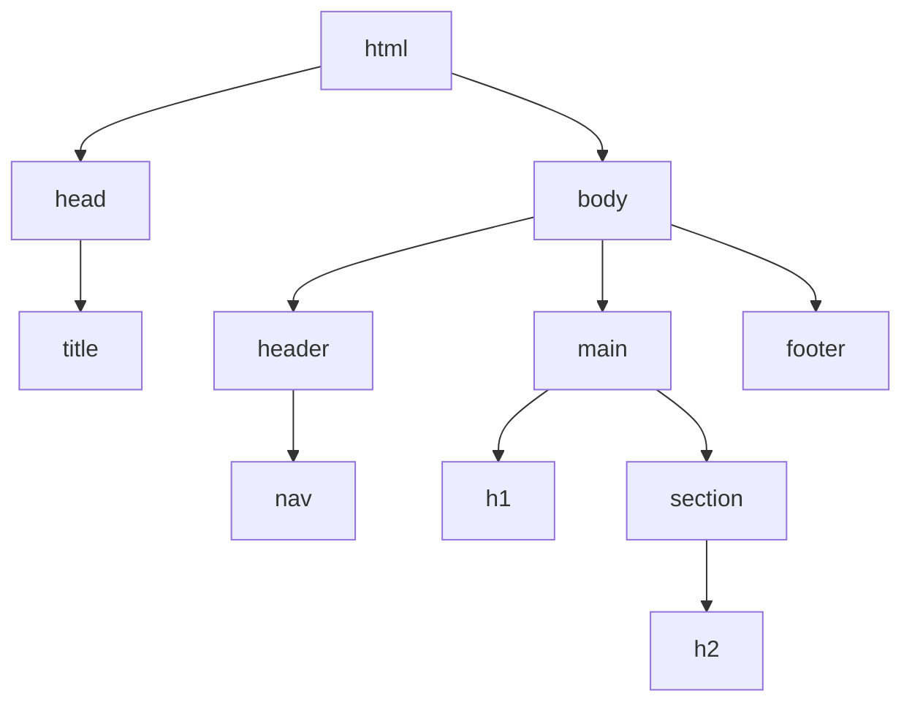
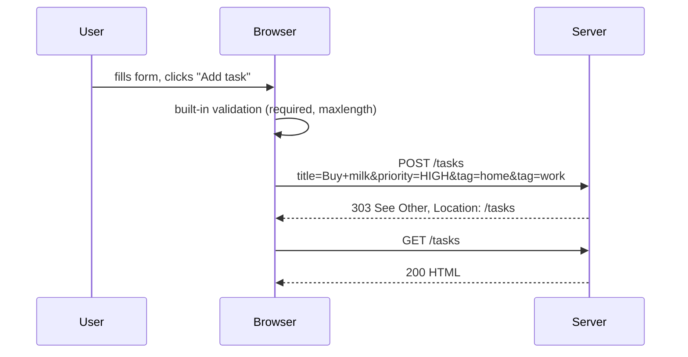

# Lecture 2 — HTML5 semantics, forms, accessibility

**Goals:** write valid, semantic HTML; understand how forms become HTTP requests; build accessible pages.

### 1. Document structure
```html
<!doctype html>
<html lang="en">
<head>
  <meta charset="utf-8">
  <meta name="viewport" content="width=device-width, initial-scale=1">
  <title>Task board</title>
  <link rel="stylesheet" href="/static/app.css">
</head>
<body>
  <header><nav>…</nav></header>
  <main>
    <h1>My tasks</h1>
    <section aria-labelledby="todo-h"><h2 id="todo-h">To do</h2> … </section>
  </main>
  <footer>© 2026</footer>
</body>
</html>
```

The browser parses HTML into the **DOM tree**:


### 2. Semantic elements
| Element | Use |
|---------|-----|
| `header`, `footer` | page or section header/footer |
| `nav` | main navigation |
| `main` | the unique main content (one per page) |
| `article` | self-contained item (a task card, a post) |
| `section` | thematic group with a heading |
| `aside` | related, secondary content |
| `button` vs `a` | **button = action**, **link = navigation** |

Semantics give free accessibility, SEO and keyboard support.

### 3. Forms — the original hypermedia control
```html
<form action="/tasks" method="post">
  <label for="title">Title</label>
  <input id="title" name="title" required maxlength="200">

  <label for="priority">Priority</label>
  <select id="priority" name="priority">
    <option value="LOW">Low</option>
    <option value="HIGH">High</option>
  </select>

  <fieldset>
    <legend>Tags</legend>
    <label><input type="checkbox" name="tag" value="home"> home</label>
    <label><input type="checkbox" name="tag" value="work"> work</label>
  </fieldset>

  <button type="submit">Add task</button>
</form>
```



Key points:
- Only fields with a `name` are sent. Repeated names (`tag`) produce multiple values.
- `method="get"` puts the data into the query string, which is right for search/filter forms.
- Encodings: `application/x-www-form-urlencoded` (default), `multipart/form-data` (file uploads).
- HTML forms support only GET and POST; other methods need a hidden `_method` field or HTMX.
- **Client-side validation is UX, not security.** The server must validate again.

Input types: `text, email, password, number, date, checkbox, radio, file, hidden, search, url, color, range`.

### 4. Accessibility (a11y)
- Every input has a `<label>` (or `aria-label`).
- Keep the heading hierarchy (`h1` → `h2` → `h3`) without skipping levels.
- Images get meaningful `alt`; decorative images get `alt=""`.
- Prefer native elements to `div` + JS (`<button>`, not `<div onclick>`).
- Colour contrast ≥ 4.5:1; never use colour alone to convey state.
- Live regions (`aria-live="polite"`) announce dynamic updates (important with HTMX).
- Test with the keyboard only (Tab, Shift+Tab, Enter, Space) and Lighthouse/axe.

### 5. Validation
Use https://validator.w3.org/ and the DevTools *Issues* tab.

### Recap questions
1. When should you use `<button>` and when `<a>`?
2. How is a form with two checked checkboxes named `tag` encoded?
3. Why is client-side validation not enough?
4. Why must a page have a `lang` attribute and a viewport meta tag?
5. Name four practices that improve accessibility.
