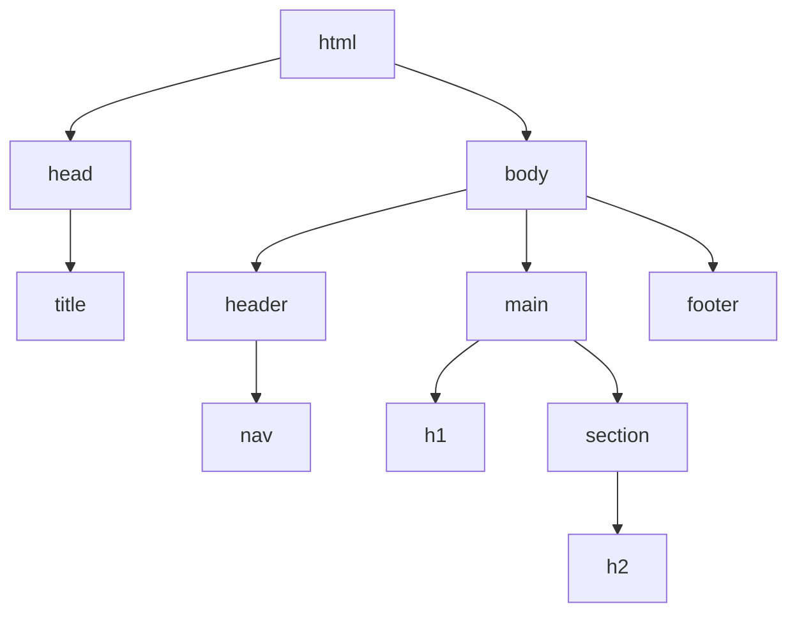
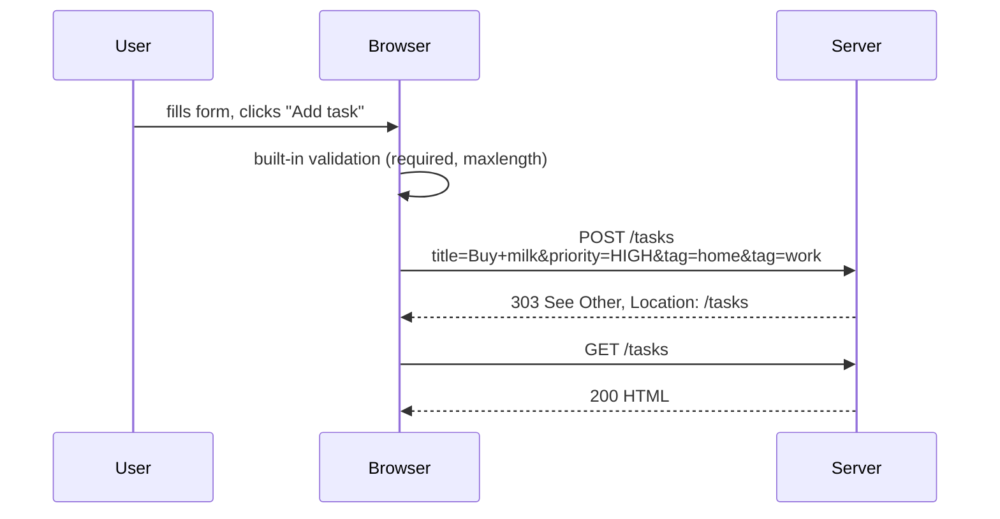
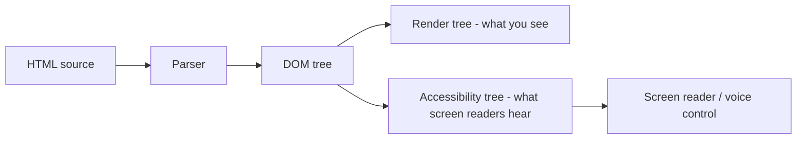
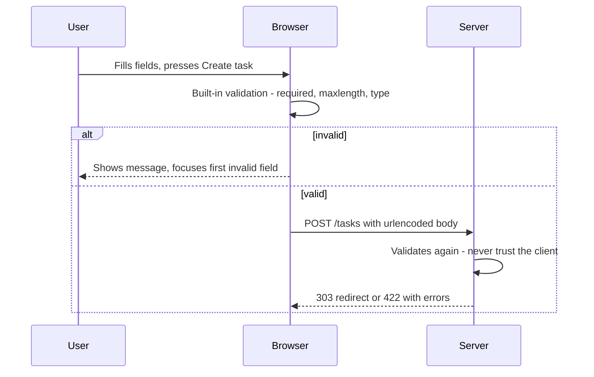
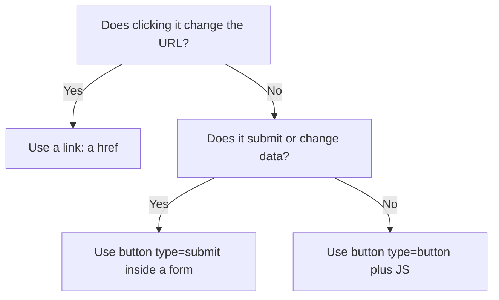
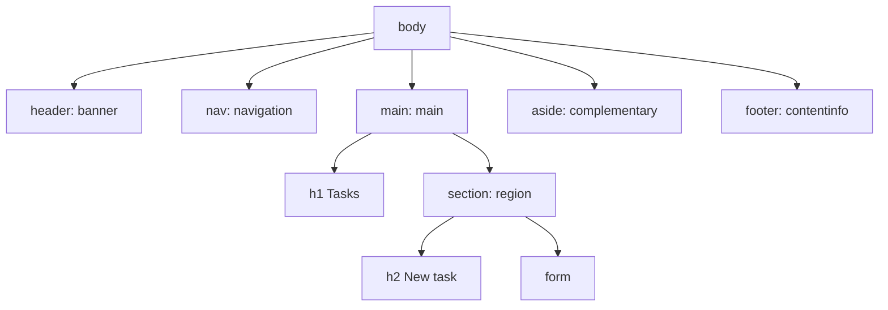
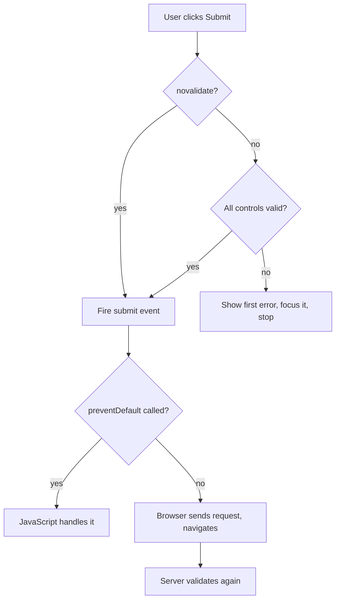

# Lecture 2 — HTML5 semantics, forms, accessibility

**Goals:** write valid, semantic HTML; understand how forms become HTTP requests; build accessible pages.

### In plain words
HTML is the **skeleton and labels of a building**. Semantic tags like `<header>`, `<nav>`, `<main>` and `<footer>` are like the signs "Reception", "Elevators", "Exit" — they tell everyone (including blind visitors using a screen reader and search engines) what each part **is**, not how it looks. A **form** is like a paper form at the post office: each box has a printed label, some boxes are required, and when you hand it in at the counter (the `action` URL) the clerk checks it. **Accessibility** means the building has ramps and braille signs so *everyone* can use it. See the [glossary](../resources/glossary.md) for terms.

### 1. Document structure
```html
<!doctype html>
<html lang="en">
<head>
  <meta charset="utf-8">
  <meta name="viewport" content="width=device-width, initial-scale=1">
  <title>Task board</title>
  <link rel="stylesheet" href="/static/app.css">
</head>
<body>
  <header><nav>…</nav></header>
  <main>
    <h1>My tasks</h1>
    <section aria-labelledby="todo-h"><h2 id="todo-h">To do</h2> … </section>
  </main>
  <footer>© 2026</footer>
</body>
</html>
```

The browser parses HTML into the **DOM tree**:


### 2. Semantic elements
| Element | Use |
|---------|-----|
| `header`, `footer` | page or section header/footer |
| `nav` | main navigation |
| `main` | the unique main content (one per page) |
| `article` | self-contained item (a task card, a post) |
| `section` | thematic group with a heading |
| `aside` | related, secondary content |
| `button` vs `a` | **button = action**, **link = navigation** |

Semantics give free accessibility, SEO and keyboard support.

### 3. Forms — the original hypermedia control
```html
<form action="/tasks" method="post">
  <label for="title">Title</label>
  <input id="title" name="title" required maxlength="200">

  <label for="priority">Priority</label>
  <select id="priority" name="priority">
    <option value="LOW">Low</option>
    <option value="HIGH">High</option>
  </select>

  <fieldset>
    <legend>Tags</legend>
    <label><input type="checkbox" name="tag" value="home"> home</label>
    <label><input type="checkbox" name="tag" value="work"> work</label>
  </fieldset>

  <button type="submit">Add task</button>
</form>
```



Key points:
- Only fields with a `name` are sent. Repeated names (`tag`) produce multiple values.
- `method="get"` puts the data into the query string, which is right for search/filter forms.
- Encodings: `application/x-www-form-urlencoded` (default), `multipart/form-data` (file uploads).
- HTML forms support only GET and POST; other methods need a hidden `_method` field or HTMX.
- **Client-side validation is UX, not security.** The server must validate again.

Input types: `text, email, password, number, date, checkbox, radio, file, hidden, search, url, color, range`.

### 4. Accessibility (a11y)
- Every input has a `<label>` (or `aria-label`).
- Keep the heading hierarchy (`h1` → `h2` → `h3`) without skipping levels.
- Images get meaningful `alt`; decorative images get `alt=""`.
- Prefer native elements to `div` + JS (`<button>`, not `<div onclick>`).
- Colour contrast ≥ 4.5:1; never use colour alone to convey state.
- Live regions (`aria-live="polite"`) announce dynamic updates (important with HTMX).
- Test with the keyboard only (Tab, Shift+Tab, Enter, Space) and Lighthouse/axe.

### 5. Validation
Use https://validator.w3.org/ and the DevTools *Issues* tab.

### Deeper dive: how the browser turns HTML into an accessible page
The browser parses HTML into the **DOM tree**. From the DOM it builds the **accessibility tree** — a simplified version containing roles (button, link, heading), names (from labels or text) and states (checked, invalid). Screen readers read this second tree. That is why a `<div onclick>` "button" is invisible as a button: it has no role, is not focusable, and does not react to the keyboard.



### Worked example: building an accessible "New task" form step by step
Step 1 — the page skeleton with landmarks:
```html
<!doctype html>
<html lang="en"> <!-- lang lets screen readers pick the right voice -->
<head>
  <meta charset="utf-8">
  <meta name="viewport" content="width=device-width, initial-scale=1"> <!-- mobile friendly -->
  <title>New task — Task Board</title> <!-- unique, descriptive title per page -->
</head>
<body>
  <header><nav aria-label="Main"><a href="/">Home</a></nav></header>
  <main>
    <h1>New task</h1> <!-- exactly one h1 that describes the page -->
    <!-- the form goes here (step 2) -->
  </main>
  <footer>© 2026 Task Board</footer>
</body>
</html>
```
Step 2 — the form with labels, hints and validation:
```html
<form method="post" action="/tasks"> <!-- POST because it creates data -->
  <!-- "for" must match the input "id": clicking the label focuses the input -->
  <label for="title">Title</label>
  <input id="title" name="title" required maxlength="100"
         aria-describedby="title-hint"> <!-- links the hint text to the field -->
  <small id="title-hint">Up to 100 characters.</small>

  <fieldset> <!-- groups related radio buttons -->
    <legend>Priority</legend> <!-- the group's label, read before each option -->
    <input type="radio" id="p-low" name="priority" value="low" checked>
    <label for="p-low">Low</label>
    <input type="radio" id="p-high" name="priority" value="high">
    <label for="p-high">High</label>
  </fieldset>

  <label for="due">Due date</label>
  <input id="due" name="due" type="date"> <!-- native date picker for free -->

  <button type="submit">Create task</button> <!-- a real button: focusable, Enter works -->
</form>
```
Step 3 — what is sent when the user submits:
```http
POST /tasks HTTP/1.1
Content-Type: application/x-www-form-urlencoded

title=Buy+milk&priority=high&due=2026-11-05
```
Only fields with a `name` are sent. Unchecked checkboxes are **not** sent at all.

### The life of a form submission


### Choosing the right element


### Common beginner mistakes
- **Using `placeholder` instead of a `<label>`.** The placeholder disappears when typing and is not a reliable accessible name.
- **Missing `name` on inputs** — the browser silently does not send that field.
- **Clickable `<div>`s and `<span>`s** instead of `<button>`/`<a>`.
- **Skipping heading levels** (`h1` → `h4`) because of font size. Use CSS for size, headings for structure.
- **Images without `alt`** — or with `alt="image"`. Describe the content, or use `alt=""` for decoration.
- **Relying only on client-side validation.** Anyone can bypass it with `curl`; the server must validate too.
- **Indicating errors only with red colour** — colour-blind users miss it; add text.

### Try it yourself
1. Build the form above, submit it to `https://httpbin.org/post` and look at the `form` field in the response.
2. Change `method` to `get` and observe where the data goes now (the URL!).
3. Navigate the whole page with **Tab / Shift+Tab / Enter / Space** only. Can you do everything?
4. Run Lighthouse → Accessibility in DevTools and fix every reported issue.
5. Add a checkbox "Urgent" and verify what is sent when it is checked vs unchecked.

### Recap questions
1. When should you use `<button>` and when `<a>`?
2. How is a form with two checked checkboxes named `tag` encoded?
3. Why is client-side validation not enough?
4. Why must a page have a `lang` attribute and a viewport meta tag?
5. Name four practices that improve accessibility.


### Extra theory: the content model
The [WHATWG HTML Living Standard](https://html.spec.whatwg.org/multipage/) sorts elements into [content categories](https://developer.mozilla.org/en-US/docs/Web/HTML/Content_categories): *flow*, *phrasing*, *sectioning*, *heading*, *interactive* and so on. Each element says which categories it may contain. For example, a `<p>` may only contain phrasing content, so a `<div>` inside a `<p>` is invalid, and an `<a>` must not contain another interactive element such as a `<button>`. Check your pages with the [W3C Markup Validator](https://validator.w3.org/).

### Extra theory: landmarks and the outline
Screen-reader users jump around a page by **landmarks** and **headings**, not by reading top to bottom. Semantic elements create landmarks automatically ([WAI-ARIA landmark roles](https://www.w3.org/WAI/ARIA/apg/practices/landmark-regions/)).

| Element | Implicit ARIA role | Note |
|---|---|---|
| [`<header>`](https://developer.mozilla.org/en-US/docs/Web/HTML/Element/header) (top-level) | `banner` | site header |
| [`<nav>`](https://developer.mozilla.org/en-US/docs/Web/HTML/Element/nav) | `navigation` | major link groups |
| [`<main>`](https://developer.mozilla.org/en-US/docs/Web/HTML/Element/main) | `main` | exactly one per page |
| [`<aside>`](https://developer.mozilla.org/en-US/docs/Web/HTML/Element/aside) | `complementary` | related side content |
| [`<footer>`](https://developer.mozilla.org/en-US/docs/Web/HTML/Element/footer) (top-level) | `contentinfo` | site footer |
| [`<form>`](https://developer.mozilla.org/en-US/docs/Web/HTML/Element/form) with a name | `form` | needs `aria-label` or `aria-labelledby` |
| `<section>` with a name | `region` | needs an accessible name |



### Extra theory: input types and attributes
Choosing the right [`<input>` type](https://developer.mozilla.org/en-US/docs/Web/HTML/Element/input#input_types) gives free validation and a better keyboard on phones.

| `type` | What the browser gives you | Useful attributes |
|---|---|---|
| `text` | plain text | `minlength`, `maxlength`, `pattern` |
| `email` | checks `x@y` form, email keyboard | `multiple` |
| `number` | spinner, numeric keyboard | `min`, `max`, `step` |
| `date` | date picker | `min`, `max` |
| `checkbox` | on/off; sent only when checked | `checked`, `value` |
| `radio` | one of a group (same `name`) | `checked`, `value` |
| `password` | hidden characters | `autocomplete="current-password"` |
| `file` | file chooser; needs `enctype="multipart/form-data"` | `accept`, `multiple` |
| `hidden` | not shown, still sent | `value` |

The [`autocomplete`](https://developer.mozilla.org/en-US/docs/Web/HTML/Attributes/autocomplete) attribute helps password managers and users with motor disabilities.

### Extra theory: how form data is encoded
The [`enctype`](https://developer.mozilla.org/en-US/docs/Web/API/HTMLFormElement/enctype) attribute decides the body format ([form submission algorithm](https://html.spec.whatwg.org/multipage/form-control-infrastructure.html#form-submission-2)).

| `method` / `enctype` | Where the data goes | Looks like |
|---|---|---|
| `GET` | query string of the URL | `/search?q=milk&done=on` |
| `POST`, `application/x-www-form-urlencoded` (default) | body | `title=Buy+milk&due=2026-11-05` |
| `POST`, `multipart/form-data` | body, parts with boundaries | needed for file uploads |
| `POST`, `text/plain` | body | for debugging only |

### Extra theory: constraint validation
The browser runs [client-side validation](https://developer.mozilla.org/en-US/docs/Learn/Forms/Form_validation) before submitting. Each control has a [`validity`](https://developer.mozilla.org/en-US/docs/Web/API/ValidityState) object; CSS can style `:invalid` and `:user-invalid`. **Never** trust it alone — the server must validate again, because anyone can send a request with `curl`.



### Extra theory: WCAG principles (POUR)
The [Web Content Accessibility Guidelines (WCAG) 2.2](https://www.w3.org/TR/WCAG22/) group rules under four principles ([W3C WAI overview](https://www.w3.org/WAI/standards-guidelines/wcag/)):

| Principle | In plain words | Example check |
|---|---|---|
| **Perceivable** | users can see or hear it | `alt` text, colour contrast 4.5:1 |
| **Operable** | users can use it | everything works with a keyboard, visible focus |
| **Understandable** | users can make sense of it | clear labels, helpful error messages |
| **Robust** | works with assistive tech | valid HTML, correct roles and names |

The first rule of [ARIA](https://www.w3.org/TR/using-aria/): if a native HTML element does the job, use it instead of adding ARIA. See the [ARIA Authoring Practices Guide](https://www.w3.org/WAI/ARIA/apg/) for patterns.

### Further reading / documentation
- [WHATWG HTML Living Standard](https://html.spec.whatwg.org/multipage/)
- [MDN: HTML elements reference](https://developer.mozilla.org/en-US/docs/Web/HTML/Element)
- [MDN: Web forms guide](https://developer.mozilla.org/en-US/docs/Learn/Forms)
- [MDN: `<input>` element](https://developer.mozilla.org/en-US/docs/Web/HTML/Element/input)
- [MDN: Client-side form validation](https://developer.mozilla.org/en-US/docs/Learn/Forms/Form_validation)
- [MDN: Accessibility](https://developer.mozilla.org/en-US/docs/Web/Accessibility)
- [MDN: ARIA](https://developer.mozilla.org/en-US/docs/Web/Accessibility/ARIA)
- [W3C WAI: Introduction to Web Accessibility](https://www.w3.org/WAI/fundamentals/accessibility-intro/)
- [WCAG 2.2](https://www.w3.org/TR/WCAG22/)
- [W3C WAI: ARIA Authoring Practices Guide](https://www.w3.org/WAI/ARIA/apg/)
- [W3C: Using ARIA](https://www.w3.org/TR/using-aria/)
- [W3C Markup Validation Service](https://validator.w3.org/)
