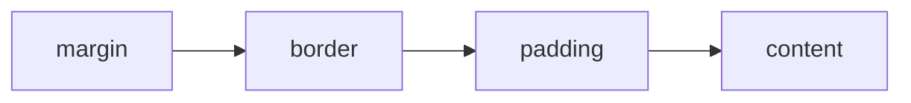
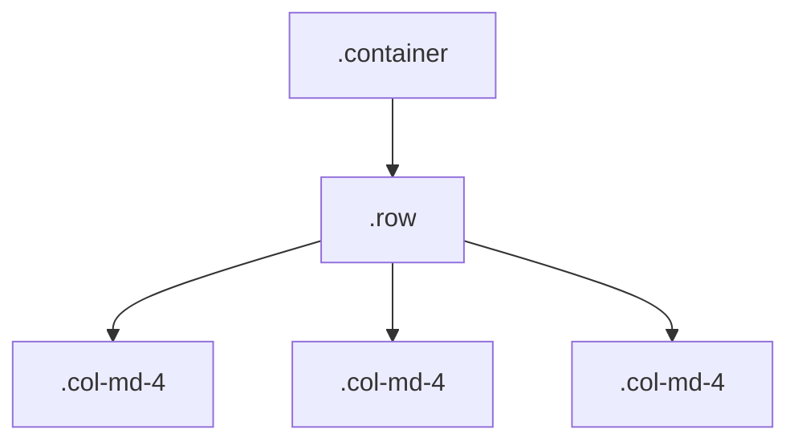
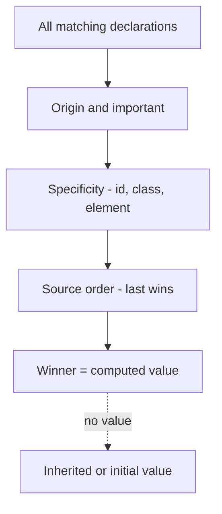
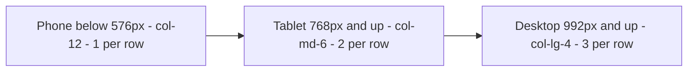
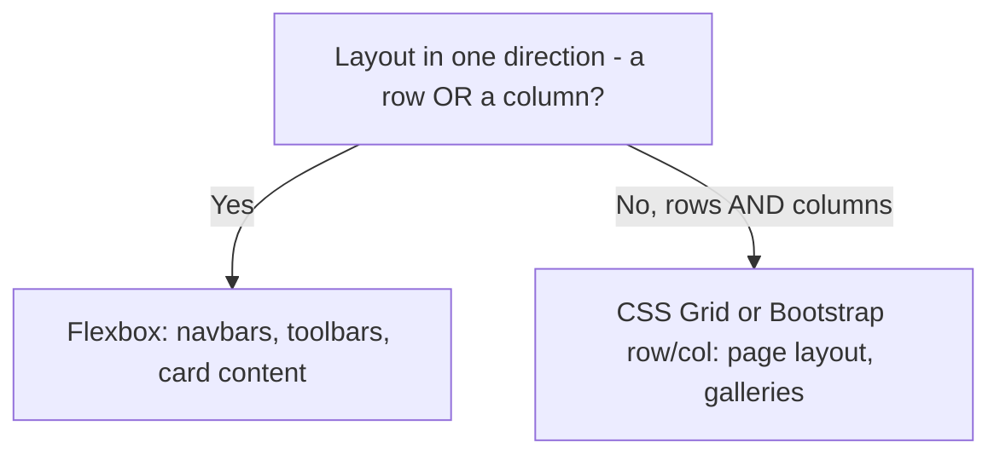

# Lecture 3 — CSS basics and Bootstrap 5

**Goals:** understand the cascade, the box model and layout; build responsive UIs with Bootstrap 5 without writing a front-end build.

### In plain words
If HTML is the skeleton of a house, **CSS is the paint, furniture and layout**. A CSS rule is an instruction like "all doors (selector) should be red (property: value)". When two instructions conflict — "all doors red" vs "the front door blue" — the **cascade** decides who wins, usually the *more specific* one. **Bootstrap** is like buying a furniture set from IKEA: ready-made, matching pieces (buttons, cards, a grid) that you assemble with class names instead of building everything from scratch. See the [glossary](../resources/glossary.md).

### 1. CSS essentials
```css
/* selector { property: value; } */
.task-card { padding: 1rem; border: 1px solid #ddd; }
.task-card.done h3 { text-decoration: line-through; }
#main > ul li:hover { background: #f5f5f5; }
```
**Cascade order:** origin & `!important` → specificity (inline > id > class/attr/pseudo-class > element) → source order.

**Box model:**

Use `box-sizing: border-box` (Bootstrap sets this globally).

**Layout:** Flexbox (1-D) and Grid (2-D).
```css
.board { display: grid; grid-template-columns: repeat(3, 1fr); gap: 1rem; }
.toolbar { display: flex; justify-content: space-between; align-items: center; }
@media (max-width: 768px) { .board { grid-template-columns: 1fr; } }
```
Custom properties: `:root { --brand: #0d6efd; } a { color: var(--brand); }`

### 2. Why Bootstrap here?
Students focus on the server. Bootstrap gives a consistent, accessible UI from plain HTML classes with no build step:
```html
<link href="https://cdn.jsdelivr.net/npm/bootstrap@5.3.3/dist/css/bootstrap.min.css" rel="stylesheet">
<script src="https://cdn.jsdelivr.net/npm/bootstrap@5.3.3/dist/js/bootstrap.bundle.min.js" defer></script>
```

### 3. The grid
Container → row → columns; 12 columns; breakpoints `sm ≥576`, `md ≥768`, `lg ≥992`, `xl ≥1200`, `xxl ≥1400`.
```html
<div class="container">
  <div class="row g-3">
    <div class="col-12 col-md-4">To do</div>
    <div class="col-12 col-md-4">Doing</div>
    <div class="col-12 col-md-4">Done</div>
  </div>
</div>
```


### 4. Components used in the course
| Component | Classes |
|-----------|---------|
| Navbar | `navbar navbar-expand-lg bg-body-tertiary` |
| Card | `card`, `card-body`, `card-title` |
| Forms | `form-label`, `form-control`, `form-select`, `form-check`, `is-invalid`, `invalid-feedback` |
| Buttons | `btn btn-primary`, `btn-outline-danger`, `btn-sm` |
| Alerts | `alert alert-success alert-dismissible` |
| Badges | `badge text-bg-warning` |
| Modal | `modal`, `data-bs-toggle="modal"` |
| Utilities | `d-flex`, `gap-2`, `mt-3`, `text-muted`, `visually-hidden` |

Example task card:
```html
<article class="card mb-2">
  <div class="card-body d-flex justify-content-between align-items-start">
    <div>
      <h3 class="h6 card-title mb-1">Write lecture 3</h3>
      <span class="badge text-bg-danger">HIGH</span>
    </div>
    <button class="btn btn-sm btn-outline-success" type="button">Done</button>
  </div>
</article>
```

Form with server-side validation errors:
```html
<div class="mb-3">
  <label class="form-label" for="title">Title</label>
  <input class="form-control is-invalid" id="title" name="title" aria-describedby="title-err">
  <div class="invalid-feedback" id="title-err">Title is required.</div>
</div>
```

### 5. Customising
Override CSS variables (`--bs-primary`, `data-bs-theme="dark"`) in your own stylesheet loaded **after** Bootstrap. Avoid editing `bootstrap.min.css`.

### Deeper dive: how the browser decides the final style
For each element and property the browser:
1. Collects every matching declaration (browser defaults, your CSS, inline styles).
2. Sorts by **origin and `!important`**.
3. Then by **specificity** — inline > id > class/attribute/pseudo-class > element.
4. Then by **order** — later wins.
5. If nothing is set, **inherits** from the parent (for inheritable props like `color`, `font`) or uses the initial value.



Specificity is counted as three numbers `(ids, classes, elements)`: `#main .card p` = `(1,1,1)` beats `.card .title p` = `(0,2,1)`.

### Worked example: a task card, plain CSS then Bootstrap
Step 1 — plain CSS:
```html
<article class="task">
  <h2 class="task__title">Buy milk</h2>
  <p class="task__meta">Due tomorrow</p>
  <button class="task__btn">Done</button>
</article>
```
```css
/* Make padding and border count inside width — easier maths */
*, *::before, *::after { box-sizing: border-box; }

.task {
  border: 1px solid #ddd;   /* thin grey frame */
  border-radius: 8px;       /* rounded corners */
  padding: 1rem;            /* space INSIDE the border */
  margin-bottom: 1rem;      /* space OUTSIDE, between cards */
  display: flex;            /* lay children in a row */
  align-items: center;      /* vertically centre them */
  gap: 1rem;                /* space between children */
}
.task__title { margin: 0; flex: 1; } /* flex: 1 = take the remaining width */
.task__meta  { margin: 0; color: #666; }
.task__btn:hover { background: #e7f1ff; } /* pseudo-class: only while hovered */
```
Step 2 — the same with Bootstrap 5 utility and component classes, no custom CSS:
```html
<link href="https://cdn.jsdelivr.net/npm/bootstrap@5.3.3/dist/css/bootstrap.min.css" rel="stylesheet">

<div class="container py-4">            <!-- centred, responsive width + vertical padding -->
  <div class="row g-3">                 <!-- grid row with gutters -->
    <div class="col-12 col-md-6 col-lg-4"> <!-- full width on phones, 1/2 on tablets, 1/3 on desktops -->
      <article class="card shadow-sm">
        <div class="card-body d-flex align-items-center gap-3"> <!-- flex utilities -->
          <h2 class="h5 card-title mb-0 flex-grow-1">Buy milk</h2>
          <span class="badge text-bg-warning">Due tomorrow</span>
          <button class="btn btn-sm btn-success">Done</button>
        </div>
      </article>
    </div>
  </div>
</div>
```

### The Bootstrap grid on different screens


### Flexbox vs Grid — which one?


### Common beginner mistakes
- **Forgetting the viewport meta tag** — Bootstrap's responsive grid will not work on phones.
- **Putting `.col` directly inside `.container` without a `.row`.** Gutters and alignment break.
- **Fighting specificity with `!important`** everywhere. Use a more specific selector or fix the order instead.
- **Mixing up padding and margin** — padding is inside the border, margin is outside.
- **Using `id` selectors for styling** — they are hard to override; prefer classes.
- **Loading Bootstrap JS without the bundle** — dropdowns/modals need Popper, included in `bootstrap.bundle.min.js`.
- **Low contrast text** (light grey on white). Check contrast in DevTools.

### Try it yourself
1. Build the plain CSS card, then use DevTools → Computed to see which rule won for `margin`.
2. Write two conflicting rules and predict the winner by specificity before checking.
3. Rebuild the card with Bootstrap and resize the window to watch it go 1 → 2 → 3 per row.
4. Add a Bootstrap navbar that collapses into a hamburger menu on small screens.
5. Override Bootstrap's primary colour using a CSS variable `--bs-primary` in your own stylesheet.

### Recap questions
1. Compute the specificity of `#main .card h3` vs `.board .card .title`.
2. When should you use Grid rather than Flexbox?
3. What does `col-12 col-md-6 col-xl-4` mean on phone, tablet and desktop?
4. How does Bootstrap show validation errors and keep them accessible?
5. Why load Bootstrap's JS with `defer`?
