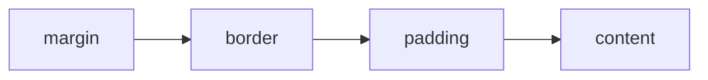
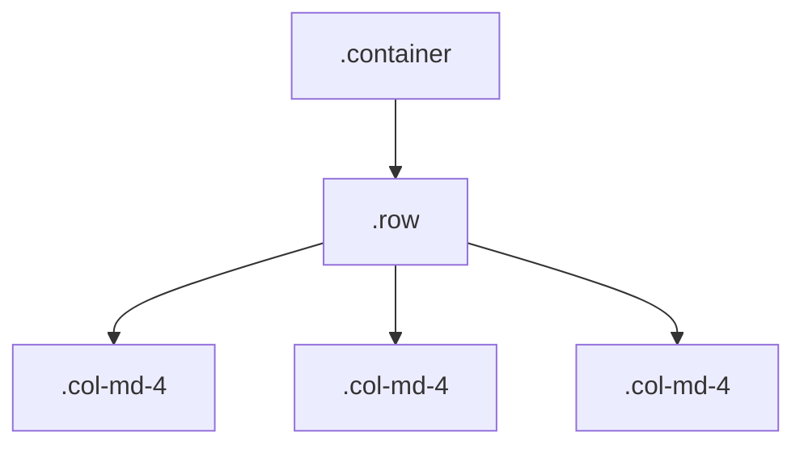

# Lecture 3 — CSS basics and Bootstrap 5

**Goals:** understand the cascade, the box model and layout; build responsive UIs with Bootstrap 5 without writing a front-end build.

### 1. CSS essentials
```css
/* selector { property: value; } */
.task-card { padding: 1rem; border: 1px solid #ddd; }
.task-card.done h3 { text-decoration: line-through; }
#main > ul li:hover { background: #f5f5f5; }
```
**Cascade order:** origin & `!important` → specificity (inline > id > class/attr/pseudo-class > element) → source order.

**Box model:**

Use `box-sizing: border-box` (Bootstrap sets this globally).

**Layout:** Flexbox (1-D) and Grid (2-D).
```css
.board { display: grid; grid-template-columns: repeat(3, 1fr); gap: 1rem; }
.toolbar { display: flex; justify-content: space-between; align-items: center; }
@media (max-width: 768px) { .board { grid-template-columns: 1fr; } }
```
Custom properties: `:root { --brand: #0d6efd; } a { color: var(--brand); }`

### 2. Why Bootstrap here?
Students focus on the server. Bootstrap gives a consistent, accessible UI from plain HTML classes with no build step:
```html
<link href="https://cdn.jsdelivr.net/npm/bootstrap@5.3.3/dist/css/bootstrap.min.css" rel="stylesheet">
<script src="https://cdn.jsdelivr.net/npm/bootstrap@5.3.3/dist/js/bootstrap.bundle.min.js" defer></script>
```

### 3. The grid
Container → row → columns; 12 columns; breakpoints `sm ≥576`, `md ≥768`, `lg ≥992`, `xl ≥1200`, `xxl ≥1400`.
```html
<div class="container">
  <div class="row g-3">
    <div class="col-12 col-md-4">To do</div>
    <div class="col-12 col-md-4">Doing</div>
    <div class="col-12 col-md-4">Done</div>
  </div>
</div>
```


### 4. Components used in the course
| Component | Classes |
|-----------|---------|
| Navbar | `navbar navbar-expand-lg bg-body-tertiary` |
| Card | `card`, `card-body`, `card-title` |
| Forms | `form-label`, `form-control`, `form-select`, `form-check`, `is-invalid`, `invalid-feedback` |
| Buttons | `btn btn-primary`, `btn-outline-danger`, `btn-sm` |
| Alerts | `alert alert-success alert-dismissible` |
| Badges | `badge text-bg-warning` |
| Modal | `modal`, `data-bs-toggle="modal"` |
| Utilities | `d-flex`, `gap-2`, `mt-3`, `text-muted`, `visually-hidden` |

Example task card:
```html
<article class="card mb-2">
  <div class="card-body d-flex justify-content-between align-items-start">
    <div>
      <h3 class="h6 card-title mb-1">Write lecture 3</h3>
      <span class="badge text-bg-danger">HIGH</span>
    </div>
    <button class="btn btn-sm btn-outline-success" type="button">Done</button>
  </div>
</article>
```

Form with server-side validation errors:
```html
<div class="mb-3">
  <label class="form-label" for="title">Title</label>
  <input class="form-control is-invalid" id="title" name="title" aria-describedby="title-err">
  <div class="invalid-feedback" id="title-err">Title is required.</div>
</div>
```

### 5. Customising
Override CSS variables (`--bs-primary`, `data-bs-theme="dark"`) in your own stylesheet loaded **after** Bootstrap. Avoid editing `bootstrap.min.css`.

### Recap questions
1. Compute the specificity of `#main .card h3` vs `.board .card .title`.
2. When should you use Grid rather than Flexbox?
3. What does `col-12 col-md-6 col-xl-4` mean on phone, tablet and desktop?
4. How does Bootstrap show validation errors and keep them accessible?
5. Why load Bootstrap's JS with `defer`?
