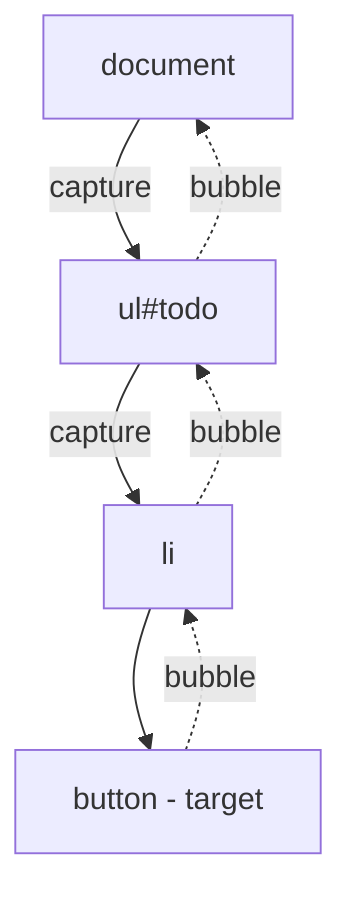
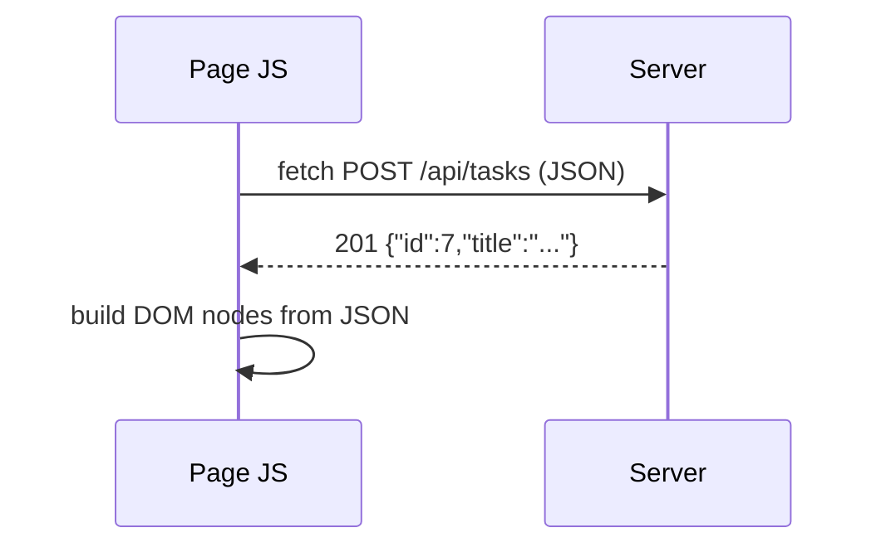
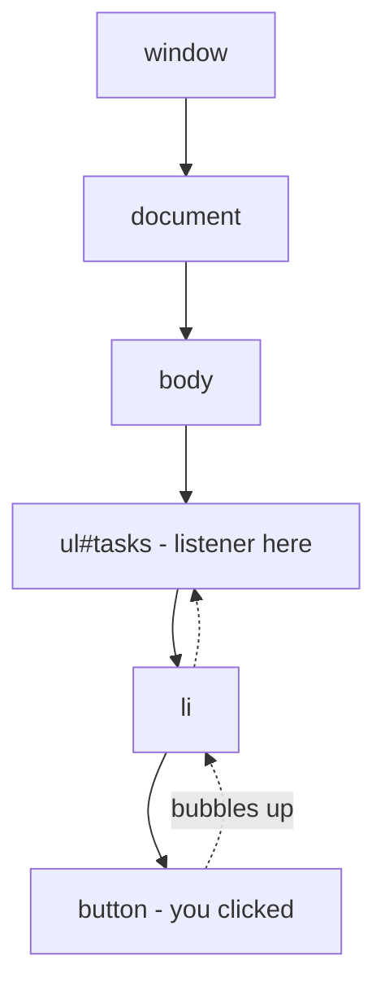
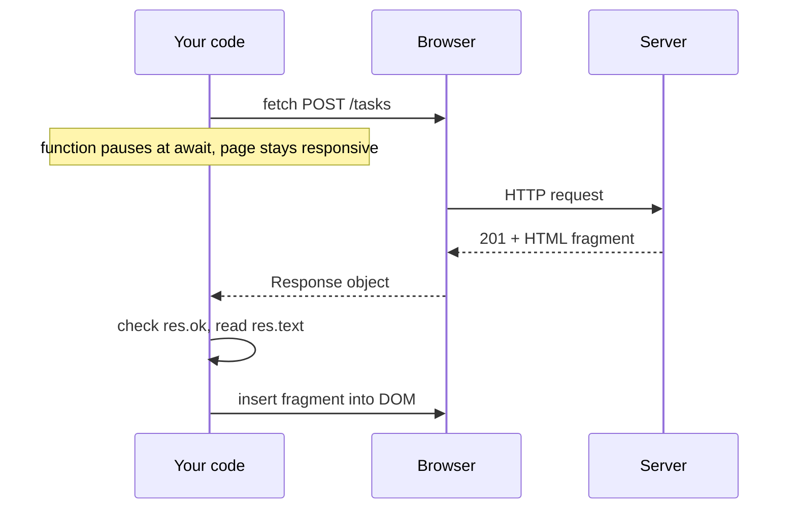

# Lecture 4 — Browser JavaScript: DOM, events, fetch

**Goals:** know just enough browser JS to understand what HTMX does for us, and when a few lines of JS are still useful.

### In plain words
The **DOM** is a live **family tree** of your page: `<html>` is the grandparent, `<body>` a parent, each `<li>` a child. JavaScript can walk this tree, read it and change it — like a stage manager moving props during a play. **Events** are the doorbell: you tell the browser "when someone rings (clicks, types, submits), call this function". **`fetch`** is sending a courier to the server for more data without leaving the page — you keep doing other things while you wait (that is what `async`/`await` expresses). See the [glossary](../resources/glossary.md).

### 1. Language refresher
```js
const tasks = [{ id: 1, title: 'A', done: false }];
const open = tasks.filter(t => !t.done).map(t => t.title);
const { title, ...rest } = tasks[0];           // destructuring
const copy = { ...tasks[0], done: true };       // spread
const label = `Task: ${title}`;                 // template literal
```
Modules: `<script type="module" src="/static/app.js"></script>` (deferred by default, strict mode, `import`/`export`).

### 2. The DOM
```js
const list = document.querySelector('#todo');
const items = document.querySelectorAll('.task');
const li = document.createElement('li');
li.textContent = 'New task';     // safe: never parses HTML
li.classList.add('task');
li.dataset.id = '7';             // -> data-id="7"
list.append(li);
// list.innerHTML = userInput;   // DANGER: XSS (lecture 8)
```

### 3. Events
```js
document.querySelector('#todo').addEventListener('click', (e) => {
  const btn = e.target.closest('button[data-action="delete"]');
  if (!btn) return;
  btn.closest('li').remove();
});
```
Event flow: **capture → target → bubble**. *Event delegation* (one listener on the parent) works for elements added later.

`e.preventDefault()` stops the default action (e.g. form submit); `e.stopPropagation()` stops bubbling.

### 4. Asynchrony and fetch
```js
async function addTask(title) {
  const res = await fetch('/api/tasks', {
    method: 'POST',
    headers: { 'Content-Type': 'application/json' },
    body: JSON.stringify({ title }),
  });
  if (!res.ok) throw new Error(`HTTP ${res.status}`);
  return res.json();
}
```

Note: `fetch` only rejects on network errors. A 404/500 still resolves, so check `res.ok`.

### 5. Progressive enhancement
Start with a form that works without JS, then enhance it:
```js
form.addEventListener('submit', async (e) => {
  e.preventDefault();
  const res = await fetch(form.action, { method: 'POST', body: new FormData(form) });
  list.insertAdjacentHTML('beforeend', await res.text()); // server returns an HTML fragment
});
```
Here the server returns **HTML** rather than JSON. That is exactly the idea HTMX generalises (lecture 12): *hypermedia as the engine of application state*.

### 6. JSON API vs HTML fragments
| | JSON + client rendering | HTML fragments |
|---|---|---|
| Rendering | in browser | on server |
| Client code | lots | almost none |
| Templates | duplicated | one place |
| Good for | mobile apps, public APIs | server-rendered web apps |

### Deeper dive: how events travel
When you click a button inside a list, the event does not happen only on the button. It travels **down** from `window` to the target (*capture phase*) and then **bubbles up** back to `window`. That is why one listener on the `<ul>` can handle clicks on all its `<li>` buttons — *event delegation*.



`async`/`await` does not block the page: while `await fetch(...)` waits for the network, the browser keeps handling scrolling and clicks.



### Worked example: a to-do list with delegation and fetch
Step 1 — the HTML (works without JS: the form posts normally):
```html
<form id="new-task" method="post" action="/tasks">
  <label for="title">Task</label>
  <input id="title" name="title" required>
  <button>Add</button>
</form>
<p id="error" role="alert" hidden></p> <!-- role=alert: screen readers announce it -->
<ul id="tasks"></ul>
<script type="module" src="/app.js"></script> <!-- modules are deferred automatically -->
```
Step 2 — the script:
```js
// app.js — ES module, runs after the HTML is parsed
const form  = document.querySelector('#new-task'); // find elements once
const list  = document.querySelector('#tasks');
const error = document.querySelector('#error');

form.addEventListener('submit', async (event) => {
  event.preventDefault();          // stop the normal full-page submit
  error.hidden = true;             // clear an old error message
  try {
    const res = await fetch(form.action, {
      method: 'POST',
      body: new FormData(form),    // collects all named fields automatically
      headers: { Accept: 'text/html' },
    });
    // fetch only rejects on network failure — 4xx/5xx must be checked manually
    if (!res.ok) throw new Error(`Server said ${res.status}`);
    list.insertAdjacentHTML('beforeend', await res.text()); // server-made, escaped HTML
    form.reset();                  // empty the inputs
    form.title.focus();            // ready for the next task
  } catch (err) {
    error.textContent = err.message; // textContent never interprets HTML — safe
    error.hidden = false;
  }
});

// Event delegation: ONE listener handles delete buttons, even ones added later
list.addEventListener('click', async (event) => {
  const btn = event.target.closest('button[data-delete]'); // was a delete button clicked?
  if (!btn) return;                                       // no — ignore the click
  const li = btn.closest('li');
  const res = await fetch(`/tasks/${btn.dataset.delete}`, { method: 'DELETE' });
  if (res.ok) li.remove();                                 // remove from the page
});
```

### Common beginner mistakes
- **Running the script before the element exists** → `null` errors. Use `type="module"` or `defer`.
- **Assuming `fetch` throws on 404/500.** It does not — always check `res.ok`.
- **Forgetting `await`** and getting a `Promise` instead of data.
- **Inserting user input with `innerHTML`** — an XSS hole. Use `textContent` or escape on the server.
- **Attaching a listener to each item** and losing it when items are re-rendered; use delegation.
- **Setting `Content-Type` manually with `FormData`** — the browser must set the multipart boundary itself.
- **Forgetting `preventDefault()`** so the page reloads and your JS result disappears.

### Try it yourself
1. In the console, select all links on a page and print their `href`s.
2. Add a click listener on `document` and log `event.target` and `event.currentTarget`.
3. Make the to-do form show a "Saving…" text and disable the button while waiting.
4. Fetch `https://httpbin.org/status/500` and display a friendly error.
5. Add a "mark as done" toggle using `data-id` and delegation.

### Recap questions
1. Why is `textContent` safer than `innerHTML`?
2. What is event delegation and why does it help with dynamic content?
3. Does `fetch` reject on a 500 response? How do you handle it?
4. What does "progressive enhancement" mean?
5. Compare returning JSON vs HTML fragments from the server.
