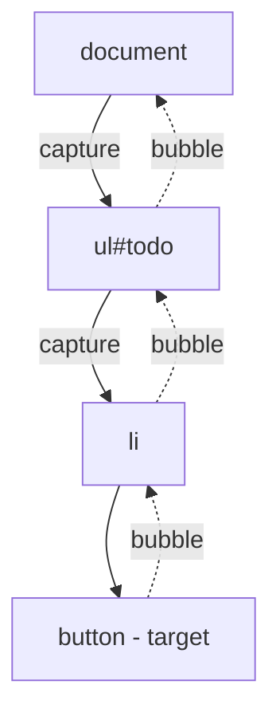
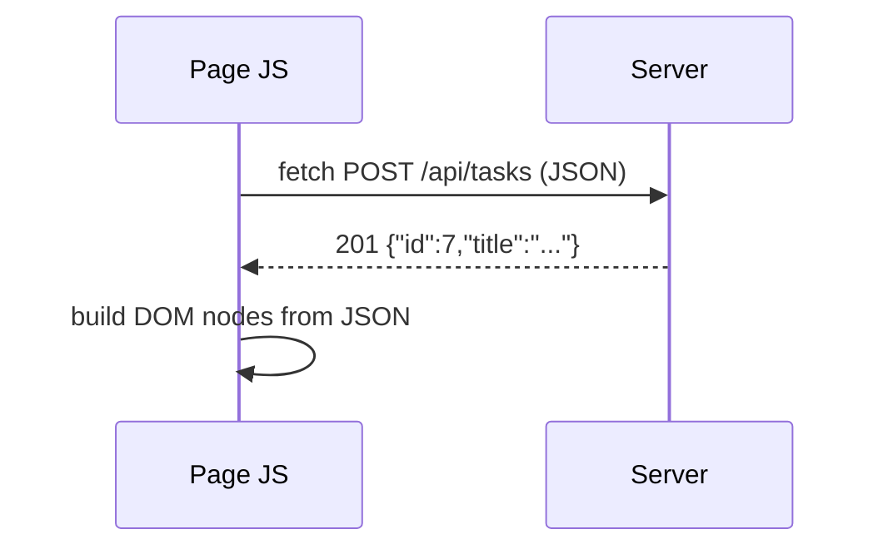

# Lecture 4 — Browser JavaScript: DOM, events, fetch

**Goals:** know just enough browser JS to understand what HTMX does for us, and when a few lines of JS are still useful.

### 1. Language refresher
```js
const tasks = [{ id: 1, title: 'A', done: false }];
const open = tasks.filter(t => !t.done).map(t => t.title);
const { title, ...rest } = tasks[0];           // destructuring
const copy = { ...tasks[0], done: true };       // spread
const label = `Task: ${title}`;                 // template literal
```
Modules: `<script type="module" src="/static/app.js"></script>` (deferred by default, strict mode, `import`/`export`).

### 2. The DOM
```js
const list = document.querySelector('#todo');
const items = document.querySelectorAll('.task');
const li = document.createElement('li');
li.textContent = 'New task';     // safe: never parses HTML
li.classList.add('task');
li.dataset.id = '7';             // -> data-id="7"
list.append(li);
// list.innerHTML = userInput;   // DANGER: XSS (lecture 8)
```

### 3. Events
```js
document.querySelector('#todo').addEventListener('click', (e) => {
  const btn = e.target.closest('button[data-action="delete"]');
  if (!btn) return;
  btn.closest('li').remove();
});
```
Event flow: **capture → target → bubble**. *Event delegation* (one listener on the parent) works for elements added later.

`e.preventDefault()` stops the default action (e.g. form submit); `e.stopPropagation()` stops bubbling.

### 4. Asynchrony and fetch
```js
async function addTask(title) {
  const res = await fetch('/api/tasks', {
    method: 'POST',
    headers: { 'Content-Type': 'application/json' },
    body: JSON.stringify({ title }),
  });
  if (!res.ok) throw new Error(`HTTP ${res.status}`);
  return res.json();
}
```

Note: `fetch` only rejects on network errors. A 404/500 still resolves, so check `res.ok`.

### 5. Progressive enhancement
Start with a form that works without JS, then enhance it:
```js
form.addEventListener('submit', async (e) => {
  e.preventDefault();
  const res = await fetch(form.action, { method: 'POST', body: new FormData(form) });
  list.insertAdjacentHTML('beforeend', await res.text()); // server returns an HTML fragment
});
```
Here the server returns **HTML** rather than JSON. That is exactly the idea HTMX generalises (lecture 12): *hypermedia as the engine of application state*.

### 6. JSON API vs HTML fragments
| | JSON + client rendering | HTML fragments |
|---|---|---|
| Rendering | in browser | on server |
| Client code | lots | almost none |
| Templates | duplicated | one place |
| Good for | mobile apps, public APIs | server-rendered web apps |

### Recap questions
1. Why is `textContent` safer than `innerHTML`?
2. What is event delegation and why does it help with dynamic content?
3. Does `fetch` reject on a 500 response? How do you handle it?
4. What does "progressive enhancement" mean?
5. Compare returning JSON vs HTML fragments from the server.
