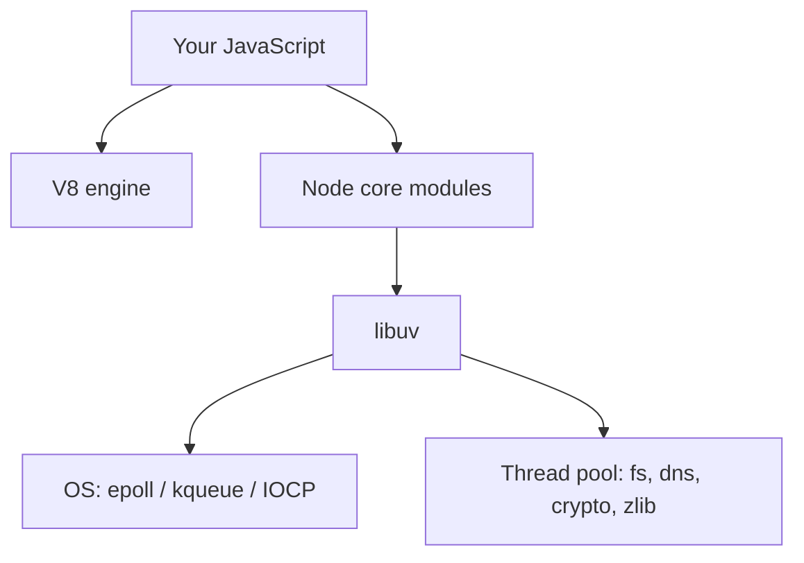
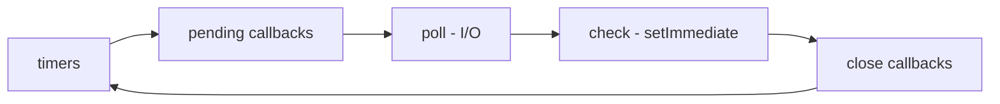

# Lecture 5 — Node.js: event loop, modules, npm

**Goals:** understand how Node.js runs JavaScript on the server, why it is non-blocking, and how projects are organised.

### 1. What is Node.js
Node.js is the V8 JavaScript engine, plus **libuv** (event loop, thread pool, async I/O), plus a standard library (`node:fs`, `node:http`, `node:crypto`, `node:test`…).



### 2. The event loop
A single JavaScript thread runs callbacks one at a time. I/O is handed to the OS or the thread pool, and its callbacks are queued when the work completes.


Microtasks (`process.nextTick`, Promise callbacks) run after each callback, before the loop moves on.

```js
console.log('1');
setTimeout(() => console.log('timeout'), 0);
setImmediate(() => console.log('immediate'));
Promise.resolve().then(() => console.log('promise'));
process.nextTick(() => console.log('nextTick'));
console.log('2');
// 1, 2, nextTick, promise, then timeout/immediate (order of these two may vary)
```

**Rule:** never block the loop. CPU-heavy synchronous code (e.g. `bcrypt.hashSync`, a large `JSON.parse`, `while(true)`) freezes *every* request.

### 3. Asynchronous styles
```js
import { readFile } from 'node:fs/promises';
// callbacks (old)      fs.readFile('a.txt', 'utf8', (err, data) => { ... })
// promises + async/await (modern)
try {
  const data = await readFile('a.txt', 'utf8');   // top-level await works in ESM
} catch (err) { console.error(err.message); }
// parallel
const [a, b] = await Promise.all([readFile('a.txt', 'utf8'), readFile('b.txt', 'utf8')]);
```

### 4. Modules: ESM
We use **ES modules** (`"type": "module"` in `package.json`).
```js
// src/util/slug.js
export function slugify(s) { return s.toLowerCase().trim().replace(/[^a-z0-9]+/g, '-'); }
export default slugify;

// src/server.js
import slugify, { slugify as s2 } from './util/slug.js';  // note: the extension is required
import http from 'node:http';
```
CommonJS (`require`, `module.exports`) still exists. Recognise it, but don't mix the two.

### 5. npm and package.json
```json
{
  "name": "task-board",
  "type": "module",
  "scripts": {
    "dev": "node --watch --env-file=.env src/server.js",
    "start": "node --env-file=.env src/server.js",
    "test": "node --test"
  },
  "dependencies": { "@prisma/client": "^5.22.0" },
  "devDependencies": { "prisma": "^5.22.0" },
  "engines": { "node": ">=20" }
}
```
- `npm install <pkg>` / `npm i -D <pkg>`; `package-lock.json` **is committed**; `node_modules/` is not.
- Semver: `^5.22.0` allows `5.x.y ≥ 5.22.0`.
- `npx <bin>` runs local binaries (`npx prisma migrate dev`).
- Be careful with dependencies (supply-chain risk): `npm audit`, few packages.

### 6. Useful built-ins
| Module | Use |
|--------|-----|
| `node:path`, `node:url` | paths, `fileURLToPath(import.meta.url)` |
| `node:fs/promises` | files |
| `node:crypto` | `randomBytes`, `scrypt`, `timingSafeEqual`, HMAC |
| `node:events` | `EventEmitter` |
| `node:stream` | streaming bodies / files |
| `node:test`, `node:assert` | testing |
| `process.env`, `process.argv` | configuration |

### 7. Streams and EventEmitter (needed for `http`)
```js
import { createReadStream } from 'node:fs';
createReadStream('big.log').on('data', chunk => {/* Buffer */}).on('end', () => {});
```
An HTTP request *is* a readable stream, and a response *is* a writable stream (lecture 6).

### Recap questions
1. Why can a single-threaded Node server handle thousands of concurrent connections?
2. What happens to other users if one request runs a 2-second synchronous loop?
3. Predict the output order of the snippet in section 2 and explain it.
4. What is the difference between `dependencies` and `devDependencies`?
5. Why must `package-lock.json` be committed?
