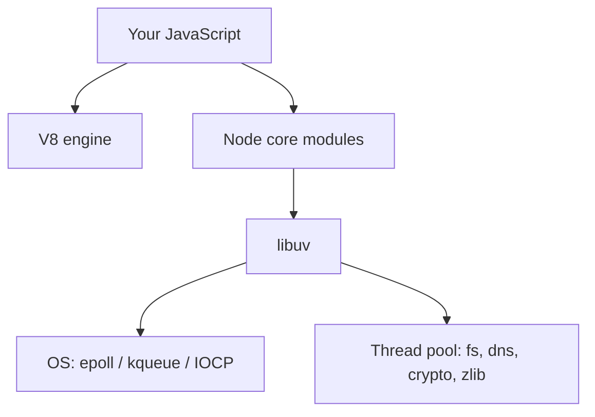
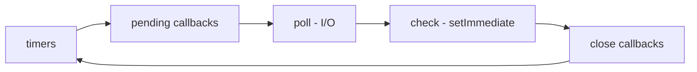
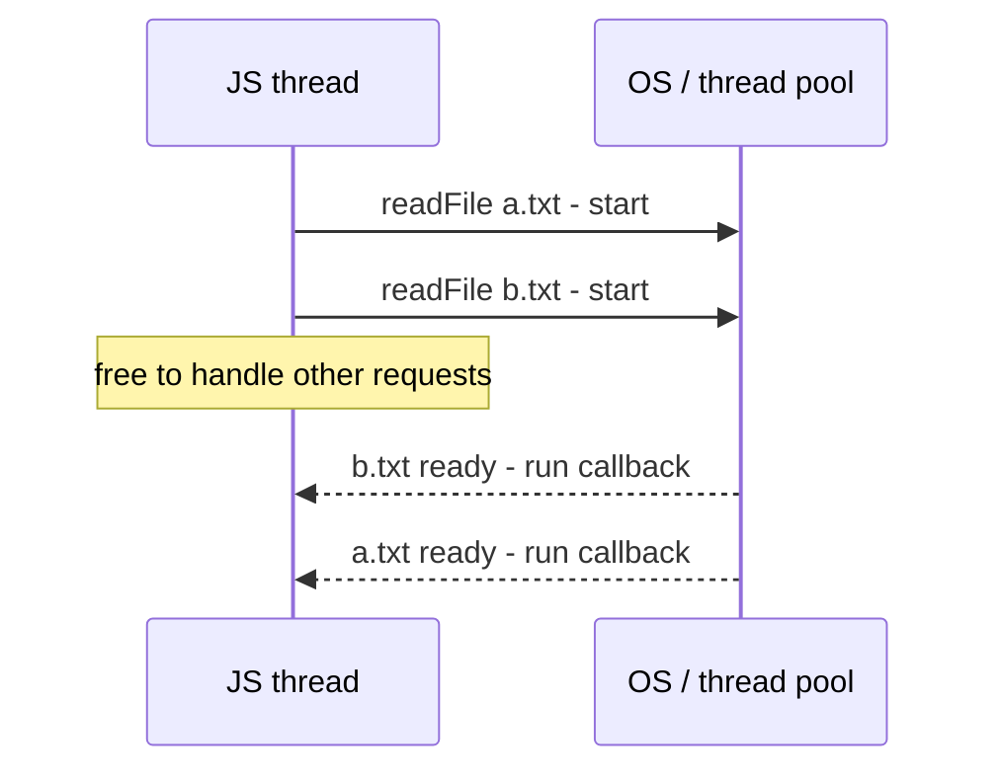
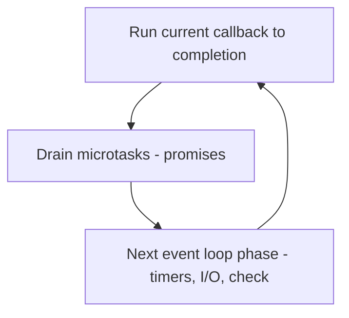
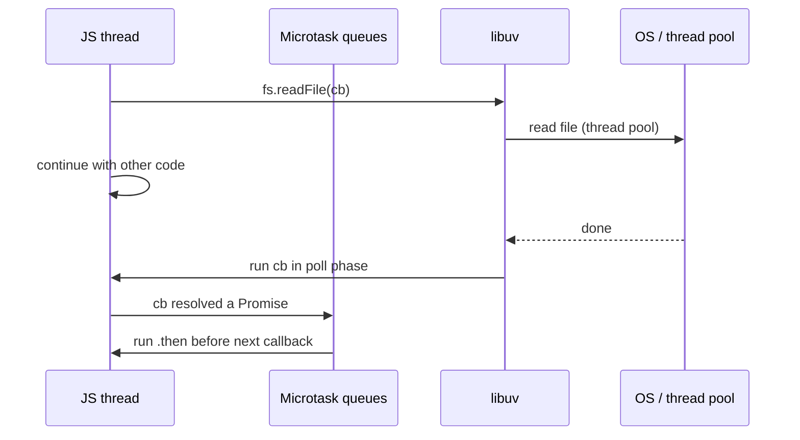
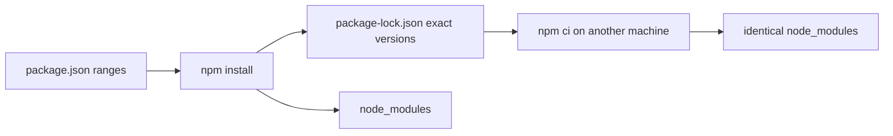

# Lecture 5 — Node.js: event loop, modules, npm

**Goals:** understand how Node.js runs JavaScript on the server, why it is non-blocking, and how projects are organised.

### In plain words
Node.js lets you run JavaScript **outside the browser** — on your laptop or a server. Imagine a **restaurant with one very fast waiter** (the single JavaScript thread). The waiter never stands at the stove waiting for a steak to cook; they hand the order to the kitchen (the operating system / thread pool), go serve other tables, and come back when the kitchen rings the bell (a *callback* or a resolved *promise*). That is the **event loop**. It works great as long as the waiter never does slow work personally — if they start peeling 100 kg of potatoes (a heavy CPU loop), every table waits. **npm** is a giant **shared toolbox**: other people's code you can download with one command, listed in `package.json` like a shopping list. See the [glossary](../resources/glossary.md).

### 1. What is Node.js
Node.js is the V8 JavaScript engine, plus **libuv** (event loop, thread pool, async I/O), plus a standard library (`node:fs`, `node:http`, `node:crypto`, `node:test`…).



### 2. The event loop
A single JavaScript thread runs callbacks one at a time. I/O is handed to the OS or the thread pool, and its callbacks are queued when the work completes.


Microtasks (`process.nextTick`, Promise callbacks) run after each callback, before the loop moves on.

```js
console.log('1');
setTimeout(() => console.log('timeout'), 0);
setImmediate(() => console.log('immediate'));
Promise.resolve().then(() => console.log('promise'));
process.nextTick(() => console.log('nextTick'));
console.log('2');
// 1, 2, nextTick, promise, then timeout/immediate (order of these two may vary)
```

**Rule:** never block the loop. CPU-heavy synchronous code (e.g. `bcrypt.hashSync`, a large `JSON.parse`, `while(true)`) freezes *every* request.

### 3. Asynchronous styles
```js
import { readFile } from 'node:fs/promises';
// callbacks (old)      fs.readFile('a.txt', 'utf8', (err, data) => { ... })
// promises + async/await (modern)
try {
  const data = await readFile('a.txt', 'utf8');   // top-level await works in ESM
} catch (err) { console.error(err.message); }
// parallel
const [a, b] = await Promise.all([readFile('a.txt', 'utf8'), readFile('b.txt', 'utf8')]);
```

### 4. Modules: ESM
We use **ES modules** (`"type": "module"` in `package.json`).
```js
// src/util/slug.js
export function slugify(s) { return s.toLowerCase().trim().replace(/[^a-z0-9]+/g, '-'); }
export default slugify;

// src/server.js
import slugify, { slugify as s2 } from './util/slug.js';  // note: the extension is required
import http from 'node:http';
```
CommonJS (`require`, `module.exports`) still exists. Recognise it, but don't mix the two.

### 5. npm and package.json
```json
{
  "name": "task-board",
  "type": "module",
  "scripts": {
    "dev": "node --watch --env-file=.env src/server.js",
    "start": "node --env-file=.env src/server.js",
    "test": "node --test"
  },
  "dependencies": { "@prisma/client": "^5.22.0" },
  "devDependencies": { "prisma": "^5.22.0" },
  "engines": { "node": ">=20" }
}
```
- `npm install <pkg>` / `npm i -D <pkg>`; `package-lock.json` **is committed**; `node_modules/` is not.
- Semver: `^5.22.0` allows `5.x.y ≥ 5.22.0`.
- `npx <bin>` runs local binaries (`npx prisma migrate dev`).
- Be careful with dependencies (supply-chain risk): `npm audit`, few packages.

### 6. Useful built-ins
| Module | Use |
|--------|-----|
| `node:path`, `node:url` | paths, `fileURLToPath(import.meta.url)` |
| `node:fs/promises` | files |
| `node:crypto` | `randomBytes`, `scrypt`, `timingSafeEqual`, HMAC |
| `node:events` | `EventEmitter` |
| `node:stream` | streaming bodies / files |
| `node:test`, `node:assert` | testing |
| `process.env`, `process.argv` | configuration |

### 7. Streams and EventEmitter (needed for `http`)
```js
import { createReadStream } from 'node:fs';
createReadStream('big.log').on('data', chunk => {/* Buffer */}).on('end', () => {});
```
An HTTP request *is* a readable stream, and a response *is* a writable stream (lecture 6).

### Deeper dive: blocking vs non-blocking

With **synchronous** calls (`readFileSync`) the thread would wait for each file in turn and handle nothing else. On a server that means all users wait. Use sync APIs only at startup (e.g. reading config).

**Microtasks vs macrotasks.** After each callback, Node empties the *microtask* queue (resolved promises, `queueMicrotask`) before moving on to the next phase of the loop (timers, I/O, `setImmediate`).



### Worked example: predict the output
```js
// order.mjs — run with: node order.mjs
console.log('1 sync');                              // runs immediately
setTimeout(() => console.log('5 timeout'), 0);      // macrotask: timers phase
setImmediate(() => console.log('6 immediate'));     // macrotask: check phase
Promise.resolve().then(() => console.log('3 promise'));    // microtask
queueMicrotask(() => console.log('4 microtask'));          // microtask
console.log('2 sync');                              // still synchronous
// Output: 1, 2, 3, 4, then 5/6 (their relative order can vary in the main module)
```

### Worked example: a small ESM project from zero
Step 1 — create the project:
```bash
mkdir hello-node && cd hello-node
npm init -y                       # creates package.json
npm pkg set type=module           # .js files are now ES modules
npm install --save-dev nodemon    # dev-only tool, goes to devDependencies
```
Step 2 — a module and its consumer:
```js
// src/math.js — a named export
export function average(numbers) {
  if (numbers.length === 0) return 0;          // avoid division by zero
  const sum = numbers.reduce((a, b) => a + b, 0);
  return sum / numbers.length;
}
```
```js
// src/main.js
import { readFile } from 'node:fs/promises';   // promise-based fs API
import { average } from './math.js';           // relative imports NEED the .js extension

// Top-level await is allowed in ES modules
const text = await readFile(new URL('../scores.txt', import.meta.url), 'utf8');
const numbers = text.split('\n').filter(Boolean).map(Number); // "10\n20\n" -> [10, 20]
console.log('Average:', average(numbers));
```
Step 3 — scripts in `package.json`:
```json
{
  "type": "module",
  "scripts": {
    "start": "node src/main.js",
    "dev": "node --watch src/main.js",
    "test": "node --test"
  }
}
```
Step 4 — a test with the built-in runner:
```js
// src/math.test.js — run with: npm test
import { test } from 'node:test';
import assert from 'node:assert/strict';
import { average } from './math.js';

test('average of numbers', () => {
  assert.equal(average([10, 20, 30]), 20);
});
test('empty list gives 0', () => {
  assert.equal(average([]), 0);
});
```

### Common beginner mistakes
- **Mixing `require` and `import`** in the same ESM file. In ESM use `import`; `require` is not defined.
- **Forgetting the `.js` extension** in relative ESM imports (`'./math'` fails).
- **Using `__dirname`** in ESM — use `import.meta.dirname` (Node 20.11+) or `new URL('.', import.meta.url)`.
- **Committing `node_modules`** to git. Commit `package.json` and `package-lock.json` instead.
- **Blocking the event loop** with a huge synchronous loop or `readFileSync` inside a request handler.
- **Unhandled promise rejections** — always `await` or `.catch()` promises.
- **Installing build tools as `dependencies`** instead of `devDependencies`.

### Try it yourself
1. Run the "predict the output" script and explain each line.
2. Write a request handler that does a 3-second `while` loop and observe that a second request waits too.
3. Create the ESM project above and add a `median()` function with tests.
4. Run `npm ls` and `npm outdated` and explain what you see.
5. Read a JSON file with `fs/promises`, parse it and print one field; handle the "file not found" error.

### Recap questions
1. Why can a single-threaded Node server handle thousands of concurrent connections?
2. What happens to other users if one request runs a 2-second synchronous loop?
3. Predict the output order of the snippet in section 2 and explain it.
4. What is the difference between `dependencies` and `devDependencies`?
5. Why must `package-lock.json` be committed?


### Extra theory: the event loop phases in detail
The official guide [The Node.js Event Loop](https://nodejs.org/en/learn/asynchronous-work/event-loop-timers-and-nexttick) describes six phases. Between every callback, Node empties first the `process.nextTick` queue, then the Promise microtask queue.

| Phase | What runs there |
|---|---|
| timers | callbacks of [`setTimeout` / `setInterval`](https://nodejs.org/docs/latest/api/timers.html) whose time has come |
| pending callbacks | some deferred system errors (e.g. TCP `ECONNREFUSED`) |
| idle, prepare | internal only |
| poll | wait for new I/O and run I/O callbacks |
| check | `setImmediate` callbacks |
| close callbacks | e.g. `socket.on('close')` |



| API | When it runs |
|---|---|
| [`process.nextTick`](https://nodejs.org/docs/latest/api/process.html#processnexttickcallback-args) | right after the current operation, before Promises |
| `Promise.then` / `await` | after nextTick queue, before the loop continues |
| `setImmediate` | in the next *check* phase |
| `setTimeout(fn, 0)` | in the next *timers* phase (≥1 ms) |

### Extra theory: ESM vs CommonJS
Node supports two module systems ([ECMAScript modules docs](https://nodejs.org/docs/latest/api/esm.html), [CommonJS docs](https://nodejs.org/docs/latest/api/modules.html), [package `"type"` field](https://nodejs.org/docs/latest/api/packages.html#type)).

| | ESM | CommonJS |
|---|---|---|
| Syntax | `import` / `export` | `require` / `module.exports` |
| Enabled by | `.mjs` or `"type": "module"` | `.cjs` or default |
| Loading | asynchronous, static analysis | synchronous, at runtime |
| Top-level `await` | yes | no |
| `__dirname` | use `import.meta.dirname` | available |
| Standard | ECMAScript (also in browsers) | Node-specific |

### Extra theory: semantic versioning and lock files
npm uses [semantic versioning](https://semver.org/): `MAJOR.MINOR.PATCH`. A major bump may break you; minor adds features; patch fixes bugs. Ranges in [`package.json`](https://docs.npmjs.com/cli/configuring-npm/package-json) decide what npm may install, and [`package-lock.json`](https://docs.npmjs.com/cli/configuring-npm/package-lock-json) records the exact tree so that [`npm ci`](https://docs.npmjs.com/cli/commands/npm-ci) gives everyone the same versions.

| Range | Allows | Example matches for `1.4.2` |
|---|---|---|
| `1.4.2` | exactly that | `1.4.2` |
| `~1.4.2` | patch updates | `1.4.x` |
| `^1.4.2` | minor + patch updates | `1.x.x` (≥1.4.2) |
| `*` | anything | any (avoid) |



### Extra theory: errors in asynchronous code
- Callback style passes the error first: `(err, data) => {}`.
- Promise style rejects; use `try/catch` around `await`.
- An unhandled rejection crashes the process in modern Node ([`--unhandled-rejections`](https://nodejs.org/docs/latest/api/cli.html#--unhandled-rejectionsmode)).
- An `'error'` event on an [`EventEmitter`](https://nodejs.org/docs/latest/api/events.html) with no listener throws.
See [Node.js errors documentation](https://nodejs.org/docs/latest/api/errors.html).

### Extra theory: streams and backpressure
[Streams](https://nodejs.org/docs/latest/api/stream.html) process data piece by piece instead of loading it all into memory. **Backpressure** means a fast producer waits when the consumer is slow; [`stream.pipeline`](https://nodejs.org/docs/latest/api/stream.html#streampipelinesource-transforms-destination-callback) handles this and errors for you.

| Stream type | Example |
|---|---|
| Readable | `fs.createReadStream`, HTTP request (`req`) |
| Writable | `fs.createWriteStream`, HTTP response (`res`) |
| Duplex | TCP socket |
| Transform | `zlib.createGzip()` |

```js
import { pipeline } from 'node:stream/promises';
import { createReadStream, createWriteStream } from 'node:fs';
import { createGzip } from 'node:zlib';

await pipeline(createReadStream('big.log'), createGzip(), createWriteStream('big.log.gz'));
```

### Extra theory: useful built-in modules
| Module | Use it for |
|---|---|
| [`node:fs/promises`](https://nodejs.org/docs/latest/api/fs.html#promises-api) | reading/writing files |
| [`node:path`](https://nodejs.org/docs/latest/api/path.html) | joining paths safely across OSes |
| [`node:http`](https://nodejs.org/docs/latest/api/http.html) | HTTP servers and clients |
| [`node:url`](https://nodejs.org/docs/latest/api/url.html) | parsing URLs (`new URL()`) |
| [`node:crypto`](https://nodejs.org/docs/latest/api/crypto.html) | hashing, random IDs (`randomUUID`) |
| [`node:test`](https://nodejs.org/docs/latest/api/test.html) | built-in test runner |
| [`node:worker_threads`](https://nodejs.org/docs/latest/api/worker_threads.html) | CPU-heavy work off the main thread |

### Further reading / documentation
- [Node.js documentation (latest API)](https://nodejs.org/docs/latest/api/)
- [Node.js Learn: Introduction to Node.js](https://nodejs.org/en/learn/getting-started/introduction-to-nodejs)
- [Node.js Learn: The event loop, timers and `process.nextTick()`](https://nodejs.org/en/learn/asynchronous-work/event-loop-timers-and-nexttick)
- [Node.js Learn: Don't block the event loop](https://nodejs.org/en/learn/asynchronous-work/dont-block-the-event-loop)
- [Node.js: ECMAScript modules](https://nodejs.org/docs/latest/api/esm.html)
- [Node.js: Events](https://nodejs.org/docs/latest/api/events.html)
- [Node.js: Stream](https://nodejs.org/docs/latest/api/stream.html)
- [libuv documentation](https://docs.libuv.org/en/v1.x/)
- [npm Docs](https://docs.npmjs.com/)
- [npm: package.json](https://docs.npmjs.com/cli/configuring-npm/package-json)
- [Semantic Versioning 2.0.0](https://semver.org/)
- [MDN: JavaScript modules](https://developer.mozilla.org/en-US/docs/Web/JavaScript/Guide/Modules)
