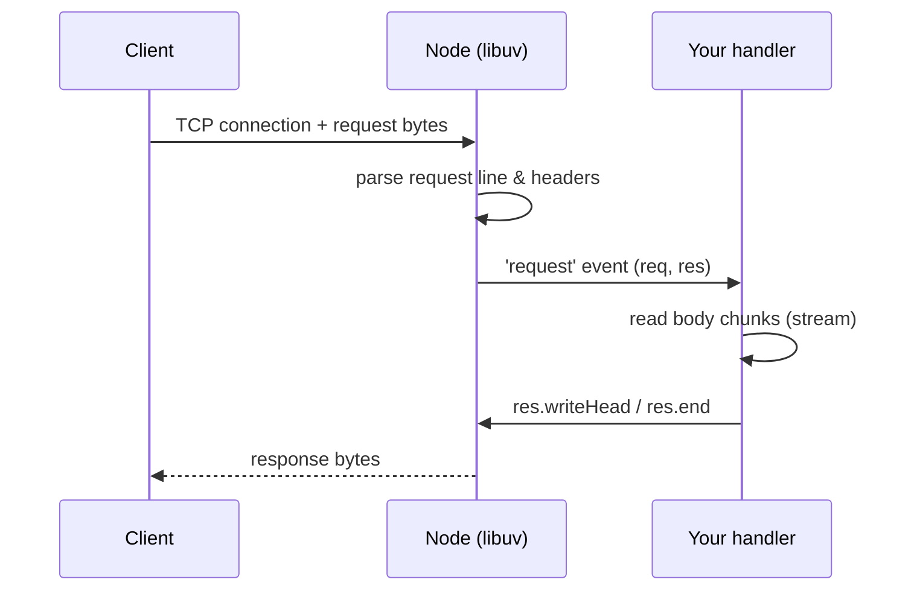
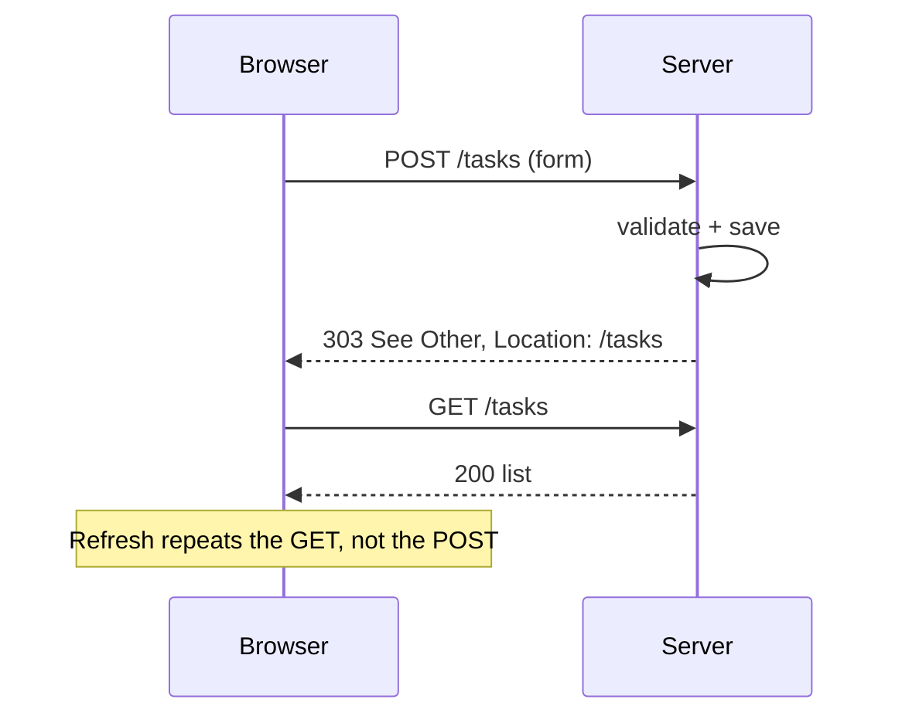
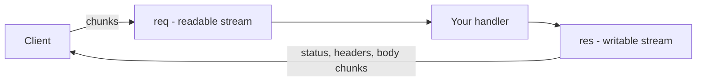
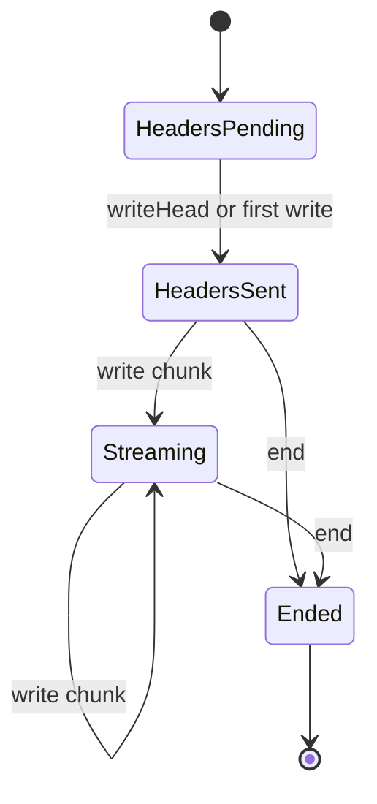

# Lecture 6 — The `node:http` server

**Goals:** handle HTTP requests with nothing but Node core: routing by hand, query strings, request bodies, static files, correct status codes and headers.

### In plain words
`node:http` is the **bare reception desk** of your web application. Every visitor (request) walks up, and your single function decides what to do: look at *what* they ask for (`req.method`, `req.url`), maybe read the letter they brought (the **body**, which arrives in pieces like pages of a fax), and hand back an answer (`res`) with a status, some labels (headers) and content. There is no receptionist manual — no router, no body parser, no static file server — we build those ourselves, which is the best way to understand what frameworks do for you. See the [glossary](../resources/glossary.md).

### 1. Hello, HTTP
```js
import http from 'node:http';

const server = http.createServer((req, res) => {
  res.statusCode = 200;
  res.setHeader('Content-Type', 'text/plain; charset=utf-8');
  res.end('Hello from node:http\n');
});
server.listen(3000, () => console.log('http://localhost:3000'));
```
`req` is an `http.IncomingMessage` (readable stream: `method`, `url`, `headers`); `res` is an `http.ServerResponse` (writable: `statusCode`, `setHeader`, `writeHead`, `write`, `end`).



### 2. Manual routing
```js
const server = http.createServer(async (req, res) => {
  const url = new URL(req.url, `http://${req.headers.host}`);
  if (req.method === 'GET' && url.pathname === '/') return sendHtml(res, '<h1>Home</h1>');
  if (req.method === 'GET' && url.pathname === '/tasks') {
    const q = url.searchParams.get('q') ?? '';
    return sendHtml(res, `<p>Searching for ${escapeHtml(q)}</p>`);
  }
  const m = url.pathname.match(/^\/tasks\/(\d+)$/);
  if (req.method === 'GET' && m) return sendHtml(res, `<p>Task #${m[1]}</p>`);
  res.writeHead(404, { 'Content-Type': 'text/plain' }).end('Not found');
});

function sendHtml(res, html, status = 200) {
  res.writeHead(status, { 'Content-Type': 'text/html; charset=utf-8' });
  res.end(html);
}
```
Already in lecture 6 this `if`-chain gets ugly, which motivates the router in lecture 7.

### 3. Reading the body
The body arrives in chunks. Always set a **size limit**.
```js
export async function readBody(req, limit = 1_000_000) {
  const chunks = [];
  let size = 0;
  for await (const chunk of req) {
    size += chunk.length;
    if (size > limit) throw Object.assign(new Error('Payload too large'), { status: 413 });
    chunks.push(chunk);
  }
  return Buffer.concat(chunks).toString('utf8');
}

export async function parseBody(req) {
  const type = (req.headers['content-type'] ?? '').split(';')[0].trim();
  const raw = await readBody(req);
  if (type === 'application/x-www-form-urlencoded') return Object.fromEntries(new URLSearchParams(raw));
  if (type === 'application/json') return raw ? JSON.parse(raw) : {};
  return {};
}
```
`Object.fromEntries` keeps only the last value for repeated keys. Use `params.getAll('tag')` for multi-value fields.

### 4. Post/Redirect/Get

```js
res.writeHead(303, { Location: '/tasks' }).end();
```

### 5. Static files (safely)
```js
import { createReadStream } from 'node:fs';
import { stat } from 'node:fs/promises';
import path from 'node:path';

const PUBLIC = path.resolve('public');
const TYPES = { '.css': 'text/css', '.js': 'text/javascript', '.png': 'image/png', '.svg': 'image/svg+xml', '.ico': 'image/x-icon' };

async function serveStatic(req, res, pathname) {
  const file = path.join(PUBLIC, decodeURIComponent(pathname.replace(/^\/static\//, '')));
  if (!file.startsWith(PUBLIC + path.sep)) return res.writeHead(403).end();   // path traversal guard
  try {
    const info = await stat(file);
    if (!info.isFile()) throw new Error();
    res.writeHead(200, {
      'Content-Type': TYPES[path.extname(file)] ?? 'application/octet-stream',
      'Content-Length': info.size,
      'Cache-Control': 'public, max-age=3600',
    });
    createReadStream(file).pipe(res);
  } catch { res.writeHead(404).end('Not found'); }
}
```
Without the guard, `GET /static/../../etc/passwd` would leak files.

### 6. Method override for HTML forms
HTML forms only send GET/POST. Either use `POST /tasks/7/delete`, or add `<input type="hidden" name="_method" value="DELETE">` and rewrite `req.method` after parsing. With HTMX (lecture 12) we can send real `DELETE`/`PUT`.

### 7. Errors and robustness
- Wrap handlers in `try/catch`; on error answer `500` and log the stack (never send it to the user).
- `server.on('clientError', ...)` handles malformed requests.
- `server.headersTimeout`, `server.requestTimeout` protect against slow clients.
- `process.on('SIGTERM', () => server.close())` gives a graceful shutdown.

### Deeper dive: `req` and `res` are streams
`req` is a **readable stream**: the body arrives in chunks (`Buffer`s), maybe slowly, maybe huge. `res` is a **writable stream**: you can `write()` many times and must call `end()` exactly once. Headers must be set **before** the first byte of the body is written.





### Worked example: a tiny JSON + HTML notes server
```js
// notes-server.js — Node >= 20, "type": "module"
import { createServer } from 'node:http';

const notes = [];                // in-memory "database" — lost on restart
const LIMIT = 10_000;            // max body size in bytes

// Read the whole body as text, rejecting bodies that are too big
async function readText(req) {
  let size = 0;
  const chunks = [];
  for await (const chunk of req) {           // req is async-iterable
    size += chunk.length;
    if (size > LIMIT) throw Object.assign(new Error('Payload Too Large'), { status: 413 });
    chunks.push(chunk);
  }
  return Buffer.concat(chunks).toString('utf8');
}

const server = createServer(async (req, res) => {
  try {
    // Build a URL object so we get pathname and searchParams parsed for us
    const url = new URL(req.url, `http://${req.headers.host}`);

    if (req.method === 'GET' && url.pathname === '/notes') {
      res.writeHead(200, { 'Content-Type': 'application/json' });
      return res.end(JSON.stringify(notes));        // send the list as JSON
    }

    if (req.method === 'POST' && url.pathname === '/notes') {
      const form = new URLSearchParams(await readText(req)); // parse title=...&...
      const text = form.get('text')?.trim();
      if (!text) {                                   // validation
        res.writeHead(422, { 'Content-Type': 'text/plain' });
        return res.end('text is required');
      }
      notes.push({ id: notes.length + 1, text });
      res.writeHead(303, { Location: '/notes' });     // Post/Redirect/Get
      return res.end();
    }

    res.writeHead(404, { 'Content-Type': 'text/plain' });
    res.end('Not Found');
  } catch (err) {
    const status = err.status ?? 500;
    if (status >= 500) console.error(err);           // log only real bugs
    if (!res.headersSent) res.writeHead(status, { 'Content-Type': 'text/plain' });
    res.end(status >= 500 ? 'Internal Server Error' : err.message);
  }
});

server.listen(3000, () => console.log('Listening on http://localhost:3000'));
```
Try it:
```bash
curl -i -d "text=Hello" http://localhost:3000/notes   # 303 See Other
curl -i http://localhost:3000/notes                   # 200 + [{"id":1,"text":"Hello"}]
curl -i -d "text=" http://localhost:3000/notes        # 422
```

### Common beginner mistakes
- **Forgetting `res.end()`** — the browser spins forever.
- **Calling `writeHead` after writing the body** → `ERR_HTTP_HEADERS_SENT`.
- **Comparing `req.url` with `'/tasks'`** while it actually is `'/tasks?page=2'`. Parse with `new URL()`.
- **No body size limit** — one client can exhaust memory.
- **Building file paths from the URL without checks** → path traversal (`/../../etc/passwd`).
- **Returning 200 after a POST** and rendering the page; refreshing then re-submits. Use 303 redirect.
- **Letting an exception crash the process** — wrap the handler in `try/catch`.

### Try it yourself
1. Run the notes server and add `DELETE /notes/:id` with manual parsing of the path.
2. Add a `GET /` route that renders the notes as an HTML list with a form.
3. Send a 20 KB body with `curl` and verify you get 413.
4. Log every request as `METHOD path status durationMs`.
5. Serve a `public/style.css` file with the correct `Content-Type`.

### Recap questions
1. Why is `new URL(req.url, base)` needed instead of `req.url` directly?
2. Why must a body reader enforce a size limit? What status do you return?
3. Explain Post/Redirect/Get and the problem it solves.
4. Show a request that exploits a static server without a path-traversal guard.
5. What is the difference between `res.write` and `res.end`?
