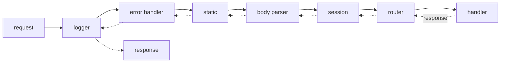
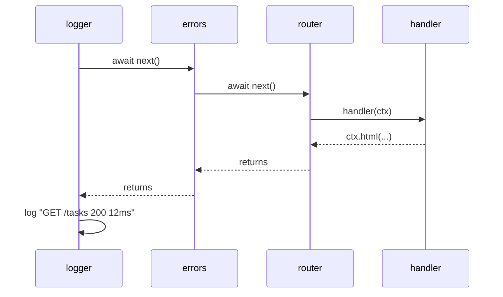
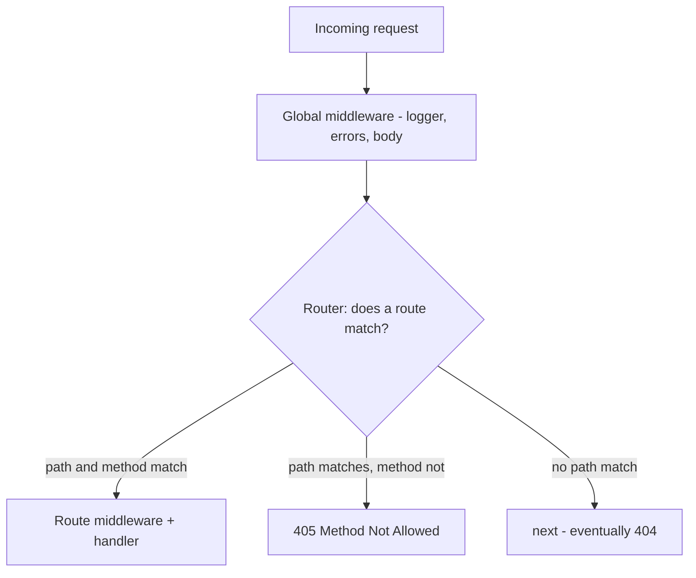
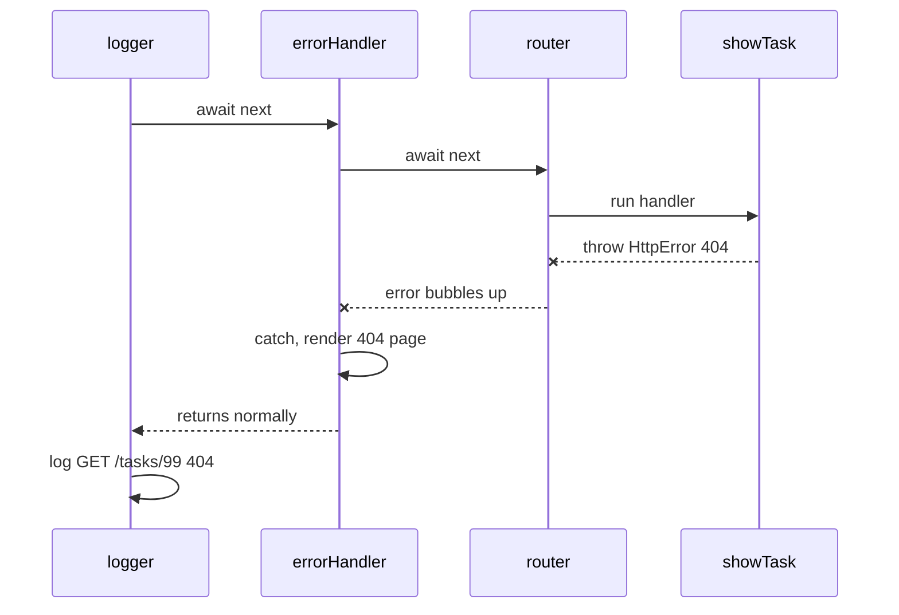

# Lecture 7 — Building a mini-framework: router, middleware, errors

**Goals:** see what Express/Koa really do by writing it ourselves in ~150 lines. That code becomes `examples/task-board/src/router.js` and `src/app.js`.

### In plain words
In lecture 6 our handler became one giant `if/else`. A **mini-framework** organises that mess. Think of an **airport**: every passenger (request) goes through a line of checkpoints — check-in (logger), security (auth), passport control (body parser) — and finally reaches the right **gate** (route handler) based on their ticket (method + path). Each checkpoint can let you through (`await next()`), stop you (send a response or throw an error), or do something on your way **back** (like stamping how long the trip took). That "go in, then come back out through the same layers" shape is the **onion model**. See the [glossary](../resources/glossary.md).

### 1. Design
- A **context object** `ctx` per request: `{ req, res, method, url, path, query, params, body, state }` plus helpers `ctx.html()`, `ctx.redirect()`, `ctx.json()`.
- **Middleware** is `async (ctx, next) => {...}`, the "onion" model.
- A **router** maps `METHOD + path pattern` to handler chains and extracts `:params`.



### 2. Composing middleware
```js
export function compose(middleware) {
  return function run(ctx) {
    let index = -1;
    function dispatch(i) {
      if (i <= index) return Promise.reject(new Error('next() called twice'));
      index = i;
      const fn = middleware[i];
      if (!fn) return Promise.resolve();
      try { return Promise.resolve(fn(ctx, () => dispatch(i + 1))); }
      catch (err) { return Promise.reject(err); }
    }
    return dispatch(0);
  };
}
```


### 3. The router
```js
export class Router {
  #routes = [];
  add(method, pattern, ...handlers) {
    const keys = [];
    const regex = new RegExp('^' + pattern
      .replace(/\/:(\w+)/g, (_, k) => { keys.push(k); return '/([^/]+)'; }) + '/?$');
    this.#routes.push({ method, regex, keys, handlers });
    return this;
  }
  get(p, ...h) { return this.add('GET', p, ...h); }
  post(p, ...h) { return this.add('POST', p, ...h); }
  put(p, ...h) { return this.add('PUT', p, ...h); }
  patch(p, ...h) { return this.add('PATCH', p, ...h); }
  delete(p, ...h) { return this.add('DELETE', p, ...h); }

  middleware() {
    return async (ctx, next) => {
      let pathMatched = false;
      for (const r of this.#routes) {
        const m = r.regex.exec(ctx.path);
        if (!m) continue;
        pathMatched = true;
        if (r.method !== ctx.method && !(r.method === 'GET' && ctx.method === 'HEAD')) continue;
        ctx.params = Object.fromEntries(r.keys.map((k, i) => [k, decodeURIComponent(m[i + 1])]));
        return compose(r.handlers)(ctx);
      }
      if (pathMatched) ctx.throw(405, 'Method Not Allowed');
      return next();
    };
  }
}
```
Usage:
```js
const router = new Router();
router.get('/tasks', listTasks);
router.get('/tasks/:id', loadTask, showTask);   // per-route middleware
router.post('/tasks', requireAuth, createTask);
```

### 4. Context and the application
```js
export function createApp() {
  const stack = [];
  const app = {
    use(fn) { stack.push(fn); return app; },
    handler() {
      const run = compose(stack);
      return async (req, res) => {
        const ctx = createContext(req, res);
        try {
          await run(ctx);
          if (!res.writableEnded) ctx.throw(404, 'Not Found');
        } catch (err) { /* last-resort error handler, see below */ }
      };
    },
  };
  return app;
}
```

### 5. Error handling
```js
export class HttpError extends Error {
  constructor(status, message, expose = status < 500) { super(message); this.status = status; this.expose = expose; }
}
export const errorHandler = async (ctx, next) => {
  try { await next(); }
  catch (err) {
    const status = err.status ?? 500;
    if (status >= 500) console.error(err);
    ctx.html(errorPage(status, err.expose ? err.message : 'Internal Server Error'), status);
  }
};
```
Operational errors (404, validation) are expected, while programmer errors (`TypeError`) should be logged and answered with 500 without leaking details.

### 6. Typical middleware
| Middleware | Responsibility |
|-----------|----------------|
| `logger` | method, path, status, duration |
| `errorHandler` | turns exceptions into pages |
| `serveStatic('/static', dir)` | files |
| `bodyParser` | urlencoded / JSON with limit |
| `methodOverride` | `_method` field → real method |
| `session` | cookie → `ctx.state.session` |
| `csrf` | token check on unsafe methods |
| `requireAuth` | 401/redirect when no user |

### 7. What frameworks add on top
Route trees (faster matching), content negotiation, streaming helpers, plugins, validation schemas. Now you know what is under the hood, so you can choose a framework consciously later.

### Deeper dive: middleware vs handler vs router
- **Middleware** — a general function that runs for many requests; it calls `next()` to continue.
- **Handler** — the final function for a specific route; it usually does not call `next()`.
- **Router** — a middleware that picks the right handler chain by method and path.



### Worked example: tracing the onion
```js
// onion.js — shows the order in which code runs
import { compose } from './compose.js';

const log = (name) => async (ctx, next) => {
  ctx.trace.push(`${name} in`);   // runs on the way IN
  await next();                   // hand over to the next layer
  ctx.trace.push(`${name} out`);  // runs on the way OUT
};

const handler = async (ctx) => { ctx.trace.push('handler'); }; // no next(): end of chain

const ctx = { trace: [] };
await compose([log('A'), log('B'), handler])(ctx);
console.log(ctx.trace);
// [ 'A in', 'B in', 'handler', 'B out', 'A out' ]
```

### Worked example: writing your own middleware
Step 1 — a timing logger:
```js
export const logger = async (ctx, next) => {
  const start = performance.now();         // high-resolution timer
  try {
    await next();                          // let the rest of the app work
  } finally {                              // runs even if an error was thrown
    const ms = (performance.now() - start).toFixed(1);
    console.log(`${ctx.method} ${ctx.path} ${ctx.res.statusCode} ${ms}ms`);
  }
};
```
Step 2 — an authentication guard used per route:
```js
import { HttpError } from './errors.js';

export const requireAuth = async (ctx, next) => {
  if (!ctx.state.user) {                   // set earlier by the session middleware
    // For a browser page we redirect; for an API we could throw 401
    return ctx.redirect('/login');
  }
  await next();                            // user is logged in — continue
};
```
Step 3 — a handler that throws an operational error:
```js
export const showTask = async (ctx) => {
  const id = Number(ctx.params.id);        // params come from '/tasks/:id'
  if (!Number.isInteger(id)) throw new HttpError(400, 'Bad task id');
  const task = await findTask(id);         // e.g. a Prisma query (lecture 9)
  if (!task) throw new HttpError(404, 'Task not found'); // errorHandler renders it
  ctx.html(taskPage(task));
};
```
Step 4 — wire everything together:
```js
import { createServer } from 'node:http';
const app = createApp();
const router = new Router();
router.get('/tasks/:id', requireAuth, showTask);

app.use(logger).use(errorHandler).use(router.middleware()); // order matters!
createServer(app.handler()).listen(3000);
```

### Where an error travels


### Common beginner mistakes
- **Forgetting `await` before `next()`** — "after" code runs too early and errors escape the error handler.
- **Calling `next()` twice** — the handler runs twice; `compose` guards against it.
- **Registering `errorHandler` after the router** — it cannot catch errors from layers before it.
- **Sending a response and then calling `next()`** — later layers try to write again.
- **Exposing `err.message` of 500 errors** — may leak SQL or file paths.
- **Route order surprises** — `/tasks/new` must be registered before `/tasks/:id`, or `new` becomes an id.

### Try it yourself
1. Run the onion example with three layers and draw the trace.
2. Write a `responseTime` middleware that sets an `X-Response-Time` header.
3. Add `router.all(path, ...handlers)` that matches any method.
4. Make the router support an optional trailing `?` param, e.g. `/tasks/:id?`.
5. Throw a plain `TypeError` in a handler and confirm the user sees a generic 500 page while the console shows the stack.

### Recap questions
1. Explain the onion model. In what order does code before and after `await next()` run?
2. Why does `compose` guard against calling `next()` twice?
3. How does the router turn `/tasks/:id` into a regular expression?
4. When should the server reply 405 and when 404?
5. Why must error messages of 5xx errors not be shown to users?
