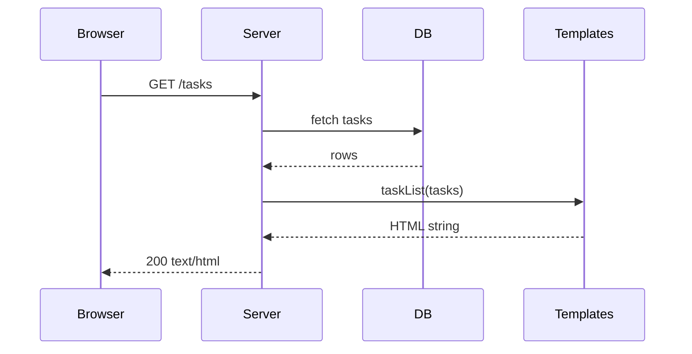
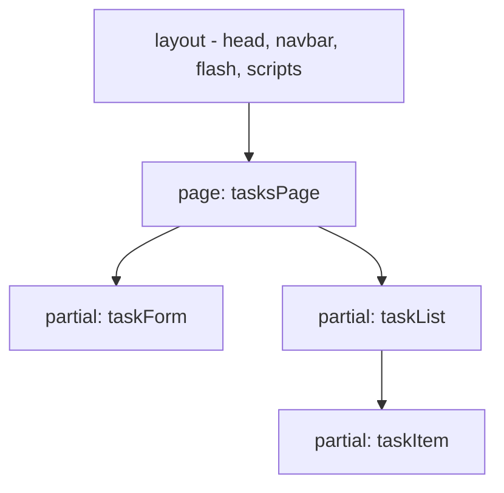
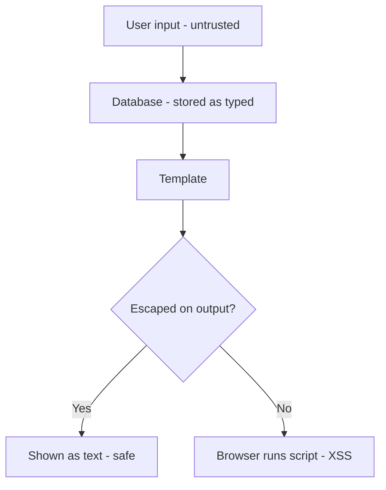
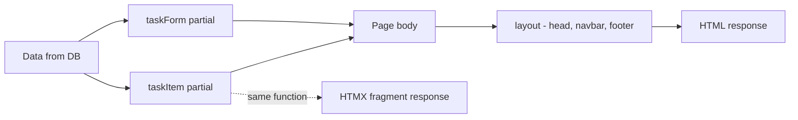
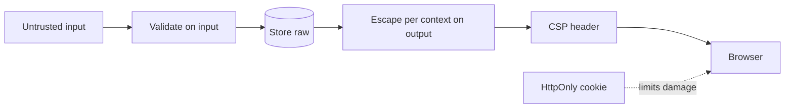

# Lecture 8 — Server-side templating, escaping, XSS

**Goals:** generate HTML on the server with plain JavaScript template literals, compose layouts and partials, and understand why escaping is mandatory.

### In plain words
A **template** is like a **mail-merge letter**: "Dear ___, your order ___ ships on ___". The server fills in the blanks with data and sends the finished HTML to the browser. The danger: if a blank is filled with something a user typed, and that text contains `<script>`, the browser will *run* it — like a letter where the customer's "name" is actually an instruction to the post office. That attack is **XSS (Cross-Site Scripting)**. The cure is **escaping**: turning special characters like `<` into harmless `&lt;` so they are shown as text, never executed. Our rule: **escape everything by default**, and only mark trusted HTML as raw on purpose. See the [glossary](../resources/glossary.md).

### 1. Server-side rendering (SSR)

The browser receives finished HTML: fast first paint, SEO-friendly, works without JS.

### 2. Cross-Site Scripting (XSS)
```js
const title = '';
`<h3>${title}</h3>`  // executes the attacker's script in every visitor's browser!
```
Fix: **escape on output**, based on the context:
```js
const MAP = { '&': '&amp;', '<': '&lt;', '>': '&gt;', '"': '&quot;', "'": '&#39;' };
export const escapeHtml = (v) => String(v ?? '').replace(/[&<>"']/g, (c) => MAP[c]);
```
| Context | Rule |
|---------|------|
| Element text | `escapeHtml` |
| Quoted attribute `value="..."` | `escapeHtml` (always quote attributes) |
| URL attribute `href` | also validate the scheme (`javascript:` is dangerous) |
| Inside `<script>` / event handlers | avoid — pass data via `data-*` attributes |

Defence in depth: `Content-Security-Policy` header, `HttpOnly` cookies (lecture 14).

### 3. A tiny safe-by-default template engine
Tagged template literals let us **escape everything by default** and mark trusted HTML explicitly:
```js
class SafeHtml { constructor(s) { this.value = s; } toString() { return this.value; } }
export const raw = (s) => new SafeHtml(s);

function render(v) {
  if (v == null || v === false) return '';
  if (Array.isArray(v)) return v.map(render).join('');
  if (v instanceof SafeHtml) return v.value;
  return escapeHtml(v);
}

export function html(strings, ...values) {
  let out = strings[0];
  values.forEach((v, i) => { out += render(v) + strings[i + 1]; });
  return new SafeHtml(out);
}
```
```js
html`<h3>${task.title}</h3>`                      // escaped
html`<ul>${tasks.map(t => html`<li>${t.title}</li>`)}</ul>`  // nested, arrays
html`${task.done && html`<span class="badge text-bg-success">done</span>`}`
```

### 4. Layouts and partials

```js
export const layout = ({ title, user, body }) => html`<!doctype html>
<html lang="en"><head>
  <meta charset="utf-8"><meta name="viewport" content="width=device-width, initial-scale=1">
  <title>${title} · Task board</title>
  <link href="https://cdn.jsdelivr.net/npm/bootstrap@5.3.3/dist/css/bootstrap.min.css" rel="stylesheet">
</head><body>
  ${navbar(user)}
  <main class="container py-4">${body}</main>
  <script src="https://unpkg.com/htmx.org@2.0.3"></script>
</body></html>`;

export const taskItem = (t) => html`
  <li class="list-group-item d-flex justify-content-between" id="task-${t.id}">
    <span class="${t.done ? 'text-decoration-line-through' : ''}">${t.title}</span>
  </li>`;
```
Partials are the key to HTMX: the **same function** renders a fragment for the full page *and* for a partial response.

### 5. Alternatives
| Option | Notes |
|--------|-------|
| Template literals (ours) | zero deps, plain JS, safe-by-default with a tag |
| EJS, Nunjucks, Handlebars, Eta | separate files, auto-escaping, more syntax |
| JSX on the server | needs a build step |
Any of them is fine for the project as long as escaping is on.

### 6. Rendering forms with errors
```js
export const taskForm = ({ values = {}, errors = {} } = {}) => html`
<form method="post" action="/tasks" novalidate>
  <input class="form-control ${errors.title ? 'is-invalid' : ''}" name="title" value="${values.title}">
  ${errors.title && html`<div class="invalid-feedback">${errors.title}</div>`}
  <button class="btn btn-primary mt-2">Add</button>
</form>`;
```
On a validation failure re-render with status **422** and the user's values kept.

### Deeper dive: context matters
Escaping is about **where** the value goes:
| Context | Example | What to do |
|---|---|---|
| HTML text | `<p>${name}</p>` | escape `& < >` |
| Quoted attribute | `value="${name}"` | escape also `" '` — always quote attributes |
| URL attribute | `href="${url}"` | escape **and** allow only `http:`/`https:` (block `javascript:`) |
| Inside `<script>` | `const x = ${data}` | avoid; put data in `data-*` attributes or JSON with `<` escaped |



### Worked example: watching escaping work
```js
// xss-demo.js
import { html, raw, escapeHtml } from './html.js';

const evil = '';   // what an attacker types as a task title

console.log(escapeHtml(evil));
// &lt;img src=x onerror=&quot;alert(1)&quot;&gt;   <- displayed as text, not run

console.log(String(html`<li>${evil}</li>`));
// <li>&lt;img src=x onerror=&quot;alert(1)&quot;&gt;</li>   <- auto-escaped by the tag

console.log(String(html`<li>${raw('<b>bold</b>')}</li>`));
// <li><b>bold</b></li>   <- raw() = "I promise this is trusted"

const items = ['a', '<b>'];
console.log(String(html`<ul>${items.map((i) => html`<li>${i}</li>`)}</ul>`));
// <ul><li>a</li><li>&lt;b&gt;</li></ul>   <- arrays of nested html are joined, not double-escaped
```

### Worked example: a full page from partials
Step 1 — a safe link helper for user-supplied URLs:
```js
// Only allow http(s) links; anything else (javascript:, data:) becomes '#'
export function safeUrl(value) {
  try {
    const u = new URL(value, 'http://localhost');      // relative URLs are fine too
    return ['http:', 'https:'].includes(u.protocol) ? value : '#';
  } catch {
    return '#';                                        // not a URL at all
  }
}
```
Step 2 — compose layout + partials in a route handler:
```js
router.get('/tasks', async (ctx) => {
  const tasks = await listTasks();                    // data from the DB
  const body = html`
    <h1>Tasks</h1>
    <ul class="list-group mb-3" id="task-list">
      ${tasks.map(taskItem)}            <!-- the partial, reused by HTMX later -->
    </ul>
    ${taskForm()}                       <!-- empty form, no errors yet -->`;
  ctx.html(String(layout({ title: 'Tasks', user: ctx.state.user, body })));
});
```
Step 3 — on validation failure, re-render with the user's input (still escaped):
```js
router.post('/tasks', async (ctx) => {
  const values = { title: ctx.body.title?.trim() ?? '' };
  const errors = values.title ? {} : { title: 'Title is required' };
  if (Object.keys(errors).length) {
    return ctx.html(String(layout({ title: 'Tasks', body: taskForm({ values, errors }) })), 422);
  }
  await createTask(values);
  ctx.redirect('/tasks');                               // PRG
});
```

### How a page is assembled


### More theory: the three kinds of XSS

| Type | Where the payload lives | Example |
|------|-------------------------|---------|
| Stored | In your database | A task title `<script>…</script>` shown to every user |
| Reflected | In the request (query string) | `/search?q=<script>…</script>` echoed back |
| DOM-based | Only in client JS | `el.innerHTML = location.hash` |

Details: [OWASP: Cross Site Scripting](https://owasp.org/www-community/attacks/xss/), [MDN: Cross-site scripting](https://developer.mozilla.org/en-US/docs/Web/Security/Attacks/XSS), and the [OWASP XSS Prevention Cheat Sheet](https://cheatsheetseries.owasp.org/cheatsheets/Cross_Site_Scripting_Prevention_Cheat_Sheet.html).

```mermaid
sequenceDiagram
    participant A as Attacker
    participant S as Server
    participant DB as Database
    participant V as Victim browser
    A->>S: POST title="<script>steal()</script>"
    S->>DB: INSERT (stored as-is, fine)
    V->>S: GET /tasks
    S->>DB: SELECT
    alt no escaping
        S-->>V: <li><script>steal()</script></li>
        V->>A: cookies / data leaked
    else escaped
        S-->>V: <li>&lt;script&gt;…</li>
        V-->>V: shown as harmless text
    end
```

Key idea: **store raw, escape on output**, for the context you output into.

### More theory: encoding per output context

| Context | Example | Correct defence |
|---------|---------|-----------------|
| HTML body | `<p>${x}</p>` | HTML-escape `& < > " '` |
| Quoted attribute | `<input value="${x}">` | HTML-escape, always quote |
| URL in `href`/`src` | `<a href="${x}">` | Allow only `http:`/`https:`, then escape; use [`encodeURIComponent`](https://developer.mozilla.org/en-US/docs/Web/JavaScript/Reference/Global_Objects/encodeURIComponent) for parts |
| Inside `<script>` | `const d = ${x}` | Avoid; or `JSON.stringify` + escape `<` as `\u003c` |
| CSS | `style="${x}"` | Avoid untrusted values |
| Unquoted attribute | `<div class=${x}>` | Never do this |

### More theory: defence in depth with CSP and cookies

Escaping is the main defence, but add layers:

- [Content-Security-Policy](https://developer.mozilla.org/en-US/docs/Web/HTTP/CSP) — e.g. `default-src 'self'` blocks inline scripts even if one slips through. See the [OWASP CSP Cheat Sheet](https://cheatsheetseries.owasp.org/cheatsheets/Content_Security_Policy_Cheat_Sheet.html).
- [`HttpOnly` cookies](https://developer.mozilla.org/en-US/docs/Web/HTTP/Cookies#restrict_access_to_cookies) — scripts cannot read the session cookie.
- On the client, prefer [`textContent`](https://developer.mozilla.org/en-US/docs/Web/API/Node/textContent) over [`innerHTML`](https://developer.mozilla.org/en-US/docs/Web/API/Element/innerHTML).



### More theory: SSR vs CSR vs static

| Approach | Where HTML is built | First paint | SEO | JS needed |
|----------|---------------------|-------------|-----|-----------|
| SSR (this course) | Server per request | Fast | Good | Optional |
| CSR (SPA) | Browser via JS | Slower | Harder | Required |
| Static (SSG) | At build time | Fastest | Good | Optional |
| Hybrid / hydration | Server, then JS takes over | Fast | Good | Required |

Further reading: [MDN: Introduction to client-side frameworks](https://developer.mozilla.org/en-US/docs/Learn_web_development/Core/Frameworks_libraries/Introduction).

### More theory: tagged template literals

Our engine uses JavaScript [tagged templates](https://developer.mozilla.org/en-US/docs/Web/JavaScript/Reference/Template_literals#tagged_templates): the tag function receives the static string parts and the interpolated values separately, so it can escape *only* the values. A `SafeHtml` wrapper marks already-escaped fragments (partials) so they aren't escaped twice.

```js
function html(strings, ...values) {
  return new SafeHtml(strings.reduce((out, s, i) =>
    out + s + (i < values.length ? toSafe(values[i]) : ''), ''));
}
```

Engines like [EJS](https://ejs.co/), [Nunjucks](https://mozilla.github.io/nunjucks/) and [Handlebars](https://handlebarsjs.com/guide/) apply the same rule: `<%= %>` / `{{ }}` escape, `<%- %>` / `{{{ }}}` / `| safe` don't.

### Common beginner mistakes
- **Building HTML with plain template literals** (no `html` tag) — nothing is escaped.
- **Using `raw()` on user data** "because it looked broken" — that re-opens XSS.
- **Unquoted attributes** like `value=${x}` — a space in the value breaks out of the attribute.
- **Trusting `href` values** — `javascript:alert(1)` survives HTML escaping; validate the scheme.
- **Double escaping** — `&amp;lt;` on screen means you escaped already-safe HTML; return `SafeHtml` from partials.
- **"Sanitising" input on save** and assuming it is safe forever — escape on output instead.
- **Forgetting `charset=utf-8`** in `Content-Type`, which causes garbled characters.

### Try it yourself
1. Run the XSS demo and add a test with `node:test` asserting the escaped output.
2. Create a task titled `<script>alert(1)</script>` in your app and confirm it shows as text.
3. Add a `link` field to tasks and render it with `safeUrl`; try `javascript:alert(1)`.
4. Write a `pagination({ page, pages })` partial and use it in the list page.
5. Add a Content-Security-Policy header `default-src 'self'` and see what breaks.

### Recap questions
1. Describe a stored XSS attack against a task board.
2. Why is "escape on output" better than "sanitize on input"?
3. How does the `html` tag know which values are trusted?
4. Why is escaping not sufficient for `href` attributes?
5. Why is a partial-based template structure useful for HTMX?

### Further reading / documentation

- [OWASP Cross Site Scripting Prevention Cheat Sheet](https://cheatsheetseries.owasp.org/cheatsheets/Cross_Site_Scripting_Prevention_Cheat_Sheet.html)
- [OWASP: Cross Site Scripting (XSS)](https://owasp.org/www-community/attacks/xss/)
- [OWASP Content Security Policy Cheat Sheet](https://cheatsheetseries.owasp.org/cheatsheets/Content_Security_Policy_Cheat_Sheet.html)
- [MDN: Cross-site scripting](https://developer.mozilla.org/en-US/docs/Web/Security/Attacks/XSS)
- [MDN: Content Security Policy](https://developer.mozilla.org/en-US/docs/Web/HTTP/CSP)
- [MDN: Using HTTP cookies](https://developer.mozilla.org/en-US/docs/Web/HTTP/Cookies)
- [MDN: Template literals (tagged templates)](https://developer.mozilla.org/en-US/docs/Web/JavaScript/Reference/Template_literals)
- [MDN: Node.textContent](https://developer.mozilla.org/en-US/docs/Web/API/Node/textContent)
- [MDN: encodeURIComponent](https://developer.mozilla.org/en-US/docs/Web/JavaScript/Reference/Global_Objects/encodeURIComponent)
- [EJS](https://ejs.co/)
- [Nunjucks](https://mozilla.github.io/nunjucks/)
- [Handlebars guide](https://handlebarsjs.com/guide/)
