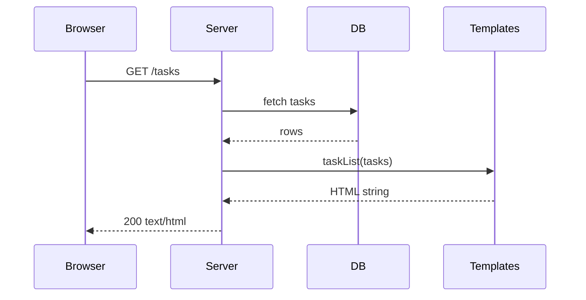
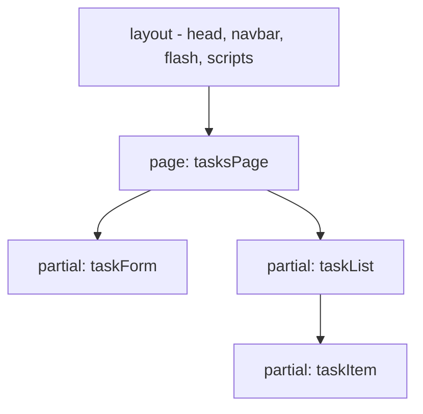

# Lecture 8 — Server-side templating, escaping, XSS

**Goals:** generate HTML on the server with plain JavaScript template literals, compose layouts and partials, and understand why escaping is mandatory.

### 1. Server-side rendering (SSR)

The browser receives finished HTML: fast first paint, SEO-friendly, works without JS.

### 2. Cross-Site Scripting (XSS)
```js
const title = '';
`<h3>${title}</h3>`  // executes the attacker's script in every visitor's browser!
```
Fix: **escape on output**, based on the context:
```js
const MAP = { '&': '&amp;', '<': '&lt;', '>': '&gt;', '"': '&quot;', "'": '&#39;' };
export const escapeHtml = (v) => String(v ?? '').replace(/[&<>"']/g, (c) => MAP[c]);
```
| Context | Rule |
|---------|------|
| Element text | `escapeHtml` |
| Quoted attribute `value="..."` | `escapeHtml` (always quote attributes) |
| URL attribute `href` | also validate the scheme (`javascript:` is dangerous) |
| Inside `<script>` / event handlers | avoid — pass data via `data-*` attributes |

Defence in depth: `Content-Security-Policy` header, `HttpOnly` cookies (lecture 14).

### 3. A tiny safe-by-default template engine
Tagged template literals let us **escape everything by default** and mark trusted HTML explicitly:
```js
class SafeHtml { constructor(s) { this.value = s; } toString() { return this.value; } }
export const raw = (s) => new SafeHtml(s);

function render(v) {
  if (v == null || v === false) return '';
  if (Array.isArray(v)) return v.map(render).join('');
  if (v instanceof SafeHtml) return v.value;
  return escapeHtml(v);
}

export function html(strings, ...values) {
  let out = strings[0];
  values.forEach((v, i) => { out += render(v) + strings[i + 1]; });
  return new SafeHtml(out);
}
```
```js
html`<h3>${task.title}</h3>`                      // escaped
html`<ul>${tasks.map(t => html`<li>${t.title}</li>`)}</ul>`  // nested, arrays
html`${task.done && html`<span class="badge text-bg-success">done</span>`}`
```

### 4. Layouts and partials

```js
export const layout = ({ title, user, body }) => html`<!doctype html>
<html lang="en"><head>
  <meta charset="utf-8"><meta name="viewport" content="width=device-width, initial-scale=1">
  <title>${title} · Task board</title>
  <link href="https://cdn.jsdelivr.net/npm/bootstrap@5.3.3/dist/css/bootstrap.min.css" rel="stylesheet">
</head><body>
  ${navbar(user)}
  <main class="container py-4">${body}</main>
  <script src="https://unpkg.com/htmx.org@2.0.3"></script>
</body></html>`;

export const taskItem = (t) => html`
  <li class="list-group-item d-flex justify-content-between" id="task-${t.id}">
    <span class="${t.done ? 'text-decoration-line-through' : ''}">${t.title}</span>
  </li>`;
```
Partials are the key to HTMX: the **same function** renders a fragment for the full page *and* for a partial response.

### 5. Alternatives
| Option | Notes |
|--------|-------|
| Template literals (ours) | zero deps, plain JS, safe-by-default with a tag |
| EJS, Nunjucks, Handlebars, Eta | separate files, auto-escaping, more syntax |
| JSX on the server | needs a build step |
Any of them is fine for the project as long as escaping is on.

### 6. Rendering forms with errors
```js
export const taskForm = ({ values = {}, errors = {} } = {}) => html`
<form method="post" action="/tasks" novalidate>
  <input class="form-control ${errors.title ? 'is-invalid' : ''}" name="title" value="${values.title}">
  ${errors.title && html`<div class="invalid-feedback">${errors.title}</div>`}
  <button class="btn btn-primary mt-2">Add</button>
</form>`;
```
On a validation failure re-render with status **422** and the user's values kept.

### Recap questions
1. Describe a stored XSS attack against a task board.
2. Why is "escape on output" better than "sanitize on input"?
3. How does the `html` tag know which values are trusted?
4. Why is escaping not sufficient for `href` attributes?
5. Why is a partial-based template structure useful for HTMX?
