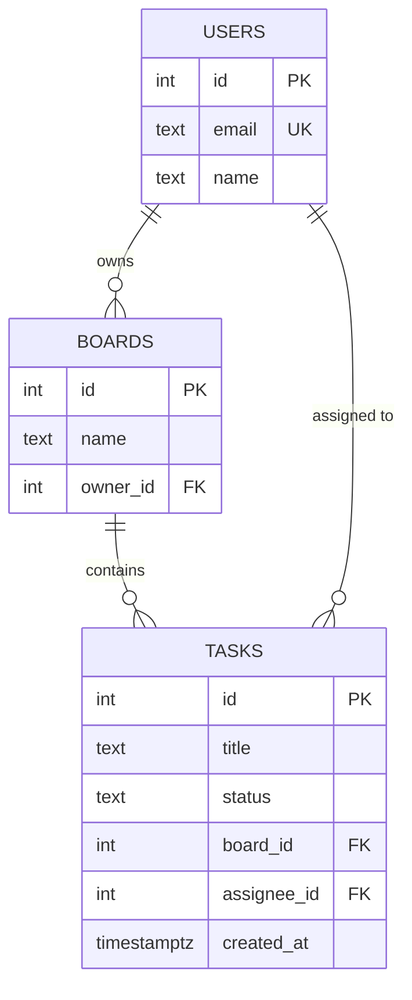
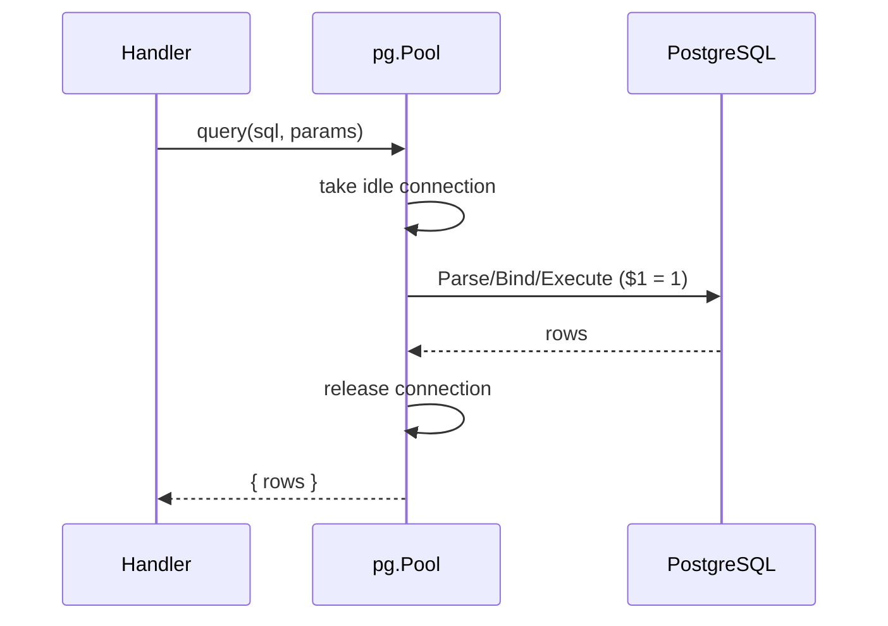

# Lecture 9 — Relational databases & SQL in PostgreSQL (with `pg`)

**Goals:** model data relationally, write SQL, and query PostgreSQL from Node *without* an ORM, so we understand what Prisma generates later.

### 1. The relational model
Tables (relations) hold rows. Each row has a **primary key**, and relationships are expressed with **foreign keys**.



### 2. DDL
```sql
CREATE TABLE users (
  id         serial PRIMARY KEY,
  email      text NOT NULL UNIQUE,
  name       text NOT NULL
);
CREATE TABLE boards (
  id       serial PRIMARY KEY,
  name     text NOT NULL,
  owner_id int  NOT NULL REFERENCES users(id) ON DELETE CASCADE
);
CREATE TABLE tasks (
  id          serial PRIMARY KEY,
  title       text NOT NULL CHECK (length(title) BETWEEN 1 AND 200),
  status      text NOT NULL DEFAULT 'TODO' CHECK (status IN ('TODO','DOING','DONE')),
  board_id    int  NOT NULL REFERENCES boards(id) ON DELETE CASCADE,
  assignee_id int  REFERENCES users(id) ON DELETE SET NULL,
  created_at  timestamptz NOT NULL DEFAULT now()
);
CREATE INDEX tasks_board_status_idx ON tasks (board_id, status);
```
Normalisation in brief: 1NF has atomic values, 2NF/3NF means no attribute depends on part of a key or on a non-key attribute. In practice: **one fact in one place**.

### 3. DML and queries
```sql
INSERT INTO users (email, name) VALUES ('ann@uni.edu', 'Ann') RETURNING id;
UPDATE tasks SET status = 'DONE' WHERE id = 7;
DELETE FROM tasks WHERE id = 7;

SELECT t.id, t.title, u.name AS assignee
FROM tasks t
LEFT JOIN users u ON u.id = t.assignee_id
WHERE t.board_id = 1 AND t.status <> 'DONE'
ORDER BY t.created_at DESC
LIMIT 20 OFFSET 0;

SELECT status, count(*) FROM tasks WHERE board_id = 1 GROUP BY status;
```
JOIN types: `INNER` returns only matches, `LEFT` keeps all rows from the left side, `FULL` keeps everything.

### 4. Using `pg` from Node
```js
import pg from 'pg';
export const pool = new pg.Pool({ connectionString: process.env.DATABASE_URL, max: 10 });

export async function listTasks(boardId) {
  const { rows } = await pool.query(
    'SELECT id, title, status FROM tasks WHERE board_id = $1 ORDER BY id', [boardId]);
  return rows;
}
```


### 5. SQL injection
```js
// NEVER:
pool.query(`SELECT * FROM users WHERE email = '${email}'`);  // email = "' OR '1'='1"
// ALWAYS: parameters
pool.query('SELECT * FROM users WHERE email = $1', [email]);
```
Parameters are sent separately from the SQL text, so they can never change its structure.

### 6. Transactions
```js
const client = await pool.connect();
try {
  await client.query('BEGIN');
  await client.query('UPDATE tasks SET board_id = $1 WHERE board_id = $2', [to, from]);
  await client.query('DELETE FROM boards WHERE id = $1', [from]);
  await client.query('COMMIT');
} catch (e) { await client.query('ROLLBACK'); throw e; }
finally { client.release(); }
```
ACID: Atomicity, Consistency, Isolation (default `READ COMMITTED`), Durability.

### 7. Pain points that motivate an ORM
- Mapping `snake_case` rows to objects by hand
- Schema changes need hand-written migration scripts
- No type/autocomplete help, so typos show up only at runtime
- Repetitive CRUD SQL

### Recap questions
1. What do `ON DELETE CASCADE` and `ON DELETE SET NULL` do? When would you use each?
2. Write a query returning the number of open tasks per user.
3. Why does a parameterised query prevent SQL injection?
4. Why use a connection pool?
5. Which index helps `WHERE board_id = ? AND status = ?` and why?
