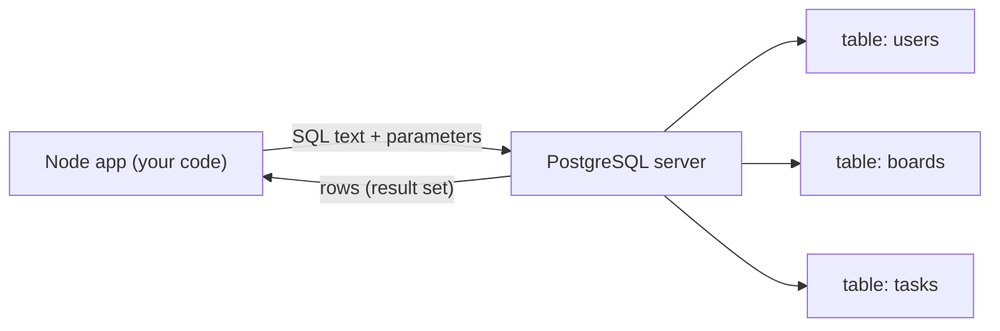
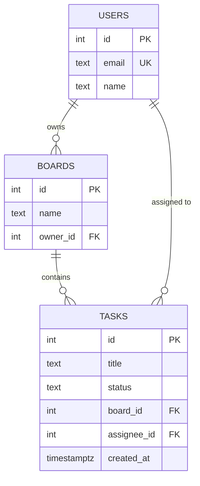
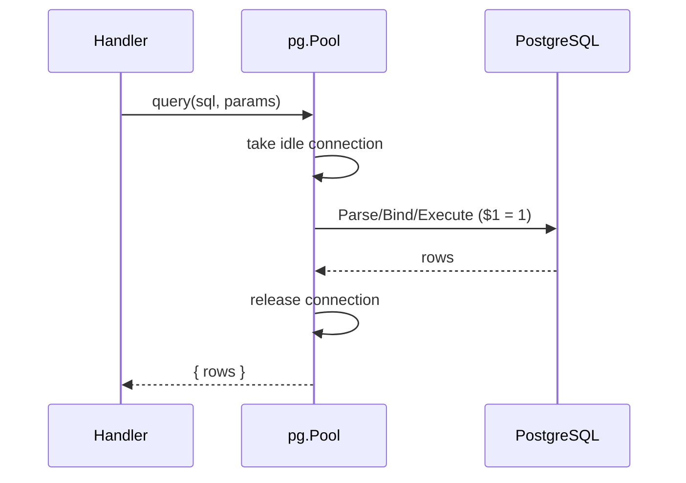
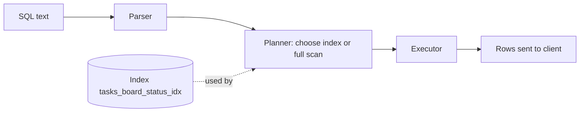
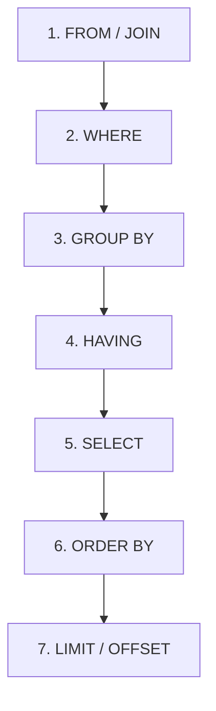

# Lecture 9 — Relational databases & SQL in PostgreSQL (with `pg`)

**Goals:** model data relationally, write SQL, and query PostgreSQL from Node *without* an ORM, so we understand what Prisma generates later.

### In plain words
Think of a database as a very strict **spreadsheet workbook**. Each *table* is a sheet, each *row* is one record (one user, one task), and each *column* has a fixed type, just like a column in a paper form that only accepts dates. The **primary key** works like a library card number: every row has its own, and no two are the same. A **foreign key** is a reference to someone else's card number. A task says "I belong to board #3" instead of copying the whole board onto the task.

**SQL** is the language you use to ask the librarian for things: "give me all unfinished tasks on board 1, newest first". PostgreSQL is the librarian. `pg` is the phone line from Node to that librarian. See also [the glossary](../resources/glossary.md) for terms like *primary key*, *index* and *transaction*.



### 1. The relational model
Tables (relations) hold rows. Each row has a **primary key**, and relationships are expressed with **foreign keys**.



### 2. DDL
```sql
CREATE TABLE users (
  id         serial PRIMARY KEY,
  email      text NOT NULL UNIQUE,
  name       text NOT NULL
);
CREATE TABLE boards (
  id       serial PRIMARY KEY,
  name     text NOT NULL,
  owner_id int  NOT NULL REFERENCES users(id) ON DELETE CASCADE
);
CREATE TABLE tasks (
  id          serial PRIMARY KEY,
  title       text NOT NULL CHECK (length(title) BETWEEN 1 AND 200),
  status      text NOT NULL DEFAULT 'TODO' CHECK (status IN ('TODO','DOING','DONE')),
  board_id    int  NOT NULL REFERENCES boards(id) ON DELETE CASCADE,
  assignee_id int  REFERENCES users(id) ON DELETE SET NULL,
  created_at  timestamptz NOT NULL DEFAULT now()
);
CREATE INDEX tasks_board_status_idx ON tasks (board_id, status);
```
Normalisation in brief: 1NF has atomic values, 2NF/3NF means no attribute depends on part of a key or on a non-key attribute. In practice: **one fact in one place**.

### 3. DML and queries
```sql
INSERT INTO users (email, name) VALUES ('ann@uni.edu', 'Ann') RETURNING id;
UPDATE tasks SET status = 'DONE' WHERE id = 7;
DELETE FROM tasks WHERE id = 7;

SELECT t.id, t.title, u.name AS assignee
FROM tasks t
LEFT JOIN users u ON u.id = t.assignee_id
WHERE t.board_id = 1 AND t.status <> 'DONE'
ORDER BY t.created_at DESC
LIMIT 20 OFFSET 0;

SELECT status, count(*) FROM tasks WHERE board_id = 1 GROUP BY status;
```
JOIN types: `INNER` returns only matches, `LEFT` keeps all rows from the left side, `FULL` keeps everything.

### 4. Using `pg` from Node
```js
import pg from 'pg';
export const pool = new pg.Pool({ connectionString: process.env.DATABASE_URL, max: 10 });

export async function listTasks(boardId) {
  const { rows } = await pool.query(
    'SELECT id, title, status FROM tasks WHERE board_id = $1 ORDER BY id', [boardId]);
  return rows;
}
```


### 5. SQL injection
```js
// NEVER:
pool.query(`SELECT * FROM users WHERE email = '${email}'`);  // email = "' OR '1'='1"
// ALWAYS: parameters
pool.query('SELECT * FROM users WHERE email = $1', [email]);
```
Parameters are sent separately from the SQL text, so they can never change its structure.

### 6. Transactions
```js
const client = await pool.connect();
try {
  await client.query('BEGIN');
  await client.query('UPDATE tasks SET board_id = $1 WHERE board_id = $2', [to, from]);
  await client.query('DELETE FROM boards WHERE id = $1', [from]);
  await client.query('COMMIT');
} catch (e) { await client.query('ROLLBACK'); throw e; }
finally { client.release(); }
```
ACID: Atomicity, Consistency, Isolation (default `READ COMMITTED`), Durability.

### 7. Pain points that motivate an ORM
- Mapping `snake_case` rows to objects by hand
- Schema changes need hand-written migration scripts
- No type/autocomplete help, so typos show up only at runtime
- Repetitive CRUD SQL

### 8. More theory: how a query is executed
When PostgreSQL receives a `SELECT`, it does not just read the table top to bottom. It goes through several stages:

1. **Parse:** check the SQL grammar (a typo such as `SELECT * FORM tasks` fails here).
2. **Plan:** the *planner* picks the cheapest way to answer. That could be scanning the whole table (*Seq Scan*) or jumping straight to matching rows through an index (*Index Scan*).
3. **Execute:** read the rows, apply `WHERE`, `JOIN`, `GROUP BY`, `ORDER BY` and `LIMIT`, then stream the result back.



An **index** is like the index at the back of a textbook. Without it, you read every page to find "HTMX". With it, you jump straight to page 212. Indexes speed up reads but make every `INSERT`/`UPDATE` slightly slower and take up disk space, so add them for columns you filter or join on often.

```sql
EXPLAIN ANALYZE
SELECT id, title FROM tasks WHERE board_id = 1 AND status = 'TODO';
-- Look for "Index Scan using tasks_board_status_idx" vs "Seq Scan on tasks"
```

The logical order in which SQL clauses are evaluated differs from the order you write them in. This explains why you can't use a `SELECT` alias inside `WHERE`:



### 9. Worked example: "open tasks per user" step by step
Goal: show each user with the number of tasks assigned to them that are not `DONE`, including users with zero.

**Step 1: start from the table you want one row per item for (users).**
```sql
SELECT u.id, u.name FROM users u;
```
**Step 2: attach tasks with a LEFT JOIN so users without tasks are kept.**
```sql
SELECT u.id, u.name, t.id AS task_id
FROM users u
LEFT JOIN tasks t
  ON t.assignee_id = u.id      -- the relationship
 AND t.status <> 'DONE';       -- filter in ON, not WHERE, to keep users with 0 tasks
```
**Step 3: group and count.** `count(t.id)` counts only non-NULL values, so users without tasks get `0`.
```sql
SELECT u.id, u.name, count(t.id) AS open_tasks
FROM users u
LEFT JOIN tasks t ON t.assignee_id = u.id AND t.status <> 'DONE'
GROUP BY u.id, u.name
ORDER BY open_tasks DESC;
```
**Step 4: call it from Node with `pg`.**
```js
// Plain pg version (the task-board app uses Prisma instead)
import { pool } from './db-pg.js';              // the pg.Pool from section 4

export async function openTasksPerUser() {
  const sql = `
    SELECT u.id, u.name, count(t.id)::int AS open_tasks  -- ::int: pg returns bigint as a string otherwise
    FROM users u
    LEFT JOIN tasks t ON t.assignee_id = u.id AND t.status <> 'DONE'
    GROUP BY u.id, u.name
    ORDER BY open_tasks DESC`;
  const { rows } = await pool.query(sql);       // rows = [{ id: 1, name: 'Ann', open_tasks: 3 }, ...]
  return rows;
}
```

### 10. Worked example: a safe search with pagination
```js
// Search tasks of one board by title, page by page.
export async function searchTasks({ boardId, q = '', page = 1, pageSize = 20 }) {
  const limit = Math.min(Math.max(pageSize, 1), 100);   // clamp: never let the client ask for 1e9 rows
  const offset = (Math.max(page, 1) - 1) * limit;        // page 1 -> offset 0
  const { rows } = await pool.query(
    `SELECT id, title, status, created_at
       FROM tasks
      WHERE board_id = $1
        AND title ILIKE $2          -- ILIKE = case-insensitive LIKE
      ORDER BY created_at DESC
      LIMIT $3 OFFSET $4`,
    [boardId, `%${q}%`, limit, offset],  // the % wildcards live in the VALUE, not in the SQL text
  );
  // Map snake_case columns to camelCase by hand (one of the pains Prisma removes)
  return rows.map((r) => ({ id: r.id, title: r.title, status: r.status, createdAt: r.created_at }));
}
```

### Common beginner mistakes
- **Building SQL with template strings** (`` `... WHERE id = ${id}` ``). Always use `$1, $2` parameters.
- **Putting the filter of a LEFT JOIN into `WHERE`**, which silently turns it into an INNER JOIN and drops rows with no match.
- **Forgetting `ORDER BY`.** Without it, row order is *not guaranteed*, even if it looks stable today.
- **Creating a new `pg.Client` per request** instead of using one shared `Pool`, which exhausts connections.
- **Not releasing a client** taken with `pool.connect()` (missing `finally { client.release() }`).
- **Storing lists in one column** (`tags = 'home,work'`). That breaks 1NF, so use a separate table.
- **Expecting `count(*)` to be a JS number.** `pg` returns `bigint` as a string, so cast it with `::int`.

### Try it yourself
1. Create the three tables from section 2 in `psql` and insert 2 users, 2 boards and 5 tasks.
2. Write a query listing every board with its owner's name and its number of `DONE` tasks.
3. Delete a user and check what happens to their boards (`CASCADE`) and to tasks assigned to them (`SET NULL`).
4. Run `EXPLAIN ANALYZE` on a query filtering by `board_id` and `status`, drop the index, and compare.
5. Try the injection string `' OR '1'='1` against a string-concatenated query in a scratch script, then fix it with parameters.
6. Write a `pg` transaction that moves all tasks from one board to another and deletes the old board. Throw an error halfway through and confirm that nothing changed.

### Recap questions
1. What do `ON DELETE CASCADE` and `ON DELETE SET NULL` do? When would you use each?
2. Write a query returning the number of open tasks per user.
3. Why does a parameterised query prevent SQL injection?
4. Why use a connection pool?
5. Which index helps `WHERE board_id = ? AND status = ?` and why?
6. Why does moving a LEFT JOIN condition from `ON` to `WHERE` change the result?
7. In which logical order are `WHERE`, `GROUP BY`, `SELECT` and `ORDER BY` evaluated?
