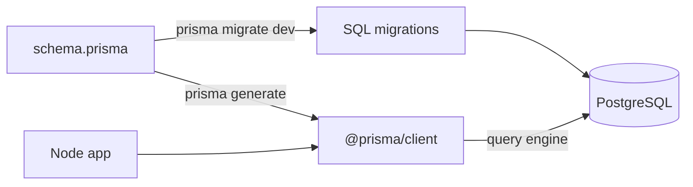
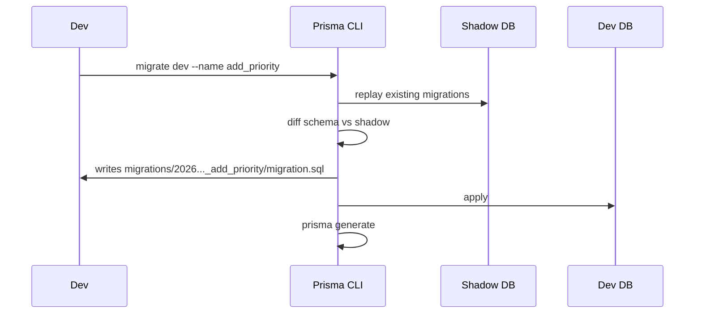

# Lecture 10 — ORM concepts and Prisma

**Goals:** understand what an ORM is, its trade-offs, and use Prisma for schema, migrations and CRUD.

### 1. What is an ORM?
An **Object-Relational Mapper** maps tables to objects or classes and generates SQL for you.

| Pattern | Examples | Idea |
|---------|----------|------|
| Active Record | Rails AR, Django ORM | objects save themselves (`task.save()`) |
| Data Mapper | Hibernate, SQLAlchemy, TypeORM | a separate mapper/session persists plain objects |
| Query builder / schema-first client | **Prisma**, Drizzle, Knex | typed client generated from a schema |

**Pros:** productivity, migrations, type safety, portability. **Cons:** hidden SQL, N+1 traps, leaky abstraction for complex queries (an escape hatch is `$queryRaw`).

### 2. Prisma architecture


### 3. Setup
```bash
npm i @prisma/client
npm i -D prisma
npx prisma init --datasource-provider postgresql
```

### 4. The schema
```prisma
generator client {
  provider = "prisma-client-js"
}

datasource db {
  provider = "postgresql"
  url      = env("DATABASE_URL")
}

enum Status {
  TODO
  DOING
  DONE
}

model Task {
  id        Int      @id @default(autoincrement())
  title     String   @db.VarChar(200)
  status    Status   @default(TODO)
  createdAt DateTime @default(now()) @map("created_at")
  updatedAt DateTime @updatedAt @map("updated_at")

  @@map("tasks")
}
```
`@map`/`@@map` keep SQL `snake_case` while JS uses `camelCase`.

### 5. Migrations
```bash
npx prisma migrate dev --name init      # dev: create + apply + generate
npx prisma migrate deploy               # prod/CI: apply existing ones
npx prisma migrate reset                # drop, re-apply, seed (dev only!)
npx prisma studio                       # GUI browser
```

Migrations are **committed**: they are the history of your schema.

### 6. The client and CRUD
```js
// src/db.js
import { PrismaClient } from '@prisma/client';
export const prisma = new PrismaClient({ log: ['warn', 'error'] });   // ONE instance per process
```
```js
const task = await prisma.task.create({ data: { title: 'Write lab 10' } });
const all  = await prisma.task.findMany({ where: { status: { not: 'DONE' } }, orderBy: { createdAt: 'desc' }, take: 20, skip: 0 });
const one  = await prisma.task.findUnique({ where: { id: 7 } });          // null if missing
const upd  = await prisma.task.update({ where: { id: 7 }, data: { status: 'DONE' } });
await prisma.task.delete({ where: { id: 7 } });
const n    = await prisma.task.count({ where: { title: { contains: 'lab', mode: 'insensitive' } } });
const sel  = await prisma.task.findMany({ select: { id: true, title: true } });
```
Generated SQL (with `log: ['query']`):
```sql
SELECT "public"."tasks"."id", "public"."tasks"."title" FROM "public"."tasks" WHERE 1=1 OFFSET $1
```

### 7. Error handling
```js
import { Prisma } from '@prisma/client';
try { await prisma.task.update({ where: { id }, data }); }
catch (e) {
  if (e instanceof Prisma.PrismaClientKnownRequestError && e.code === 'P2025') ctx.throw(404, 'Task not found');
  if (e instanceof Prisma.PrismaClientKnownRequestError && e.code === 'P2002') ctx.throw(409, 'Already exists');
  throw e;
}
```

### 8. Raw SQL when needed
```js
const stats = await prisma.$queryRaw`SELECT status, count(*)::int AS n FROM tasks GROUP BY status`;
```
Tagged templates are parameterised. Never use `$queryRawUnsafe` with user input.

### Recap questions
1. Compare Active Record and Data Mapper.
2. What do `prisma migrate dev` and `prisma migrate deploy` each do, and where do you use them?
3. Why should the app create only one `PrismaClient`?
4. What is the shadow database used for?
5. How do you turn Prisma error `P2025` into an HTTP 404?
