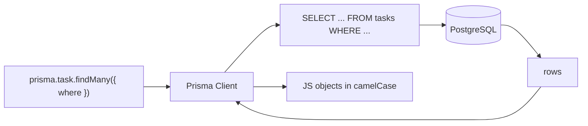
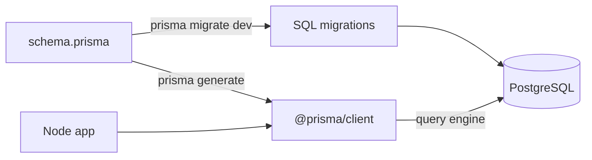
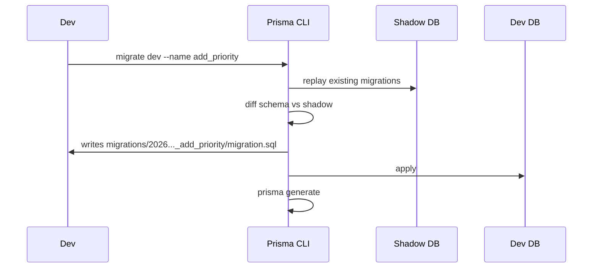
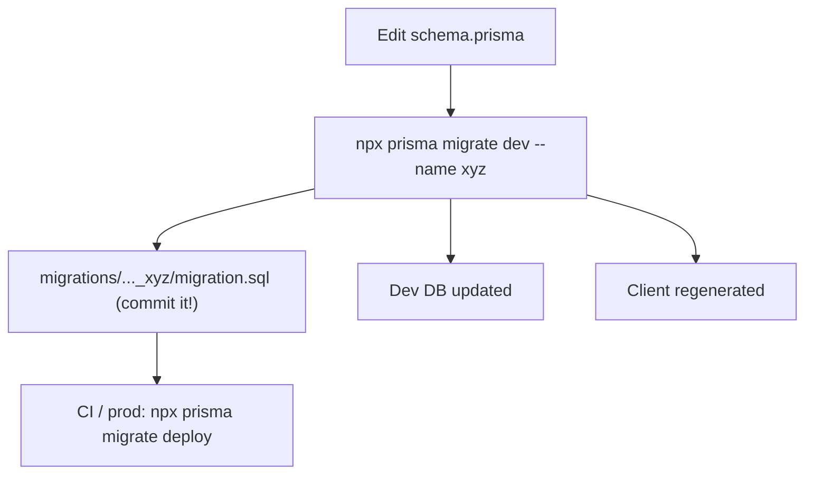
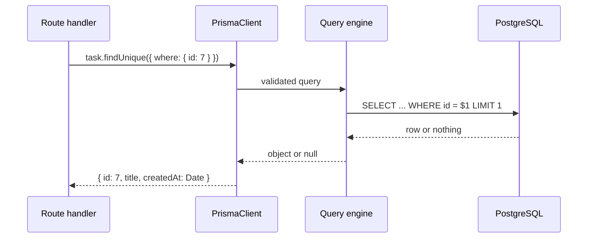

# Lecture 10 — ORM concepts and Prisma

**Goals:** understand what an ORM is, its trade-offs, and use Prisma for schema, migrations and CRUD.

### In plain words
Writing raw SQL is like phoning a restaurant and dictating every recipe step to the chef. An **ORM** is more like a waiter with a menu. You say "one task, with its tags, please", and the waiter turns that into the precise instructions (SQL) the kitchen (PostgreSQL) understands. **Prisma** goes further: you describe your data once in a *blueprint* (`schema.prisma`), and Prisma builds both the database tables (migrations) and a ready-made JavaScript client with autocomplete. The kitchen is still there, though, and sometimes you need to talk to the chef directly (`$queryRaw`). Terms used here are in the [glossary](../resources/glossary.md).



### 1. What is an ORM?
An **Object-Relational Mapper** maps tables to objects or classes and generates SQL for you.

| Pattern | Examples | Idea |
|---------|----------|------|
| Active Record | Rails AR, Django ORM | objects save themselves (`task.save()`) |
| Data Mapper | Hibernate, SQLAlchemy, TypeORM | a separate mapper/session persists plain objects |
| Query builder / schema-first client | **Prisma**, Drizzle, Knex | typed client generated from a schema |

**Pros:** productivity, migrations, type safety, portability. **Cons:** hidden SQL, N+1 traps, leaky abstraction for complex queries (an escape hatch is `$queryRaw`).

### 2. Prisma architecture


### 3. Setup
```bash
npm i @prisma/client
npm i -D prisma
npx prisma init --datasource-provider postgresql
```

### 4. The schema
```prisma
generator client {
  provider = "prisma-client-js"
}

datasource db {
  provider = "postgresql"
  url      = env("DATABASE_URL")
}

enum Status {
  TODO
  DOING
  DONE
}

model Task {
  id        Int      @id @default(autoincrement())
  title     String   @db.VarChar(200)
  status    Status   @default(TODO)
  createdAt DateTime @default(now()) @map("created_at")
  updatedAt DateTime @updatedAt @map("updated_at")

  @@map("tasks")
}
```
`@map`/`@@map` keep SQL `snake_case` while JS uses `camelCase`.

### 5. Migrations
```bash
npx prisma migrate dev --name init      # dev: create + apply + generate
npx prisma migrate deploy               # prod/CI: apply existing ones
npx prisma migrate reset                # drop, re-apply, seed (dev only!)
npx prisma studio                       # GUI browser
```

Migrations are **committed**: they are the history of your schema.

### 6. The client and CRUD
```js
// src/db.js
import { PrismaClient } from '@prisma/client';
export const prisma = new PrismaClient({ log: ['warn', 'error'] });   // ONE instance per process
```
```js
const task = await prisma.task.create({ data: { title: 'Write lab 10' } });
const all  = await prisma.task.findMany({ where: { status: { not: 'DONE' } }, orderBy: { createdAt: 'desc' }, take: 20, skip: 0 });
const one  = await prisma.task.findUnique({ where: { id: 7 } });          // null if missing
const upd  = await prisma.task.update({ where: { id: 7 }, data: { status: 'DONE' } });
await prisma.task.delete({ where: { id: 7 } });
const n    = await prisma.task.count({ where: { title: { contains: 'lab', mode: 'insensitive' } } });
const sel  = await prisma.task.findMany({ select: { id: true, title: true } });
```
Generated SQL (with `log: ['query']`):
```sql
SELECT "public"."tasks"."id", "public"."tasks"."title" FROM "public"."tasks" WHERE 1=1 OFFSET $1
```

### 7. Error handling
```js
import { Prisma } from '@prisma/client';
try { await prisma.task.update({ where: { id }, data }); }
catch (e) {
  if (e instanceof Prisma.PrismaClientKnownRequestError && e.code === 'P2025') ctx.throw(404, 'Task not found');
  if (e instanceof Prisma.PrismaClientKnownRequestError && e.code === 'P2002') ctx.throw(409, 'Already exists');
  throw e;
}
```

### 8. Raw SQL when needed
```js
const stats = await prisma.$queryRaw`SELECT status, count(*)::int AS n FROM tasks GROUP BY status`;
```
Tagged templates are parameterised. Never use `$queryRawUnsafe` with user input.

### 9. More theory: schema-first workflow and the type mapping
Prisma's **single source of truth** is `schema.prisma`. You never edit tables by hand. Instead you:

1. change the schema,
2. run `migrate dev`, which writes a new SQL migration file and applies it,
3. let `generate` rebuild the client so new fields show up in autocomplete.



| Prisma type | PostgreSQL type | JS value |
|-------------|-----------------|----------|
| `Int` | `integer` | `number` |
| `String` | `text` (or `@db.VarChar(n)`) | `string` |
| `Boolean` | `boolean` | `boolean` |
| `DateTime` | `timestamp(3)` | `Date` |
| `enum Status` | PostgreSQL enum | `'TODO'` string |
| `Field?` | nullable column | `null` allowed |

The life of one `findUnique` call:


### 10. Worked example: adding a `priority` field end to end
**Step 1: change the schema.**
```prisma
enum Priority {
  LOW
  MEDIUM
  HIGH
}

model Task {
  // ...existing fields...
  priority Priority @default(MEDIUM)   // default so existing rows stay valid
}
```
**Step 2: create and apply the migration.**
```bash
npx prisma migrate dev --name add_priority
# creates prisma/migrations/<timestamp>_add_priority/migration.sql
```
**Step 3: use it in code.** The client now knows `priority`:
```js
// src/routes/tasks.js (simplified from the task-board app)
import { prisma } from '../db.js';                 // the ONE shared client

export async function createTask(ctx) {
  const boardId = Number(ctx.params.id);            // params are strings, so convert
  const priority = ['LOW', 'MEDIUM', 'HIGH'].includes(ctx.body.priority)
    ? ctx.body.priority                             // accept only known values
    : 'MEDIUM';
  const task = await prisma.task.create({
    data: { title: ctx.body.title.trim(), priority, boardId },
    select: { id: true, title: true, priority: true },   // return only what the view needs
  });
  return ctx.html(`<li id="task-${task.id}">${task.title}</li>`); // real app: html`` tag escapes!
}
```
**Step 4: query by it.**
```js
const urgent = await prisma.task.findMany({
  where: { boardId, priority: 'HIGH', status: { not: 'DONE' } }, // AND of all conditions
  orderBy: [{ priority: 'desc' }, { createdAt: 'asc' }],          // several sort keys
});
```

### 11. Worked example: "update or 404" helper
```js
import { Prisma } from '@prisma/client';
import { prisma } from '../db.js';

// Updates a task's status; turns "record not found" into a clean HTTP 404.
export async function setStatus(ctx, id, status) {
  try {
    return await prisma.task.update({ where: { id }, data: { status } });
  } catch (e) {
    // P2025 = "An operation failed because it depends on one or more records that were required but not found"
    if (e instanceof Prisma.PrismaClientKnownRequestError && e.code === 'P2025') {
      ctx.throw(404, 'Task not found');           // HttpError handled by the error middleware
    }
    throw e;                                       // anything else is a real 500
  }
}
```

### Common beginner mistakes
- **Calling `new PrismaClient()` in every file or request**, which opens too many connections. Export one instance from `src/db.js`.
- **Editing the database by hand** (in psql or Studio) instead of through migrations. The schema and the DB then drift apart.
- **Editing an already-applied migration file.** Create a new migration instead.
- **Running `migrate dev` or `migrate reset` in production.** Use `migrate deploy`.
- **Forgetting `await`**, so you get a pending Promise instead of data.
- **Using `findUnique` on a non-unique field.** It only accepts `@id`/`@unique` fields, so use `findFirst` otherwise.
- **Passing `req` strings straight into `where: { id }`.** Convert them to numbers first.
- **Reaching for `$queryRawUnsafe` with string concatenation**, which brings SQL injection right back.

### Try it yourself
1. Add a `description String?` field to `Task`, migrate, and look at the generated `migration.sql`.
2. Enable `log: ['query']` and write down the SQL for `findMany`, `count` and `update`.
3. Write a function `renameTask(id, title)` that returns 404 on `P2025`.
4. Add a `@unique` to a field, insert a duplicate, and catch `P2002` as 409.
5. Use `prisma studio` to browse the data, then compare it with `psql`.
6. Rewrite the "open tasks per user" query of Lecture 9 using `$queryRaw` with a tagged template.

### Recap questions
1. Compare Active Record and Data Mapper.
2. What do `prisma migrate dev` and `prisma migrate deploy` each do, and where do you use them?
3. Why should the app create only one `PrismaClient`?
4. What is the shadow database used for?
5. How do you turn Prisma error `P2025` into an HTTP 404?
6. Why should a new non-null column usually get a `@default`?
7. When would you choose `select` over returning the full model?
