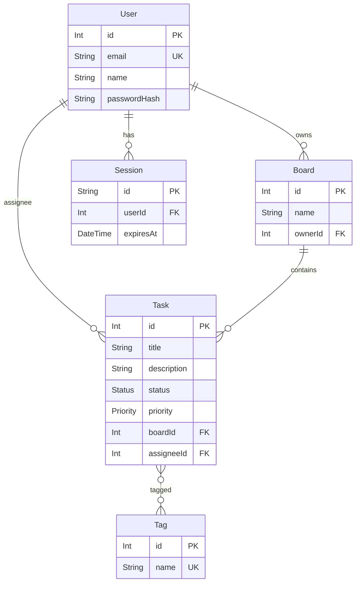
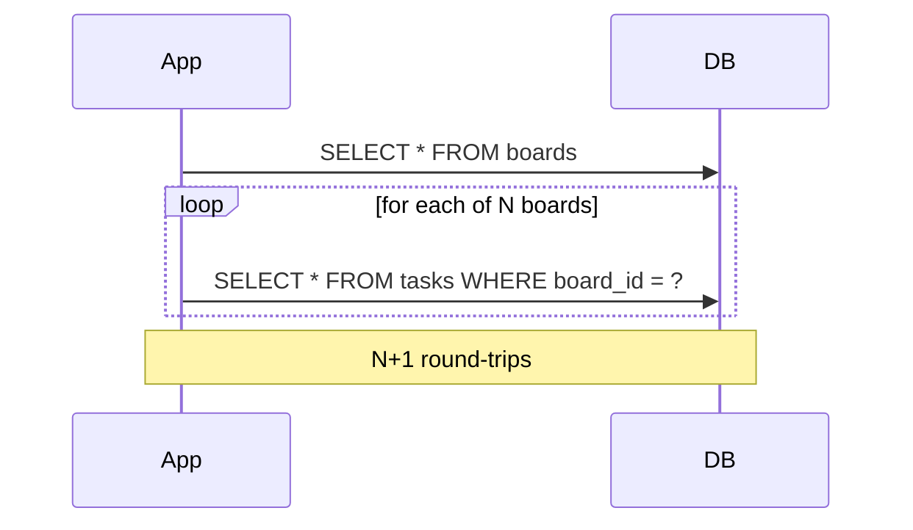

# Lecture 11 — Relations, transactions, N+1, seeding

**Goals:** model 1–N and N–M relations in Prisma, load related data efficiently, keep data consistent with transactions, and seed a database.

### 1. The full Task board model


```prisma
model User {
  id           Int       @id @default(autoincrement())
  email        String    @unique
  name         String
  passwordHash String    @map("password_hash")
  boards       Board[]
  tasks        Task[]    @relation("Assignee")
  sessions     Session[]
  @@map("users")
}

model Board {
  id      Int    @id @default(autoincrement())
  name    String
  owner   User   @relation(fields: [ownerId], references: [id], onDelete: Cascade)
  ownerId Int    @map("owner_id")
  tasks   Task[]
  @@map("boards")
}

model Task {
  id         Int      @id @default(autoincrement())
  title      String   @db.VarChar(200)
  status     Status   @default(TODO)
  board      Board    @relation(fields: [boardId], references: [id], onDelete: Cascade)
  boardId    Int      @map("board_id")
  assignee   User?    @relation("Assignee", fields: [assigneeId], references: [id], onDelete: SetNull)
  assigneeId Int?     @map("assignee_id")
  tags       Tag[]                                   // implicit many-to-many (_TagToTask)
  @@index([boardId, status])
  @@map("tasks")
}

model Tag {
  id    Int    @id @default(autoincrement())
  name  String @unique
  tasks Task[]
  @@map("tags")
}
```
For an N–M relation with extra data (e.g. `addedAt`), use an **explicit** join model `TaskTag { taskId, tagId, addedAt, @@id([taskId, tagId]) }`.

### 2. Reading relations
```js
const board = await prisma.board.findUnique({
  where: { id },
  include: {
    owner: { select: { name: true } },
    tasks: { orderBy: { id: 'asc' }, include: { tags: true, assignee: { select: { name: true } } } },
  },
});
// filter by relation
await prisma.task.findMany({ where: { tags: { some: { name: 'urgent' } }, board: { ownerId: userId } } });
// aggregate
await prisma.task.groupBy({ by: ['status'], where: { boardId: id }, _count: true });
```

### 3. Nested writes
```js
await prisma.task.create({
  data: {
    title: 'Prepare lab 11',
    board: { connect: { id: boardId } },
    tags: { connectOrCreate: [{ where: { name: 'teaching' }, create: { name: 'teaching' } }] },
  },
});
await prisma.task.update({ where: { id }, data: { tags: { set: [], connect: [{ id: 2 }] } } });
```

### 4. The N+1 problem
```js
// BAD: 1 query for boards + N queries for tasks
const boards = await prisma.board.findMany();
for (const b of boards) b.tasks = await prisma.task.findMany({ where: { boardId: b.id } });
```

```js
// GOOD: 2 queries total (Prisma batches with WHERE board_id IN (...))
const boards = await prisma.board.findMany({ include: { tasks: true } });
```
Detect it with `log: ['query']` and count the queries per request.

### 5. Transactions
```js
// a) sequential operations, all-or-nothing
await prisma.$transaction([
  prisma.task.deleteMany({ where: { boardId } }),
  prisma.board.delete({ where: { id: boardId } }),
]);

// b) interactive, with logic
await prisma.$transaction(async (tx) => {
  const open = await tx.task.count({ where: { assigneeId: userId, status: { not: 'DONE' } } });
  if (open >= 10) throw new HttpError(409, 'User has too many open tasks');
  await tx.task.update({ where: { id: taskId }, data: { assigneeId: userId } });
});
```
Keep interactive transactions short and never wait for the user (or HTTP calls) inside them.

### 6. Seeding
```js
// prisma/seed.js
import { PrismaClient } from '@prisma/client';
const prisma = new PrismaClient();
await prisma.tag.createMany({ data: [{ name: 'home' }, { name: 'work' }], skipDuplicates: true });
await prisma.user.upsert({ where: { email: 'demo@example.com' }, update: {}, create: { /* ... */ } });
await prisma.$disconnect();
```
`package.json`: `"prisma": { "seed": "node prisma/seed.js" }`, then run `npx prisma db seed`. Seeds must be **idempotent** (`upsert`, `skipDuplicates`).

### Recap questions
1. When do you need an explicit join model instead of an implicit N–M relation?
2. Explain N+1 and two ways to avoid it.
3. Difference between `include` and `select`?
4. When do you use a batch transaction versus an interactive transaction?
5. Why must seed scripts be idempotent?
