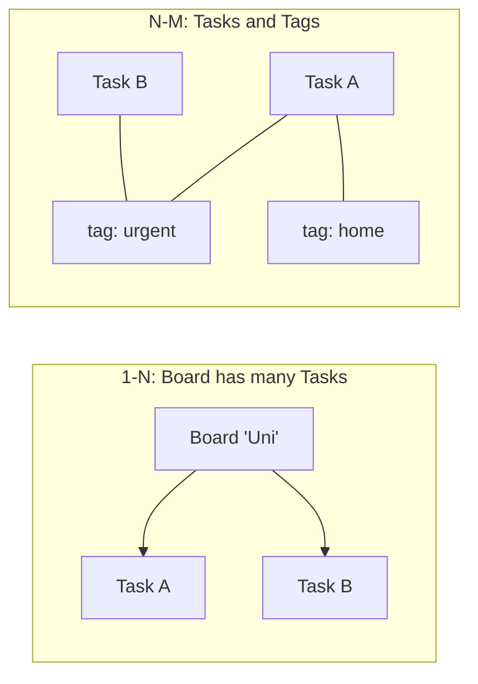
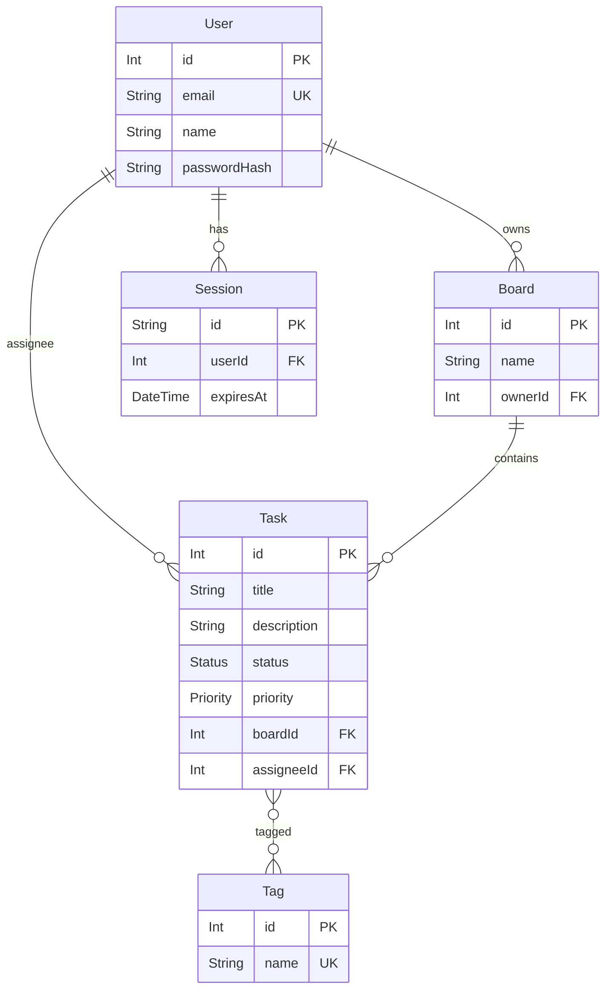
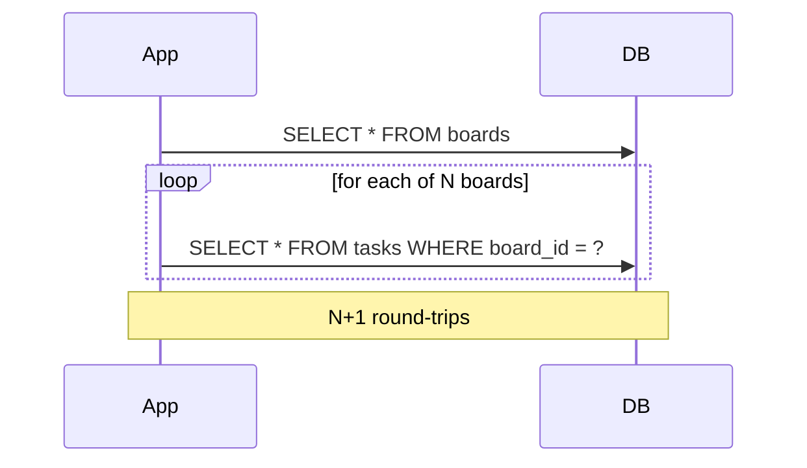
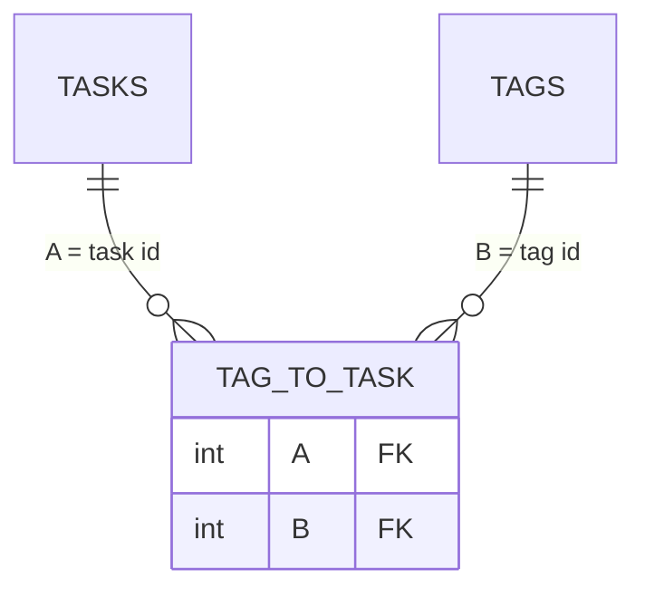
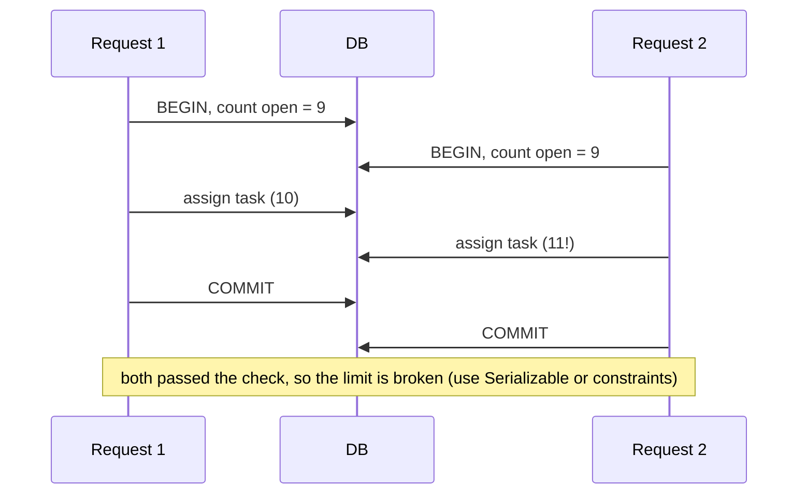

# Lecture 11 — Relations, transactions, N+1, seeding

**Goals:** model 1–N and N–M relations in Prisma, load related data efficiently, keep data consistent with transactions, and seed a database.

### In plain words
- **Relations** are how records point at each other. A *board* is like a folder, and *tasks* are sheets inside it (one-to-many). *Tags* are like coloured stickers: one sheet can have many stickers, and the same sticker colour is used on many sheets (many-to-many).
- **N+1** is like going to the supermarket once for each item on your shopping list instead of buying everything in one trip.
- A **transaction** is like a bank transfer. Money leaves account A *and* arrives in account B, or nothing happens at all.
- **Seeding** is like stocking a new shop with demo products before opening, so you can test the shelves.

See the [glossary](../resources/glossary.md) for *foreign key*, *join table* and *ACID*.



### 1. The full Task board model


```prisma
model User {
  id           Int       @id @default(autoincrement())
  email        String    @unique
  name         String
  passwordHash String    @map("password_hash")
  boards       Board[]
  tasks        Task[]    @relation("Assignee")
  sessions     Session[]
  @@map("users")
}

model Board {
  id      Int    @id @default(autoincrement())
  name    String
  owner   User   @relation(fields: [ownerId], references: [id], onDelete: Cascade)
  ownerId Int    @map("owner_id")
  tasks   Task[]
  @@map("boards")
}

model Task {
  id         Int      @id @default(autoincrement())
  title      String   @db.VarChar(200)
  status     Status   @default(TODO)
  board      Board    @relation(fields: [boardId], references: [id], onDelete: Cascade)
  boardId    Int      @map("board_id")
  assignee   User?    @relation("Assignee", fields: [assigneeId], references: [id], onDelete: SetNull)
  assigneeId Int?     @map("assignee_id")
  tags       Tag[]                                   // implicit many-to-many (_TagToTask)
  @@index([boardId, status])
  @@map("tasks")
}

model Tag {
  id    Int    @id @default(autoincrement())
  name  String @unique
  tasks Task[]
  @@map("tags")
}
```
For an N–M relation with extra data (e.g. `addedAt`), use an **explicit** join model `TaskTag { taskId, tagId, addedAt, @@id([taskId, tagId]) }`.

### 2. Reading relations
```js
const board = await prisma.board.findUnique({
  where: { id },
  include: {
    owner: { select: { name: true } },
    tasks: { orderBy: { id: 'asc' }, include: { tags: true, assignee: { select: { name: true } } } },
  },
});
// filter by relation
await prisma.task.findMany({ where: { tags: { some: { name: 'urgent' } }, board: { ownerId: userId } } });
// aggregate
await prisma.task.groupBy({ by: ['status'], where: { boardId: id }, _count: true });
```

### 3. Nested writes
```js
await prisma.task.create({
  data: {
    title: 'Prepare lab 11',
    board: { connect: { id: boardId } },
    tags: { connectOrCreate: [{ where: { name: 'teaching' }, create: { name: 'teaching' } }] },
  },
});
await prisma.task.update({ where: { id }, data: { tags: { set: [], connect: [{ id: 2 }] } } });
```

### 4. The N+1 problem
```js
// BAD: 1 query for boards + N queries for tasks
const boards = await prisma.board.findMany();
for (const b of boards) b.tasks = await prisma.task.findMany({ where: { boardId: b.id } });
```

```js
// GOOD: 2 queries total (Prisma batches with WHERE board_id IN (...))
const boards = await prisma.board.findMany({ include: { tasks: true } });
```
Detect it with `log: ['query']` and count the queries per request.

### 5. Transactions
```js
// a) sequential operations, all-or-nothing
await prisma.$transaction([
  prisma.task.deleteMany({ where: { boardId } }),
  prisma.board.delete({ where: { id: boardId } }),
]);

// b) interactive, with logic
await prisma.$transaction(async (tx) => {
  const open = await tx.task.count({ where: { assigneeId: userId, status: { not: 'DONE' } } });
  if (open >= 10) throw new HttpError(409, 'User has too many open tasks');
  await tx.task.update({ where: { id: taskId }, data: { assigneeId: userId } });
});
```
Keep interactive transactions short and never wait for the user (or HTTP calls) inside them.

### 6. Seeding
```js
// prisma/seed.js
import { PrismaClient } from '@prisma/client';
const prisma = new PrismaClient();
await prisma.tag.createMany({ data: [{ name: 'home' }, { name: 'work' }], skipDuplicates: true });
await prisma.user.upsert({ where: { email: 'demo@example.com' }, update: {}, create: { /* ... */ } });
await prisma.$disconnect();
```
`package.json`: `"prisma": { "seed": "node prisma/seed.js" }`, then run `npx prisma db seed`. Seeds must be **idempotent** (`upsert`, `skipDuplicates`).

### 7. More theory: how Prisma stores each relation kind
| Relation | Where is the foreign key? | Prisma syntax |
|----------|---------------------------|---------------|
| 1–1 (User–Profile) | on one side, with `@unique` | `user User @relation(fields: [userId], references: [id])` + `userId Int @unique` |
| 1–N (Board–Task) | on the "many" side (`tasks.board_id`) | `board Board @relation(...)` + list `tasks Task[]` |
| N–M implicit (Task–Tag) | in a hidden join table `_TagToTask(A, B)` | `tags Tag[]` / `tasks Task[]` |
| N–M explicit | in your own model `TaskTag` | two 1–N relations |



**Isolation in a nutshell.** Two requests can run transactions at the same time. Under PostgreSQL's default `READ COMMITTED`, each statement sees data committed before that statement started. A "check then write" sequence (count open tasks, then assign) can therefore race. For strict rules, use a unique constraint, `isolationLevel: 'Serializable'` (and retry on error `P2034`), or a single atomic `UPDATE ... WHERE`.



### 8. Worked example: a board page with counts, without N+1
Goal: a list of the user's boards, each with its number of tasks per status.
```js
import { prisma } from '../db.js';

export async function boardsOverview(userId) {
  // Query 1: the boards, plus a total count computed by the DB (no task rows loaded)
  const boards = await prisma.board.findMany({
    where: { ownerId: userId },                       // only MY boards (authorization!)
    orderBy: { name: 'asc' },
    select: { id: true, name: true, _count: { select: { tasks: true } } },
  });

  // Query 2: per-status counts for ALL those boards at once
  const grouped = await prisma.task.groupBy({
    by: ['boardId', 'status'],
    where: { boardId: { in: boards.map((b) => b.id) } }, // one IN (...) instead of N queries
    _count: { _all: true },
  });

  // Combine in JS: { [boardId]: { TODO: n, DOING: n, DONE: n } }
  const byBoard = {};
  for (const g of grouped) {
    byBoard[g.boardId] ??= { TODO: 0, DOING: 0, DONE: 0 };
    byBoard[g.boardId][g.status] = g._count._all;
  }
  return boards.map((b) => ({ ...b, total: b._count.tasks, counts: byBoard[b.id] ?? { TODO: 0, DOING: 0, DONE: 0 } }));
}
// Total: 2 queries, no matter whether the user has 3 boards or 300.
```

### 9. Worked example: moving a task safely between boards
```js
import { prisma } from '../db.js';

// Moves a task to another board; both boards must belong to the user.
export async function moveTask(ctx, taskId, targetBoardId) {
  const userId = ctx.state.user.id;
  return prisma.$transaction(async (tx) => {          // tx = a client bound to ONE transaction
    const task = await tx.task.findFirst({ where: { id: taskId, board: { ownerId: userId } } });
    if (!task) ctx.throw(404, 'Task not found');     // throwing => automatic ROLLBACK

    const target = await tx.board.findFirst({ where: { id: targetBoardId, ownerId: userId } });
    if (!target) ctx.throw(404, 'Board not found');

    return tx.task.update({ where: { id: taskId }, data: { boardId: targetBoardId } });
  });                                                  // returning normally => COMMIT
}
```
Note that we use `tx`, not `prisma`, inside the callback. A call on `prisma` would run *outside* the transaction.

### Common beginner mistakes
- **Querying relations inside a loop** (`for ... await prisma.x.findMany`), which is classic N+1.
- **Using `include` everywhere**, which loads huge object graphs. Use `select` for the fields you actually render.
- **Using `prisma` instead of `tx` inside `$transaction(async (tx) => ...)`.**
- **Calling `fetch()`, sending emails or waiting for user input inside a transaction**, which holds locks and times out.
- **Forgetting `onDelete`**, so deleting a board fails with a foreign-key error (or deletes more than expected).
- **Non-idempotent seeds** (`create` instead of `upsert`), which crash on the second run with `P2002`.
- **Confusing `connect` (link an existing row) and `create` (insert a new row)** in nested writes.

### Try it yourself
1. Add an explicit `TaskTag` model with an `addedAt` field and migrate.
2. Turn on `log: ['query']`, write the N+1 loop, count the queries, then fix it with `include`.
3. Write a function that returns all tasks tagged `urgent` across the current user's boards.
4. Write a `$transaction` that deletes a board and creates an "archive" log row. Force an error and check that both were rolled back.
5. Make `prisma/seed.js` create a demo user with 2 boards and 6 tasks, and run it twice.
6. Reproduce the race from section 7 with two `Promise.all` calls, then fix it with `isolationLevel: 'Serializable'`.

### Recap questions
1. When do you need an explicit join model instead of an implicit N–M relation?
2. Explain N+1 and two ways to avoid it.
3. Difference between `include` and `select`?
4. When do you use a batch transaction versus an interactive transaction?
5. Why must seed scripts be idempotent?
6. Where does the foreign key live in a 1–N relation?
7. Why can a "check, then update" transaction still break a rule under `READ COMMITTED`?
