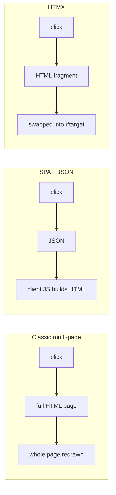
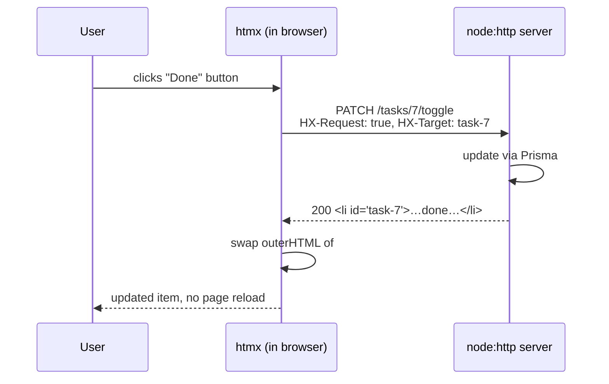
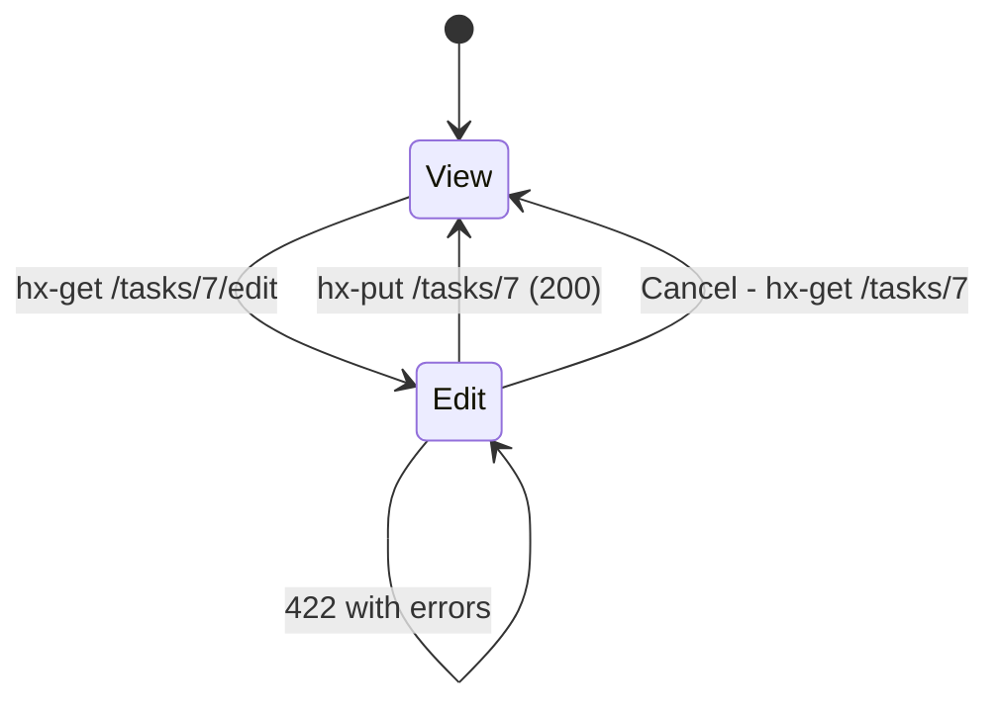
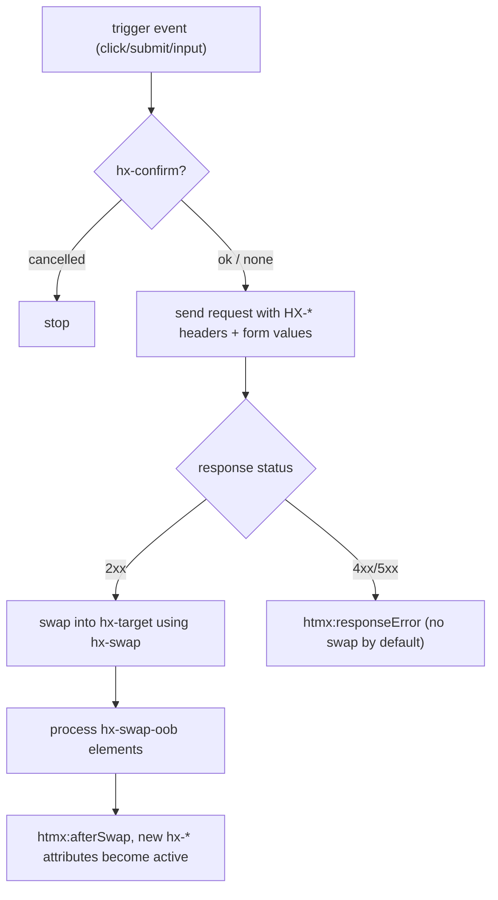

# Lecture 12 — HTMX: hypermedia-driven interactivity

**Goals:** build dynamic UIs by returning **HTML fragments** from the server, with no client-side framework.

### In plain words
A classic website works like ordering a **whole new newspaper** every time one headline changes: click a link, and the browser throws the page away and loads a new one. A React-style single-page app is like getting a box of raw ingredients (JSON) and cooking the page yourself in the browser. **HTMX** is in between. You ask the server for *just the new paragraph*, already printed (HTML), and HTMX glues it into the right spot on the page. The server stays the boss of what the page looks like, and you write almost no JavaScript. Terms such as *fragment*, *swap* and *target* are in the [glossary](../resources/glossary.md).



### 1. The idea
HTMX extends HTML: *any* element can issue *any* HTTP method on *any* event, and put the response *anywhere* in the page.
```html
<script src="https://unpkg.com/htmx.org@2.0.3"></script>
```


### 2. Core attributes
| Attribute | Purpose | Example |
|-----------|---------|---------|
| `hx-get/post/put/patch/delete` | request | `hx-delete="/tasks/7"` |
| `hx-trigger` | event | `keyup changed delay:300ms`, `load`, `every 5s`, `revealed` |
| `hx-target` | where to put the response | `#task-list`, `closest li`, `this` |
| `hx-swap` | how | `innerHTML` (default), `outerHTML`, `beforeend`, `afterbegin`, `delete`, `none` |
| `hx-select` | pick part of the response | `#content` |
| `hx-confirm` | confirm dialog | `"Delete task?"` |
| `hx-indicator` | loading spinner | `#spinner` |
| `hx-push-url` | update the address bar | `true` |
| `hx-boost` | AJAX-ify links/forms | on `<body>` |
| `hx-vals`, `hx-include` | extra params | `'{"status":"DONE"}'` |
| `hx-headers` | headers (CSRF!) | `'{"X-CSRF-Token":"..."}'` |

### 3. Examples from the Task board
**Add a task without a reload:**
```html
<form hx-post="/tasks" hx-target="#task-list" hx-swap="beforeend"
      hx-on::after-request="if(event.detail.successful) this.reset()">
  <input class="form-control" name="title" required>
  <button class="btn btn-primary">Add</button>
</form>
<ul id="task-list" class="list-group">…</ul>
```
**Toggle / delete:**
```html
<li id="task-7" class="list-group-item">
  <button hx-patch="/tasks/7/toggle" hx-target="closest li" hx-swap="outerHTML">✓</button>
  <button hx-delete="/tasks/7" hx-target="closest li" hx-swap="outerHTML swap:200ms"
          hx-confirm="Delete this task?">🗑</button>
</li>
```
Server: `DELETE` answers `200` with an **empty body**, so the `li` is replaced by nothing. (HTMX 2 does not swap on `204`.)

**Live search:**
```html
<input type="search" name="q" hx-get="/tasks/search" hx-trigger="input changed delay:300ms, search"
       hx-target="#task-list" hx-indicator="#spin">
```

**Inline edit (click-to-edit):** `GET /tasks/7/edit` returns a form fragment, `PUT /tasks/7` returns the display fragment.


### 4. Server side: full page or fragment?
```js
export async function listTasks(ctx) {
  const tasks = await prisma.task.findMany({ where: { boardId: ctx.params.id } });
  if (ctx.isHtmx) return ctx.html(taskList(tasks));          // fragment
  return ctx.render('Board', boardPage({ tasks }));           // full layout
}
// ctx.isHtmx = req.headers['hx-request'] === 'true' (boosted requests also set HX-Boosted)
```
Add `Vary: HX-Request` so that caches don't mix the two.

**Response headers HTMX understands:** `HX-Redirect`, `HX-Refresh`, `HX-Trigger` (fires client events, e.g. a toast), `HX-Retarget`, `HX-Reswap`, `HX-Push-Url`.

### 5. Validation errors with HTMX
HTMX by default does not swap 4xx/5xx responses. Options:
- return `422` + `HX-Retarget: #form` + `HX-Reswap: outerHTML`, together with `htmx.config.responseHandling` allowing 422 swaps, or
- return `200` with the re-rendered form containing errors (simplest, used in the reference app with `hx-target` = the form itself).

### 6. Out-of-band swaps
Update several regions with one response:
```html
<li id="task-8">…new task…</li>
<span id="todo-count" hx-swap-oob="true">5</span>
```

### 7. When HTMX is *not* enough
Highly interactive, offline-first or canvas-like apps (spreadsheets, editors) still need heavy client JS. For CRUD apps (most of the Web) hypermedia is simpler.

### 8. More theory: the request life cycle and events
Every HTMX interaction follows the same five questions: **which element** (the one with `hx-*`), **when** (`hx-trigger`, defaulting to `click` for buttons, `submit` for forms and `change` for inputs), **what request** (`hx-get`/`hx-post`/...), **where to put the answer** (`hx-target`, defaulting to the element itself) and **how** (`hx-swap`). Form fields inside a `<form>`, or the element's own `name`/`value`, are sent automatically.

HTMX also fires events you can listen to (`htmx:beforeRequest`, `htmx:afterSwap`, `htmx:responseError`, ...). This is handy for toasts, focusing inputs, or showing errors.



**Progressive enhancement.** Write forms that work *without* HTMX first (`<form method="post" action="/boards/1/tasks">`), then add `hx-post`. If JS fails to load, the app still works, and the server just returns a full page or a redirect when `HX-Request` is missing.

### 9. Worked example: "add task" end to end
**Step 1: the HTML (rendered by the server).**
```html
<!-- Works without JS (action/method) and with HTMX (hx-post) -->
<form action="/boards/1/tasks" method="post"
      hx-post="/boards/1/tasks"
      hx-target="#col-TODO"
      hx-swap="beforeend"
      hx-on::after-request="if (event.detail.successful) this.reset()">
  <input type="hidden" name="_csrf" value="...">
  <input class="form-control" name="title" required maxlength="200">
  <button class="btn btn-primary">Add</button>
</form>
<ul id="col-TODO" class="list-group"></ul>
```
`hx-target` names the TODO column list, and `beforeend` appends the new card at the end of it.

**Step 2: the route handler.**
```js
// Simplified from examples/task-board/src/routes/boards.js
router.post('/boards/:id/tasks', requireAuth, loadBoard, async (ctx) => {
  const { ok, values, errors } = validateTask(ctx.body);       // never trust the client
  if (!ok) {
    // Re-render the form with messages; 200 so HTMX swaps it (see section 5)
    return ctx.html(taskForm({ board: ctx.state.board, values, errors }));
  }
  const task = await prisma.task.create({
    data: { title: values.title, boardId: ctx.state.board.id },
  });
  if (ctx.isHtmx) return ctx.html(taskCard(task));             // fragment: just one <li>
  return ctx.redirect(`/boards/${ctx.state.board.id}`);        // no-JS fallback: 303 redirect
});
```
**Step 3: the fragment view.** It uses the escaping `html` tag so a title like `<script>` is harmless:
```js
export const taskCard = (t) => html`
  <li id="task-${t.id}" class="list-group-item d-flex justify-content-between">
    <span>${t.title}</span>
    <button class="btn btn-sm btn-outline-danger"
            hx-delete="/tasks/${t.id}" hx-target="closest li" hx-swap="outerHTML"
            hx-confirm="Delete this task?">Delete</button>
  </li>`;
```

### 10. Worked example: update a counter at the same time (OOB)
```js
// After toggling a task, return the new card AND the updated badge in one response.
router.patch('/tasks/:id/toggle', requireAuth, loadTask, async (ctx) => {
  const t = ctx.state.task;
  const updated = await prisma.task.update({
    where: { id: t.id },
    data: { status: t.status === 'DONE' ? 'TODO' : 'DONE' },
  });
  const open = await prisma.task.count({ where: { boardId: t.boardId, status: { not: 'DONE' } } });
  return ctx.html(html`
    ${taskCard(updated)}
    <span id="open-count" class="badge text-bg-secondary" hx-swap-oob="true">${open}</span>`);
  // The first element goes to hx-target; the element with hx-swap-oob replaces #open-count wherever it is.
});
```

### Common beginner mistakes
- **Returning a full page (with `<html>`, navbar...) to an HTMX request**, which nests a page inside the page. Check `ctx.isHtmx`.
- **Mixing up `innerHTML` and `outerHTML`.** Replacing the inside of an `<li>` with another `<li>` produces `<li><li>`.
- **Returning `204` from DELETE** and wondering why the row stays. HTMX 2 doesn't swap on 204, so return `200` with an empty body.
- **Expecting 4xx responses to be swapped.** They aren't by default, so configure `responseHandling` or return the form with 200.
- **Forgetting the CSRF token** in `hx-headers` or a hidden input, so every POST fails with 403.
- **Building fragments with plain template strings** instead of the escaping `html` tag, which opens up XSS.
- **Forgetting `Vary: HX-Request`**, so the browser or a proxy caches the fragment and later shows it as the full page.
- **Duplicate `id`s** in the page, so `hx-target="#task-7"` hits the wrong element.

### Try it yourself
1. Add a "Clear done" button that deletes all `DONE` tasks and swaps the column with `innerHTML`.
2. Make the live search show a Bootstrap spinner using `hx-indicator`.
3. Implement click-to-edit for the board name (GET edit form / PUT save / Cancel).
4. Return an OOB-updated counter badge when a task is added or deleted.
5. Send `HX-Trigger: {"toast":"Saved"}` from the server and show a Bootstrap toast with `document.body.addEventListener('toast', ...)`.
6. Disable JavaScript in DevTools and check that adding a task still works through the normal form post.

### Recap questions
1. What headers does HTMX add to every request? How does the server use them?
2. What is the difference between `hx-swap="innerHTML"` and `outerHTML`?
3. Why does the delete handler return 200 with an empty body instead of 204?
4. How do you implement "active search" with debouncing?
5. What is an out-of-band swap? Give a use case.
6. Why does the server need `Vary: HX-Request`?
7. What are the default triggers for a button, a form and an input?
8. What is progressive enhancement and how does HTMX support it?
