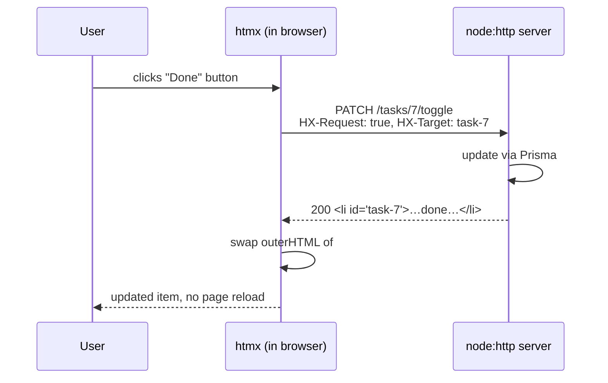
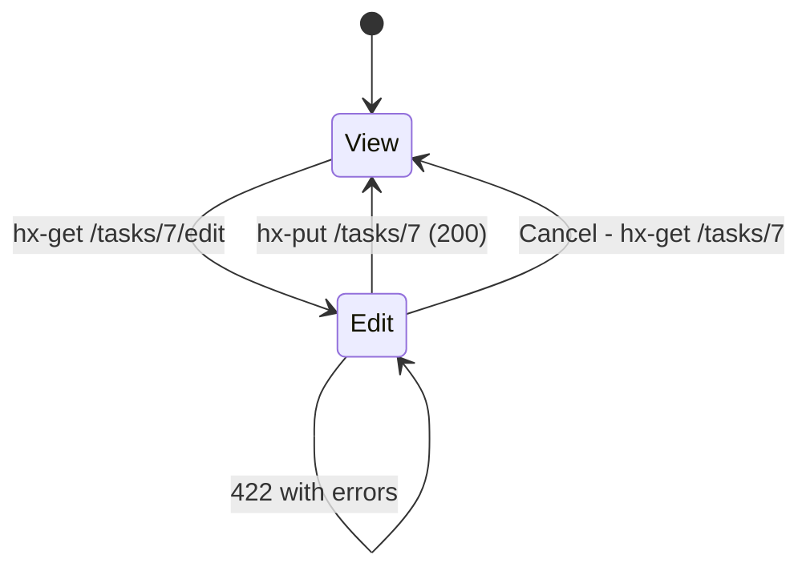

# Lecture 12 — HTMX: hypermedia-driven interactivity

**Goals:** build dynamic UIs by returning **HTML fragments** from the server, with no client-side framework.

### 1. The idea
HTMX extends HTML: *any* element can issue *any* HTTP method on *any* event, and put the response *anywhere* in the page.
```html
<script src="https://unpkg.com/htmx.org@2.0.3"></script>
```


### 2. Core attributes
| Attribute | Purpose | Example |
|-----------|---------|---------|
| `hx-get/post/put/patch/delete` | request | `hx-delete="/tasks/7"` |
| `hx-trigger` | event | `keyup changed delay:300ms`, `load`, `every 5s`, `revealed` |
| `hx-target` | where to put the response | `#task-list`, `closest li`, `this` |
| `hx-swap` | how | `innerHTML` (default), `outerHTML`, `beforeend`, `afterbegin`, `delete`, `none` |
| `hx-select` | pick part of the response | `#content` |
| `hx-confirm` | confirm dialog | `"Delete task?"` |
| `hx-indicator` | loading spinner | `#spinner` |
| `hx-push-url` | update the address bar | `true` |
| `hx-boost` | AJAX-ify links/forms | on `<body>` |
| `hx-vals`, `hx-include` | extra params | `'{"status":"DONE"}'` |
| `hx-headers` | headers (CSRF!) | `'{"X-CSRF-Token":"..."}'` |

### 3. Examples from the Task board
**Add a task without a reload:**
```html
<form hx-post="/tasks" hx-target="#task-list" hx-swap="beforeend"
      hx-on::after-request="if(event.detail.successful) this.reset()">
  <input class="form-control" name="title" required>
  <button class="btn btn-primary">Add</button>
</form>
<ul id="task-list" class="list-group">…</ul>
```
**Toggle / delete:**
```html
<li id="task-7" class="list-group-item">
  <button hx-patch="/tasks/7/toggle" hx-target="closest li" hx-swap="outerHTML">✓</button>
  <button hx-delete="/tasks/7" hx-target="closest li" hx-swap="outerHTML swap:200ms"
          hx-confirm="Delete this task?">🗑</button>
</li>
```
Server: `DELETE` answers `200` with an **empty body**, so the `li` is replaced by nothing. (HTMX 2 does not swap on `204`.)

**Live search:**
```html
<input type="search" name="q" hx-get="/tasks/search" hx-trigger="input changed delay:300ms, search"
       hx-target="#task-list" hx-indicator="#spin">
```

**Inline edit (click-to-edit):** `GET /tasks/7/edit` returns a form fragment, `PUT /tasks/7` returns the display fragment.


### 4. Server side: full page or fragment?
```js
export async function listTasks(ctx) {
  const tasks = await prisma.task.findMany({ where: { boardId: ctx.params.id } });
  if (ctx.isHtmx) return ctx.html(taskList(tasks));          // fragment
  return ctx.render('Board', boardPage({ tasks }));           // full layout
}
// ctx.isHtmx = req.headers['hx-request'] === 'true' (boosted requests also set HX-Boosted)
```
Add `Vary: HX-Request` so that caches don't mix the two.

**Response headers HTMX understands:** `HX-Redirect`, `HX-Refresh`, `HX-Trigger` (fires client events, e.g. a toast), `HX-Retarget`, `HX-Reswap`, `HX-Push-Url`.

### 5. Validation errors with HTMX
HTMX by default does not swap 4xx/5xx responses. Options:
- return `422` + `HX-Retarget: #form` + `HX-Reswap: outerHTML`, together with `htmx.config.responseHandling` allowing 422 swaps, or
- return `200` with the re-rendered form containing errors (simplest, used in the reference app with `hx-target` = the form itself).

### 6. Out-of-band swaps
Update several regions with one response:
```html
<li id="task-8">…new task…</li>
<span id="todo-count" hx-swap-oob="true">5</span>
```

### 7. When HTMX is *not* enough
Highly interactive, offline-first or canvas-like apps (spreadsheets, editors) still need heavy client JS. For CRUD apps (most of the Web) hypermedia is simpler.

### Recap questions
1. What headers does HTMX add to every request? How does the server use them?
2. What is the difference between `hx-swap="innerHTML"` and `outerHTML`?
3. Why does the delete handler return 200 with an empty body instead of 204?
4. How do you implement "active search" with debouncing?
5. What is an out-of-band swap? Give a use case.
6. Why does the server need `Vary: HX-Request`?
