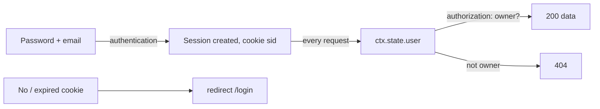
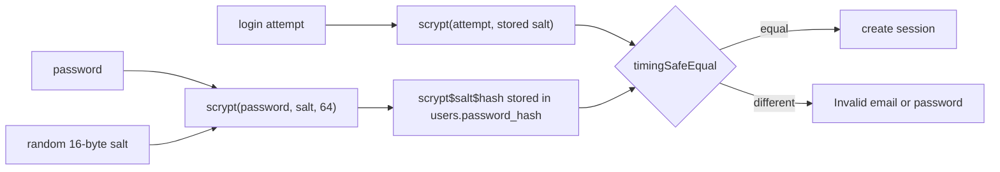
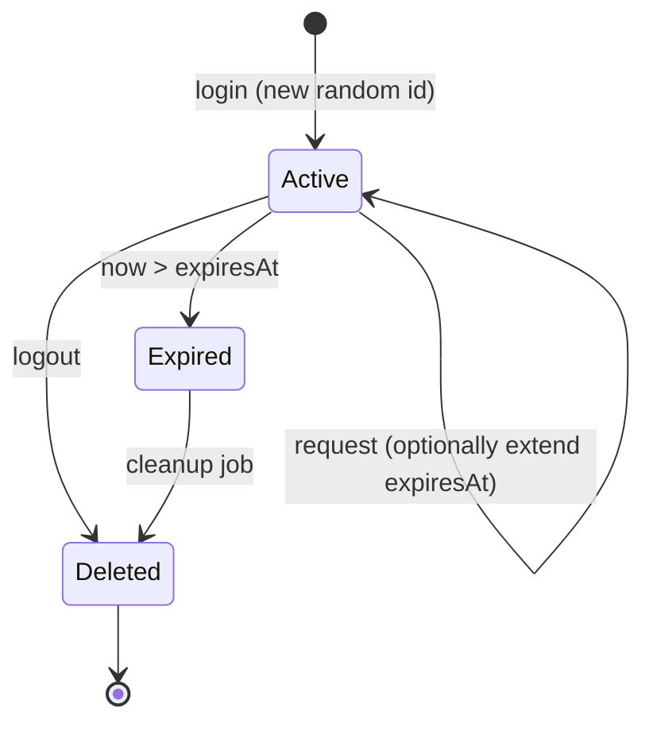
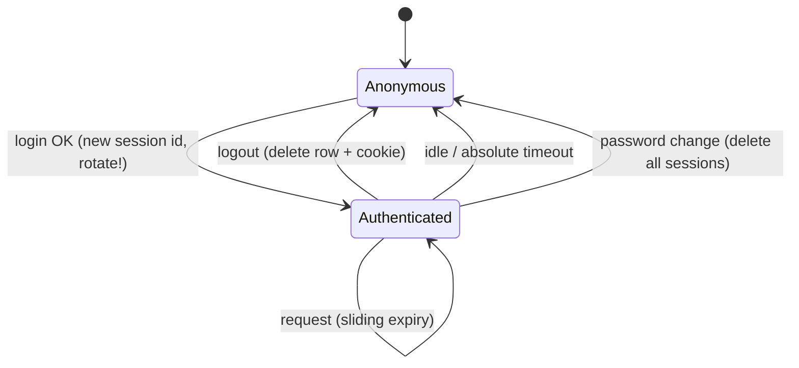
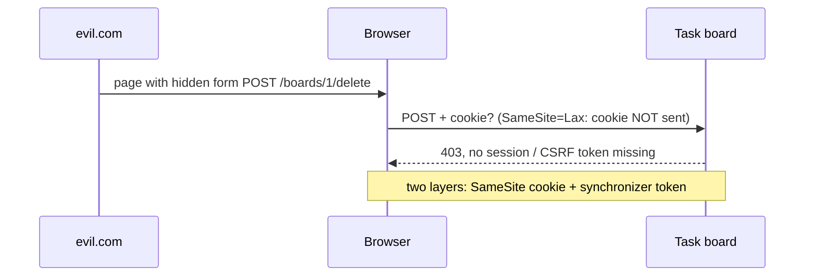

# Lecture 13 — Sessions, cookies, authentication, CSRF

**Goals:** implement registration/login with secure password storage, server-side sessions in PostgreSQL, authorization, and CSRF protection, all without auth libraries.

### In plain words
Think of a **hotel**:
- At the reception you show your passport. That is **authentication**: proving who you are.
- You receive a **key card**. That is the **session cookie**. You don't show your passport again at every door, you just tap the card.
- The card opens *your* room and the gym, but not other guests' rooms. That is **authorization**.
- The hotel keeps a list of which card belongs to which guest and when it expires. That is the **sessions table** in PostgreSQL. If you lose the card, reception can cancel it (logout / revoke).
- The hotel doesn't keep your PIN in plain text. It keeps a **fingerprint** of it (a password *hash*), so even a stolen guest book doesn't reveal PINs.
- **CSRF** is a con artist who tricks you into tapping your card on *their* door reader, which secretly opens your room. The defence is a secret code (the token) that only real hotel forms know.

See the [glossary](../resources/glossary.md) for *hash*, *salt*, *cookie*, *session* and *CSRF*.



### 1. Authentication vs authorization
- **Authentication:** *who are you?* (login)
- **Authorization:** *what may you do?* (only the board owner may delete it)

### 2. Cookies
```http
Set-Cookie: sid=Yk2…; Path=/; HttpOnly; Secure; SameSite=Lax; Max-Age=604800
```
| Attribute | Why |
|-----------|-----|
| `HttpOnly` | JS can't read it, which limits XSS damage |
| `Secure` | sent only over HTTPS |
| `SameSite=Lax` | not sent on cross-site POSTs (CSRF mitigation) |
| `Max-Age`/`Expires` | lifetime |
| `Path`, `Domain` | scope |

Parsing by hand:
```js
export const parseCookies = (h = '') => Object.fromEntries(
  h.split(';').map(p => p.trim().split('=')).filter(([k]) => k).map(([k, ...v]) => [k, decodeURIComponent(v.join('='))]));
```

### 3. Password hashing
Never store plain or fast-hashed (MD5/SHA-256) passwords. Use a **slow, salted KDF**: scrypt (built into Node), bcrypt or argon2.
```js
import { scrypt, randomBytes, timingSafeEqual } from 'node:crypto';
import { promisify } from 'node:util';
const scryptAsync = promisify(scrypt);

export async function hashPassword(pw) {
  const salt = randomBytes(16);
  const key = await scryptAsync(pw, salt, 64);
  return `scrypt$${salt.toString('hex')}$${key.toString('hex')}`;
}
export async function verifyPassword(pw, stored) {
  const [, saltHex, keyHex] = stored.split('$');
  const key = await scryptAsync(pw, Buffer.from(saltHex, 'hex'), 64);
  return timingSafeEqual(key, Buffer.from(keyHex, 'hex'));
}
```

### 4. Server-side sessions
```mermaid
sequenceDiagram
  participant B as Browser
  participant S as Server
  participant DB as PostgreSQL
  B->>S: POST /login (email, password)
  S->>DB: find user by email
  S->>S: verifyPassword (scrypt)
  S->>DB: INSERT session (random id, userId, expiresAt)
  S-->>B: 303 /boards + Set-Cookie: sid=…; HttpOnly
  B->>S: GET /boards, Cookie: sid=…
  S->>DB: find session + user (not expired)
  S-->>B: 200 user's boards
  B->>S: POST /logout
  S->>DB: DELETE session
  S-->>B: Set-Cookie: sid=; Max-Age=0
```
```js
export const session = async (ctx, next) => {
  const sid = ctx.cookies.sid;
  if (sid) {
    const s = await prisma.session.findUnique({ where: { id: sid }, include: { user: true } });
    if (s && s.expiresAt > new Date()) { ctx.state.session = s; ctx.state.user = s.user; }
  }
  await next();
};
```
- The session id is `randomBytes(32).toString('base64url')`, so it is unguessable.
- **Rotate** the id on login (prevents session fixation).
- Alternative: signed stateless cookies/JWT. They are harder to revoke, so we use DB sessions.

### 5. Authorization middleware
```js
export const requireAuth = async (ctx, next) => {
  if (!ctx.state.user) {
    if (ctx.isHtmx) { ctx.res.setHeader('HX-Redirect', '/login'); return ctx.html('', 401); }
    return ctx.redirect('/login');
  }
  await next();
};
// ownership check: query with the owner in WHERE, so other users get 404
const board = await prisma.board.findFirst({ where: { id, ownerId: ctx.state.user.id } });
if (!board) ctx.throw(404, 'Board not found');
```
Missing ownership checks (IDOR) are the #1 OWASP risk: *Broken Access Control*.

### 6. CSRF
An attacker's site makes your browser send a request to our site with your cookies.

```mermaid
sequenceDiagram
  participant V as Victim browser
  participant E as evil.example
  participant T as taskboard
  V->>E: visits page
  E-->>V: <form action="https://taskboard/boards/1/delete" method=post> auto-submit
  V->>T: POST /boards/1/delete + Cookie sid (if SameSite=None)
  T->>T: CSRF token missing → 403
```

Defences (use several):
1. `SameSite=Lax` cookies.
2. **Synchronizer token:** a random token stored in the session, rendered into forms (`<input type="hidden" name="_csrf">`) and HTMX (`hx-headers='{"X-CSRF-Token": "…"}'` on `<body>`), and checked on every POST/PUT/PATCH/DELETE with `timingSafeEqual`.
3. Check the `Origin` header on unsafe methods.

### 7. Flash messages
Store a one-time message in the session (or a short cookie) before a redirect, show it on the next page, then delete it.

### 8. More theory: why slow hashing and random ids?
- A **hash** is a one-way fingerprint: easy to compute from the password, practically impossible to reverse.
- A **salt** is random data stored next to the hash. Two users with the password `123456` get different hashes, so pre-computed "rainbow tables" are useless.
- **Slow on purpose:** SHA-256 can be computed billions of times per second on a GPU, while scrypt is deliberately expensive in CPU *and* memory. Logging in once takes ~50 ms for you, but brute-forcing millions of guesses becomes impractical.
- **`timingSafeEqual`** compares in constant time, so an attacker can't learn how many leading bytes matched by measuring response time.
- **Session ids** must come from a CSPRNG (`randomBytes`), never `Math.random()` or an incrementing number.



Life of a session record:


### 9. Worked example: the login route step by step
```js
// Simplified from examples/task-board/src/routes/auth.js
import { randomBytes } from 'node:crypto';
import { prisma } from '../db.js';
import { verifyPassword } from '../lib/password.js';

const WEEK = 7 * 24 * 60 * 60;                       // seconds

router.post('/login', rateLimit({ max: 10 }), async (ctx) => {
  // 1. Normalise input (emails are case-insensitive in practice)
  const email = String(ctx.body.email ?? '').trim().toLowerCase();
  const password = String(ctx.body.password ?? '');

  // 2. Look the user up and verify the password
  const user = await prisma.user.findUnique({ where: { email } });
  const ok = user && await verifyPassword(password, user.passwordHash);

  // 3. Same generic message for "no such user" and "wrong password" (no account enumeration)
  if (!ok) return ctx.html(loginPage({ email, error: 'Invalid email or password.' }), 401);

  // 4. Rotate: delete any old session from this browser (prevents session fixation)
  if (ctx.cookies.sid) await prisma.session.deleteMany({ where: { id: ctx.cookies.sid } });

  // 5. Create a fresh, unguessable session id
  const session = await prisma.session.create({
    data: {
      id: randomBytes(32).toString('base64url'),
      userId: user.id,
      expiresAt: new Date(Date.now() + WEEK * 1000),
    },
  });

  // 6. Send it as an HttpOnly cookie (Secure in production)
  ctx.setCookie('sid', session.id, { maxAge: WEEK, httpOnly: true, sameSite: 'Lax', secure: config.isProd });

  // 7. Post/Redirect/Get: 303 so a refresh doesn't resubmit the password
  return ctx.redirect('/boards');
});
```

### 10. Worked example: checking the CSRF token
```js
import { randomBytes, timingSafeEqual } from 'node:crypto';

const SAFE = new Set(['GET', 'HEAD', 'OPTIONS']);

export const csrf = async (ctx, next) => {
  const s = ctx.state.session;
  if (s && !s.csrfToken) {                           // lazily create one token per session
    s.csrfToken = randomBytes(32).toString('base64url');
    await prisma.session.update({ where: { id: s.id }, data: { csrfToken: s.csrfToken } });
  }
  ctx.state.csrfToken = s?.csrfToken;                // views render it into forms / hx-headers

  if (!SAFE.has(ctx.method)) {
    const sent = String(ctx.body._csrf ?? ctx.req.headers['x-csrf-token'] ?? '');
    const expected = String(s?.csrfToken ?? '');
    const a = Buffer.from(sent), b = Buffer.from(expected);
    // lengths must match before timingSafeEqual, otherwise it throws
    if (!expected || a.length !== b.length || !timingSafeEqual(a, b)) ctx.throw(403, 'Invalid CSRF token');
  }
  await next();
};
```
The exact field names may differ slightly from the reference app. The principle is what matters.

### 11. More theory: cookie attributes in detail
A cookie is set with the [`Set-Cookie`](https://developer.mozilla.org/en-US/docs/Web/HTTP/Headers/Set-Cookie) header. Every attribute closes a different hole ([MDN: Using HTTP cookies](https://developer.mozilla.org/en-US/docs/Web/HTTP/Cookies)):

| Attribute | What it does | Attack it limits |
|-----------|--------------|------------------|
| `HttpOnly` | JS cannot read it (`document.cookie`) | session theft through XSS |
| `Secure` | sent only over HTTPS | sniffing on public Wi-Fi |
| `SameSite=Lax` | not sent on cross-site POST / subrequests | most CSRF |
| `SameSite=Strict` | never sent from other sites, even on links | CSRF (but breaks "open from email" login) |
| `Path=/` | which paths receive it | accidental leaks to other apps on the host |
| `Max-Age` / `Expires` | lifetime; absent = session cookie | long-lived stolen cookies |
| `__Host-` prefix | forces `Secure`, `Path=/`, no `Domain` | subdomain overriding the cookie |

Example: `Set-Cookie: __Host-sid=7f3c...; HttpOnly; Secure; SameSite=Lax; Path=/; Max-Age=604800`.

### 12. More theory: sessions vs tokens (JWT)
| | Server-side session (this course) | Stateless token (JWT) |
|---|---|---|
| What the client holds | random id | signed data (user id, expiry) |
| Where the truth lives | `sessions` table | inside the token |
| Logout / revoke | delete the row, done | hard: token valid until expiry (needs a denylist) |
| DB lookup per request | yes (cheap with an index) | no |
| Size | ~40 bytes | hundreds of bytes |
| Good for | server-rendered apps, HTMX | APIs across services, mobile clients |

For a server-rendered app, sessions are simpler and safer. See the [OWASP Session Management Cheat Sheet](https://cheatsheetseries.owasp.org/cheatsheets/Session_Management_Cheat_Sheet.html) and the [OWASP JWT Cheat Sheet](https://cheatsheetseries.owasp.org/cheatsheets/JSON_Web_Token_for_Java_Cheat_Sheet.html).



### 13. More theory: password storage and login hardening
Node.js has [`crypto.scrypt`](https://nodejs.org/api/crypto.html#cryptoscryptpassword-salt-keylen-options-callback), [`crypto.randomBytes`](https://nodejs.org/api/crypto.html#cryptorandombytessize-callback) and [`crypto.timingSafeEqual`](https://nodejs.org/api/crypto.html#cryptotimingsafeequala-b) built in, so no extra package is needed.

| Algorithm | Type | Recommended? ([OWASP Password Storage](https://cheatsheetseries.owasp.org/cheatsheets/Password_Storage_Cheat_Sheet.html)) |
|-----------|------|------------------------|
| MD5, SHA-1, SHA-256 (plain) | fast hash | **no**: billions of guesses per second on a GPU |
| PBKDF2 | slow, CPU-hard | acceptable (high iteration count) |
| bcrypt | slow, CPU-hard | acceptable (72-byte input limit) |
| scrypt | slow, memory-hard | yes (built into Node) |
| Argon2id | slow, memory-hard | yes, first choice (needs a package) |

Other login rules from the [OWASP Authentication Cheat Sheet](https://cheatsheetseries.owasp.org/cheatsheets/Authentication_Cheat_Sheet.html): use the same error text for "no such user" and "wrong password", rate-limit login attempts, rotate the session id after login (prevents session fixation), and compare secrets in constant time.


More on CSRF defences: [OWASP CSRF Prevention Cheat Sheet](https://cheatsheetseries.owasp.org/cheatsheets/Cross-Site_Request_Forgery_Prevention_Cheat_Sheet.html).

### Common beginner mistakes
- **Storing passwords in plain text or with MD5/SHA-1/SHA-256.** Use scrypt, bcrypt or argon2.
- **Different error messages for "unknown email" and "wrong password"**, which lets attackers find valid accounts.
- **Storing `userId` directly in a cookie** (`Set-Cookie: user=5`). Anyone can edit it to `6`.
- **Forgetting `HttpOnly`/`Secure`** on the session cookie.
- **Not rotating the session id on login**, which allows session fixation.
- **Checking only "is logged in" but not "is owner"** (IDOR): `/boards/2` shows someone else's board.
- **Comparing secrets with `===`** instead of `timingSafeEqual`.
- **Logout that only deletes the cookie** but not the DB row, so a stolen cookie still works.
- **Using GET for state changes** (`GET /tasks/7/delete`). Links, prefetchers and CSRF can trigger them.

### Try it yourself
1. Call `hashPassword('secret')` twice and explain why the outputs differ.
2. Log in, copy the `sid` cookie from DevTools, log out, then replay a request with `curl -b sid=...`. It must fail.
3. Create two users, and as user A try to open user B's board URL. Confirm you get 404.
4. Build a tiny `evil.html` with an auto-submitting form to `/boards/1/delete` and verify that the CSRF check blocks it.
5. Add a "log out everywhere" button that deletes all sessions of the current user.
6. Add a flash message "Welcome back, Ann!" after login.

### Recap questions
1. Why is SHA-256 a bad password hash while scrypt is good?
2. What does `HttpOnly` protect against, and what does it not protect against?
3. What is session fixation and how does rotation prevent it?
4. Explain a CSRF attack and the synchronizer-token defence.
5. Why return 404 rather than 403 for another user's board?
6. What is a salt and which attack does it defeat?
7. Why should logout delete the session row and not just the cookie?

### Further reading / documentation
- [MDN: Using HTTP cookies](https://developer.mozilla.org/en-US/docs/Web/HTTP/Cookies)
- [MDN: Set-Cookie](https://developer.mozilla.org/en-US/docs/Web/HTTP/Headers/Set-Cookie)
- [Node.js: crypto module](https://nodejs.org/api/crypto.html)
- [OWASP: Authentication Cheat Sheet](https://cheatsheetseries.owasp.org/cheatsheets/Authentication_Cheat_Sheet.html)
- [OWASP: Password Storage Cheat Sheet](https://cheatsheetseries.owasp.org/cheatsheets/Password_Storage_Cheat_Sheet.html)
- [OWASP: Session Management Cheat Sheet](https://cheatsheetseries.owasp.org/cheatsheets/Session_Management_Cheat_Sheet.html)
- [OWASP: CSRF Prevention Cheat Sheet](https://cheatsheetseries.owasp.org/cheatsheets/Cross-Site_Request_Forgery_Prevention_Cheat_Sheet.html)
- [OWASP: Authorization Cheat Sheet](https://cheatsheetseries.owasp.org/cheatsheets/Authorization_Cheat_Sheet.html)
- [OWASP: JSON Web Token Cheat Sheet](https://cheatsheetseries.owasp.org/cheatsheets/JSON_Web_Token_for_Java_Cheat_Sheet.html)
