# Lecture 13 — Sessions, cookies, authentication, CSRF

**Goals:** implement registration/login with secure password storage, server-side sessions in PostgreSQL, authorization, and CSRF protection, all without auth libraries.

### 1. Authentication vs authorization
- **Authentication:** *who are you?* (login)
- **Authorization:** *what may you do?* (only the board owner may delete it)

### 2. Cookies
```http
Set-Cookie: sid=Yk2…; Path=/; HttpOnly; Secure; SameSite=Lax; Max-Age=604800
```
| Attribute | Why |
|-----------|-----|
| `HttpOnly` | JS can't read it, which limits XSS damage |
| `Secure` | sent only over HTTPS |
| `SameSite=Lax` | not sent on cross-site POSTs (CSRF mitigation) |
| `Max-Age`/`Expires` | lifetime |
| `Path`, `Domain` | scope |

Parsing by hand:
```js
export const parseCookies = (h = '') => Object.fromEntries(
  h.split(';').map(p => p.trim().split('=')).filter(([k]) => k).map(([k, ...v]) => [k, decodeURIComponent(v.join('='))]));
```

### 3. Password hashing
Never store plain or fast-hashed (MD5/SHA-256) passwords. Use a **slow, salted KDF**: scrypt (built into Node), bcrypt or argon2.
```js
import { scrypt, randomBytes, timingSafeEqual } from 'node:crypto';
import { promisify } from 'node:util';
const scryptAsync = promisify(scrypt);

export async function hashPassword(pw) {
  const salt = randomBytes(16);
  const key = await scryptAsync(pw, salt, 64);
  return `scrypt$${salt.toString('hex')}$${key.toString('hex')}`;
}
export async function verifyPassword(pw, stored) {
  const [, saltHex, keyHex] = stored.split('$');
  const key = await scryptAsync(pw, Buffer.from(saltHex, 'hex'), 64);
  return timingSafeEqual(key, Buffer.from(keyHex, 'hex'));
}
```

### 4. Server-side sessions
```mermaid
sequenceDiagram
  participant B as Browser
  participant S as Server
  participant DB as PostgreSQL
  B->>S: POST /login (email, password)
  S->>DB: find user by email
  S->>S: verifyPassword (scrypt)
  S->>DB: INSERT session (random id, userId, expiresAt)
  S-->>B: 303 /boards + Set-Cookie: sid=…; HttpOnly
  B->>S: GET /boards, Cookie: sid=…
  S->>DB: find session + user (not expired)
  S-->>B: 200 user's boards
  B->>S: POST /logout
  S->>DB: DELETE session
  S-->>B: Set-Cookie: sid=; Max-Age=0
```
```js
export const session = async (ctx, next) => {
  const sid = ctx.cookies.sid;
  if (sid) {
    const s = await prisma.session.findUnique({ where: { id: sid }, include: { user: true } });
    if (s && s.expiresAt > new Date()) { ctx.state.session = s; ctx.state.user = s.user; }
  }
  await next();
};
```
- The session id is `randomBytes(32).toString('base64url')`, so it is unguessable.
- **Rotate** the id on login (prevents session fixation).
- Alternative: signed stateless cookies/JWT. They are harder to revoke, so we use DB sessions.

### 5. Authorization middleware
```js
export const requireAuth = async (ctx, next) => {
  if (!ctx.state.user) {
    if (ctx.isHtmx) { ctx.res.setHeader('HX-Redirect', '/login'); return ctx.html('', 401); }
    return ctx.redirect('/login');
  }
  await next();
};
// ownership check: query with the owner in WHERE, so other users get 404
const board = await prisma.board.findFirst({ where: { id, ownerId: ctx.state.user.id } });
if (!board) ctx.throw(404, 'Board not found');
```
Missing ownership checks (IDOR) are the #1 OWASP risk: *Broken Access Control*.

### 6. CSRF
An attacker's site makes your browser send a request to our site with your cookies.

```mermaid
sequenceDiagram
  participant V as Victim browser
  participant E as evil.example
  participant T as taskboard
  V->>E: visits page
  E-->>V: <form action="https://taskboard/boards/1/delete" method=post> auto-submit
  V->>T: POST /boards/1/delete + Cookie sid (if SameSite=None)
  T->>T: CSRF token missing → 403
```

Defences (use several):
1. `SameSite=Lax` cookies.
2. **Synchronizer token:** a random token stored in the session, rendered into forms (`<input type="hidden" name="_csrf">`) and HTMX (`hx-headers='{"X-CSRF-Token": "…"}'` on `<body>`), and checked on every POST/PUT/PATCH/DELETE with `timingSafeEqual`.
3. Check the `Origin` header on unsafe methods.

### 7. Flash messages
Store a one-time message in the session (or a short cookie) before a redirect, show it on the next page, then delete it.

### Recap questions
1. Why is SHA-256 a bad password hash while scrypt is good?
2. What does `HttpOnly` protect against, and what does it not protect against?
3. What is session fixation and how does rotation prevent it?
4. Explain a CSRF attack and the synchronizer-token defence.
5. Why return 404 rather than 403 for another user's board?
