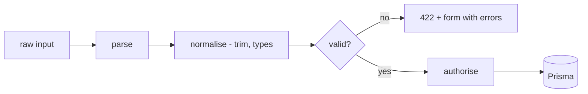
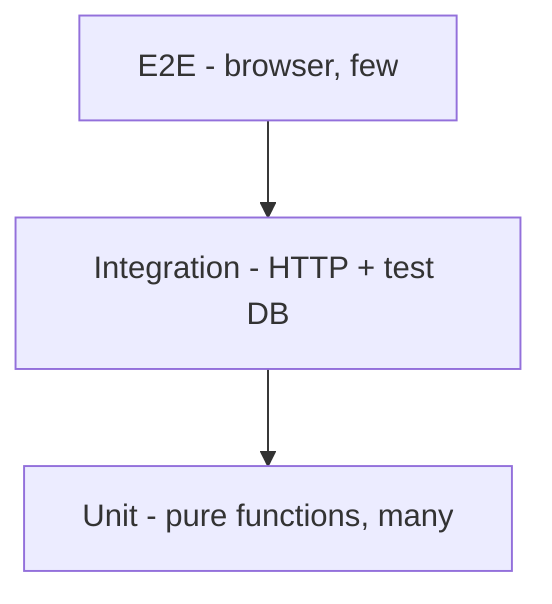

# Lecture 14 — Validation, security (OWASP Top 10), testing with `node:test`

**Goals:** validate all input on the server, harden the app with security headers, and write unit and integration tests using only Node core.

### 1. Validation
Trust nothing from the client: body, query, params, headers, cookies.
```js
export function validateTask(input) {
  const errors = {};
  const title = String(input.title ?? '').trim();
  if (!title) errors.title = 'Title is required.';
  else if (title.length > 200) errors.title = 'Title must be at most 200 characters.';
  const status = input.status ?? 'TODO';
  if (!['TODO', 'DOING', 'DONE'].includes(status)) errors.status = 'Invalid status.';
  return { ok: Object.keys(errors).length === 0, values: { title, status }, errors };
}
const id = Number.parseInt(ctx.params.id, 10);
if (!Number.isSafeInteger(id) || id < 1) ctx.throw(404, 'Not found');
```

Libraries like `zod` are allowed in the project, but writing validators by hand once teaches the principle.

### 2. OWASP Top 10 (2021) mapped to our stack
| # | Risk | Our mitigation |
|---|------|----------------|
| A01 | Broken Access Control | `requireAuth`, ownership in `WHERE`, 404 for others' data |
| A02 | Cryptographic Failures | HTTPS, scrypt, `Secure` cookies, no secrets in git |
| A03 | Injection (SQL, XSS) | Prisma/params, `html` tag escaping, CSP |
| A04 | Insecure Design | threat modelling, rate limits on login |
| A05 | Security Misconfiguration | security headers, no stack traces to users |
| A06 | Vulnerable Components | few deps, `npm audit`, lockfile |
| A07 | Identification & Auth Failures | session rotation, expiry, generic login errors |
| A08 | Software & Data Integrity | lockfile, SRI on CDN scripts |
| A09 | Logging & Monitoring Failures | structured logs, log failed logins |
| A10 | SSRF | don't fetch user-supplied URLs server-side |

### 3. Security headers middleware
```js
export const securityHeaders = async (ctx, next) => {
  const h = ctx.res;
  h.setHeader('Content-Security-Policy',
    "default-src 'self'; script-src 'self' https://unpkg.com https://cdn.jsdelivr.net; style-src 'self' https://cdn.jsdelivr.net; img-src 'self' data:");
  h.setHeader('X-Content-Type-Options', 'nosniff');
  h.setHeader('Referrer-Policy', 'same-origin');
  h.setHeader('X-Frame-Options', 'DENY');
  await next();
};
```
Note: `hx-on` attributes and inline scripts need `'unsafe-inline'` or `'unsafe-eval'` for HTMX, so prefer them only where necessary and use SRI (`integrity="sha384-…"`) on CDN tags.

### 4. Rate limiting (in memory)
```js
const hits = new Map();
export const rateLimit = ({ windowMs = 60_000, max = 10 } = {}) => async (ctx, next) => {
  const key = ctx.req.socket.remoteAddress + ctx.path;
  const now = Date.now();
  const e = hits.get(key) ?? { n: 0, reset: now + windowMs };
  if (now > e.reset) { e.n = 0; e.reset = now + windowMs; }
  if (++e.n > max) ctx.throw(429, 'Too many requests');
  hits.set(key, e);
  await next();
};
```

### 5. Testing with `node:test`

**Unit test:**
```js
import { test } from 'node:test';
import assert from 'node:assert/strict';
import { html } from '../src/views/html.js';

test('html escapes interpolated values', () => {
  assert.equal(String(html`<p>${'<b>'}</p>`), '<p>&lt;b&gt;</p>');
});
```
**Integration test (real server on a random port):**
```js
import { before, after, test } from 'node:test';
import assert from 'node:assert/strict';
import { createServer } from '../src/app.js';

let server, base;
before(async () => {
  server = createServer();
  await new Promise(r => server.listen(0, r));
  base = `http://127.0.0.1:${server.address().port}`;
});
after(() => server.close());

test('GET /health returns ok', async () => {
  const res = await fetch(`${base}/health`);
  assert.equal(res.status, 200);
});
test('unknown route returns 404', async () => {
  assert.equal((await fetch(`${base}/nope`)).status, 404);
});
```
Run with `node --test`, `node --test --watch` or `node --test --experimental-test-coverage`.

For DB tests use a separate `taskboard_test` database: `DATABASE_URL=... npx prisma migrate reset --force`, then run the tests.

### Recap questions
1. Why must validation happen on the server even with HTML `required`?
2. Pick three OWASP risks and explain how the Task board mitigates them.
3. What does CSP protect against? Why can it conflict with HTMX?
4. Why start the test server on port `0`?
5. What should be unit-tested and what integration-tested in a web app?
