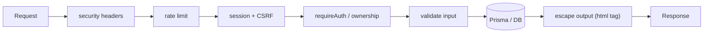
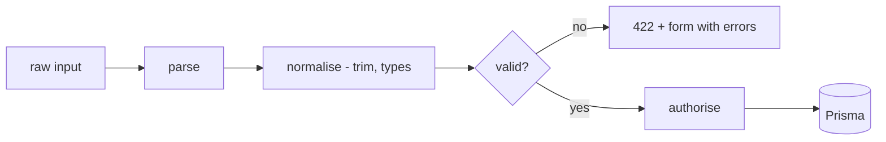
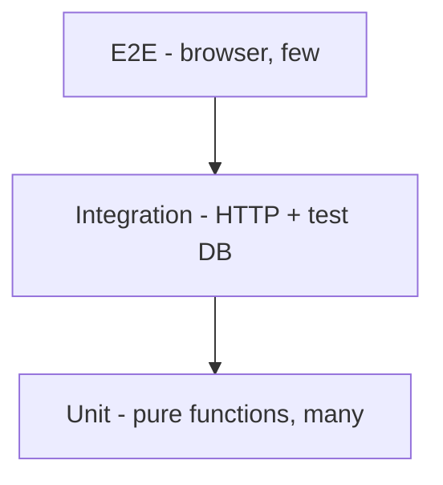
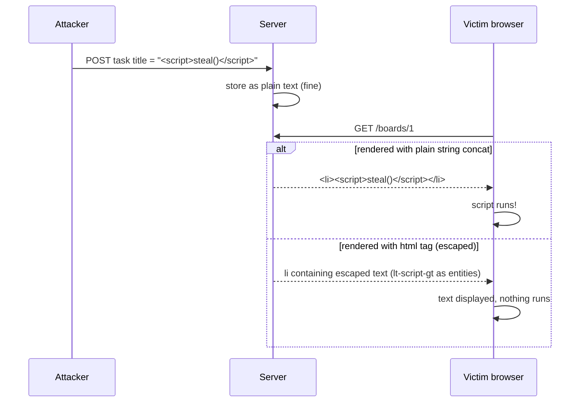
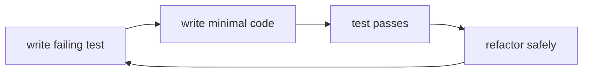
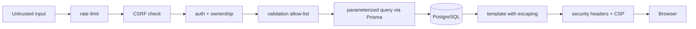
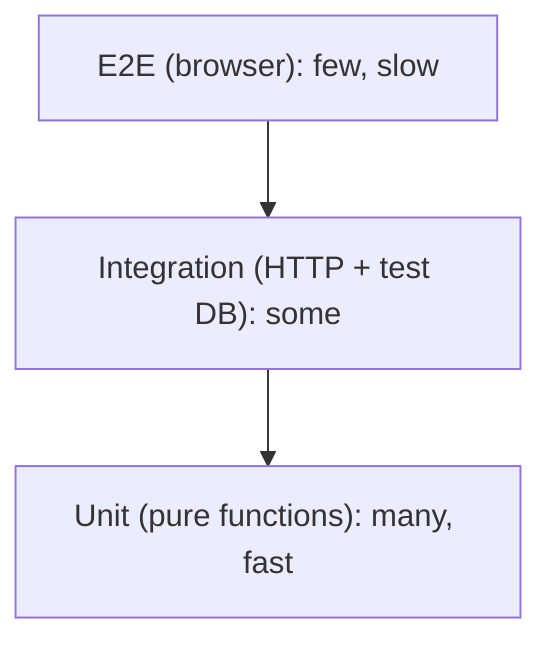

# Lecture 14 — Validation, security (OWASP Top 10), testing with `node:test`

**Goals:** validate all input on the server, harden the app with security headers, and write unit and integration tests using only Node core.

### In plain words
- **Validation** is the bouncer at the club door. HTML `required` is just a sign saying "no sneakers", and anyone can ignore it (with curl, DevTools...). The server bouncer actually checks every guest.
- **Security** is about locking every door, not just the front one. The OWASP Top 10 is a checklist of the doors burglars use most often.
- **Security headers** are instructions you pin on your house for the browser: "only run scripts from these addresses" (CSP), "don't put my page inside someone else's frame".
- **Rate limiting** is a shop allowing only 10 customers a minute through the door, which stops a password-guessing robot.
- **Tests** are a smoke alarm. You hope it never rings, but when you change something it tells you immediately if you broke the house.

More terms in the [glossary](../resources/glossary.md).


Each layer catches something the others miss. This is called **defence in depth**.

### 1. Validation
Trust nothing from the client: body, query, params, headers, cookies.
```js
export function validateTask(input) {
  const errors = {};
  const title = String(input.title ?? '').trim();
  if (!title) errors.title = 'Title is required.';
  else if (title.length > 200) errors.title = 'Title must be at most 200 characters.';
  const status = input.status ?? 'TODO';
  if (!['TODO', 'DOING', 'DONE'].includes(status)) errors.status = 'Invalid status.';
  return { ok: Object.keys(errors).length === 0, values: { title, status }, errors };
}
const id = Number.parseInt(ctx.params.id, 10);
if (!Number.isSafeInteger(id) || id < 1) ctx.throw(404, 'Not found');
```

Libraries like `zod` are allowed in the project, but writing validators by hand once teaches the principle.

### 2. OWASP Top 10 (2021) mapped to our stack
| # | Risk | Our mitigation |
|---|------|----------------|
| A01 | Broken Access Control | `requireAuth`, ownership in `WHERE`, 404 for others' data |
| A02 | Cryptographic Failures | HTTPS, scrypt, `Secure` cookies, no secrets in git |
| A03 | Injection (SQL, XSS) | Prisma/params, `html` tag escaping, CSP |
| A04 | Insecure Design | threat modelling, rate limits on login |
| A05 | Security Misconfiguration | security headers, no stack traces to users |
| A06 | Vulnerable Components | few deps, `npm audit`, lockfile |
| A07 | Identification & Auth Failures | session rotation, expiry, generic login errors |
| A08 | Software & Data Integrity | lockfile, SRI on CDN scripts |
| A09 | Logging & Monitoring Failures | structured logs, log failed logins |
| A10 | SSRF | don't fetch user-supplied URLs server-side |

### 3. Security headers middleware
```js
export const securityHeaders = async (ctx, next) => {
  const h = ctx.res;
  h.setHeader('Content-Security-Policy',
    "default-src 'self'; script-src 'self' https://unpkg.com https://cdn.jsdelivr.net; style-src 'self' https://cdn.jsdelivr.net; img-src 'self' data:");
  h.setHeader('X-Content-Type-Options', 'nosniff');
  h.setHeader('Referrer-Policy', 'same-origin');
  h.setHeader('X-Frame-Options', 'DENY');
  await next();
};
```
Note: `hx-on` attributes and inline scripts need `'unsafe-inline'` or `'unsafe-eval'` for HTMX, so prefer them only where necessary and use SRI (`integrity="sha384-…"`) on CDN tags.

### 4. Rate limiting (in memory)
```js
const hits = new Map();
export const rateLimit = ({ windowMs = 60_000, max = 10 } = {}) => async (ctx, next) => {
  const key = ctx.req.socket.remoteAddress + ctx.path;
  const now = Date.now();
  const e = hits.get(key) ?? { n: 0, reset: now + windowMs };
  if (now > e.reset) { e.n = 0; e.reset = now + windowMs; }
  if (++e.n > max) ctx.throw(429, 'Too many requests');
  hits.set(key, e);
  await next();
};
```

### 5. Testing with `node:test`

**Unit test:**
```js
import { test } from 'node:test';
import assert from 'node:assert/strict';
import { html } from '../src/views/html.js';

test('html escapes interpolated values', () => {
  assert.equal(String(html`<p>${'<b>'}</p>`), '<p>&lt;b&gt;</p>');
});
```
**Integration test (real server on a random port):**
```js
import { before, after, test } from 'node:test';
import assert from 'node:assert/strict';
import { createServer } from '../src/app.js';

let server, base;
before(async () => {
  server = createServer();
  await new Promise(r => server.listen(0, r));
  base = `http://127.0.0.1:${server.address().port}`;
});
after(() => server.close());

test('GET /health returns ok', async () => {
  const res = await fetch(`${base}/health`);
  assert.equal(res.status, 200);
});
test('unknown route returns 404', async () => {
  assert.equal((await fetch(`${base}/nope`)).status, 404);
});
```
Run with `node --test`, `node --test --watch` or `node --test --experimental-test-coverage`.

For DB tests use a separate `taskboard_test` database: `DATABASE_URL=... npx prisma migrate reset --force`, then run the tests.

### 6. More theory: XSS and why escaping works
**Cross-site scripting (XSS)** happens when user text is put into HTML *as code*. If a task title is `` and we concatenate it into the page, every visitor runs that script. **Escaping** turns `<` into `&lt;`, `>` into `&gt;`, `"` into `&quot;` and so on, so the browser shows the characters instead of interpreting them. CSP is the second line of defence: even if something slips through, the browser refuses to run scripts from unapproved sources.



**What to test where:**
| Layer | Example | Test type |
|-------|---------|-----------|
| pure function | `validateTask`, `parseCookies`, `html` escaping | unit |
| middleware | `securityHeaders` sets CSP | integration (fetch, check headers) |
| route + DB | `POST /boards/1/tasks` creates a row | integration with test DB |
| access control | user A gets 404 on B's board | integration |
| full UI flow | log in, add a task, see it | E2E (optional, e.g. Playwright) |

### 7. Worked example: unit-testing a validator (Arrange, Act, Assert)
```js
// test/validation.test.js
import { describe, test } from 'node:test';
import assert from 'node:assert/strict';
import { validateTask } from '../src/validation.js';

describe('validateTask', () => {
  test('accepts a normal title and trims it', () => {
    // Arrange: build the input
    const input = { title: '  Buy milk  ' };
    // Act: call the code under test
    const r = validateTask(input);
    // Assert: check the outcome
    assert.equal(r.ok, true);
    assert.equal(r.values.title, 'Buy milk');
  });

  test('rejects an empty title', () => {
    const r = validateTask({ title: '   ' });
    assert.equal(r.ok, false);
    assert.match(r.errors.title, /required/i);   // regex: don't depend on exact wording
  });

  test('rejects a 201-character title', () => {
    const r = validateTask({ title: 'x'.repeat(201) });  // boundary value: max + 1
    assert.equal(r.ok, false);
  });
});
```
Test **boundaries** (0, 1, 200, 201 characters), not just the "happy path".

### 8. Worked example: integration test for headers and access control
```js
// test/security.test.js
import { before, after, test } from 'node:test';
import assert from 'node:assert/strict';
import { createServer } from '../src/app.js';

let server, base;
before(async () => {
  server = createServer();
  await new Promise((r) => server.listen(0, r));     // port 0 = any free port
  base = `http://127.0.0.1:${server.address().port}`;
});
after(() => server.close());

test('responses carry security headers', async () => {
  const res = await fetch(`${base}/health`);
  assert.equal(res.headers.get('x-content-type-options'), 'nosniff');
  assert.ok(res.headers.get('content-security-policy')?.includes("default-src 'self'"));
});

test('anonymous user is redirected away from /boards', async () => {
  const res = await fetch(`${base}/boards`, { redirect: 'manual' }); // don't follow the 303
  assert.equal(res.status, 303);
  assert.equal(res.headers.get('location'), '/login');
});

test('POST without CSRF token is rejected', async () => {
  const res = await fetch(`${base}/login`, {
    method: 'POST',
    headers: { 'content-type': 'application/x-www-form-urlencoded' },
    body: 'email=a%40b.c&password=x',
    redirect: 'manual',
  });
  assert.ok([401, 403, 422].includes(res.status));   // never 200/303 for a bad login
});
```
Adapt the exact paths and statuses to the reference app's `test/` folder.



### 9. More theory: defence in depth and trust boundaries
No single check is enough. Each layer assumes the one before it may fail ([OWASP Top 10](https://owasp.org/Top10/), [OWASP Input Validation Cheat Sheet](https://cheatsheetseries.owasp.org/cheatsheets/Input_Validation_Cheat_Sheet.html)).



| Attack | Main defence | Second layer | Docs |
|--------|--------------|--------------|------|
| SQL injection | parameterized queries (Prisma, `$queryRaw` tagged template) | least-privilege DB user | [OWASP SQLi Prevention](https://cheatsheetseries.owasp.org/cheatsheets/SQL_Injection_Prevention_Cheat_Sheet.html) |
| XSS | context-aware output escaping | CSP, `HttpOnly` cookies | [OWASP XSS Prevention](https://cheatsheetseries.owasp.org/cheatsheets/Cross_Site_Scripting_Prevention_Cheat_Sheet.html) |
| CSRF | synchronizer token | `SameSite` cookies | [OWASP CSRF](https://cheatsheetseries.owasp.org/cheatsheets/Cross-Site_Request_Forgery_Prevention_Cheat_Sheet.html) |
| IDOR (other user's board) | ownership in every `where` | 404 instead of 403 | [OWASP Authorization](https://cheatsheetseries.owasp.org/cheatsheets/Authorization_Cheat_Sheet.html) |
| Brute force | rate limiting | slow hashing | [OWASP Authentication](https://cheatsheetseries.owasp.org/cheatsheets/Authentication_Cheat_Sheet.html) |
| Clickjacking | `frame-ancestors 'none'` | `X-Frame-Options: DENY` | [MDN: CSP](https://developer.mozilla.org/en-US/docs/Web/HTTP/CSP) |
| Vulnerable packages | `npm audit`, update | lockfile, fewer deps | [npm audit](https://docs.npmjs.com/cli/commands/npm-audit) |

### 10. Reference: security headers
| Header | Recommended value | Why |
|--------|-------------------|-----|
| [`Content-Security-Policy`](https://developer.mozilla.org/en-US/docs/Web/HTTP/Headers/Content-Security-Policy) | `default-src 'self'; frame-ancestors 'none'` | blocks injected scripts from other origins and inline |
| [`Strict-Transport-Security`](https://developer.mozilla.org/en-US/docs/Web/HTTP/Headers/Strict-Transport-Security) | `max-age=31536000; includeSubDomains` | browser always uses HTTPS |
| [`X-Content-Type-Options`](https://developer.mozilla.org/en-US/docs/Web/HTTP/Headers/X-Content-Type-Options) | `nosniff` | no MIME guessing |
| [`Referrer-Policy`](https://developer.mozilla.org/en-US/docs/Web/HTTP/Headers/Referrer-Policy) | `strict-origin-when-cross-origin` | does not leak full URLs |
| `X-Frame-Options` | `DENY` | old-browser clickjacking defence |

More: [OWASP HTTP Headers Cheat Sheet](https://cheatsheetseries.owasp.org/cheatsheets/HTTP_Headers_Cheat_Sheet.html).

### 11. More theory: the test pyramid and `node:test` features
Many fast unit tests at the bottom, fewer integration tests in the middle, very few slow end-to-end tests at the top.



| Level | Example in Task board | Speed | Finds |
|-------|----------------------|-------|-------|
| Unit | `validateTask({ title: '' })` | ms | logic bugs |
| Integration | `POST /boards/1/tasks` with a cookie, check DB | 10–100 ms | wiring, SQL, auth bugs |
| End-to-end | real browser clicks "Add" | seconds | UI and JS bugs |

Useful parts of the built-in runner ([Node.js: test runner](https://nodejs.org/api/test.html), [Node.js: assert](https://nodejs.org/api/assert.html)):

| Feature | API |
|---------|-----|
| group tests | `describe()` / `it()` or nested `test()` |
| setup/teardown | `before`, `after`, `beforeEach`, `afterEach` |
| run only one / skip | `test.only` (with `--test-only`), `test.skip`, `test.todo` |
| mocks | `mock.fn()`, `mock.method(obj, 'name')`, `mock.timers` |
| coverage | `node --test --experimental-test-coverage` |
| watch mode | `node --test --watch` |
| deep equality | `assert.deepStrictEqual`, `assert.rejects` |

### Common beginner mistakes
- **Relying on client-side checks only** (`required`, `maxlength`, JS validation).
- **Validating but not normalising**, e.g. not trimming, or treating `"5"` and `5` the same by accident.
- **Showing stack traces or Prisma errors to users**, which leaks internals (A05).
- **Building HTML with plain template literals**, which leads to XSS.
- **Adding `'unsafe-inline'` to CSP "to make it work"** without understanding the trade-off.
- **Rate limiting by a header the client controls** (`X-Forwarded-For` without a trusted proxy).
- **Tests that depend on each other or on leftover DB data.** Reset the test DB and make every test independent.
- **Running tests against the development database** and wiping your own data.
- **Testing only the happy path.** Also test invalid input, missing auth and other users' data.

### Try it yourself
1. Create a task titled `<b>bold</b>` and confirm it shows literally on the page.
2. Temporarily render a title with plain string concatenation, observe the problem, then revert.
3. Open DevTools and check the response headers. Remove an allowed CDN from the CSP and watch the console errors.
4. Write unit tests for `parseCookies` (empty header, several cookies, `=` inside a value, malformed `%`).
5. Write an integration test proving that the 11th login attempt within a minute gets `429`.
6. Run `node --test --experimental-test-coverage` and find one uncovered branch to test.
7. Run `npm audit` and explain one finding (or why there are none).

### Recap questions
1. Why must validation happen on the server even with HTML `required`?
2. Pick three OWASP risks and explain how the Task board mitigates them.
3. What does CSP protect against? Why can it conflict with HTMX?
4. Why start the test server on port `0`?
5. What should be unit-tested and what integration-tested in a web app?
6. How does escaping prevent XSS, and why is CSP still useful?
7. Why should tests use a separate database, and how do you keep tests independent?

### Further reading / documentation
- [OWASP Top 10](https://owasp.org/Top10/)
- [OWASP Cheat Sheet Series](https://cheatsheetseries.owasp.org/)
- [OWASP: Input Validation Cheat Sheet](https://cheatsheetseries.owasp.org/cheatsheets/Input_Validation_Cheat_Sheet.html)
- [OWASP: XSS Prevention Cheat Sheet](https://cheatsheetseries.owasp.org/cheatsheets/Cross_Site_Scripting_Prevention_Cheat_Sheet.html)
- [OWASP: SQL Injection Prevention Cheat Sheet](https://cheatsheetseries.owasp.org/cheatsheets/SQL_Injection_Prevention_Cheat_Sheet.html)
- [OWASP: HTTP Headers Cheat Sheet](https://cheatsheetseries.owasp.org/cheatsheets/HTTP_Headers_Cheat_Sheet.html)
- [MDN: Content Security Policy](https://developer.mozilla.org/en-US/docs/Web/HTTP/CSP)
- [Node.js: test runner (`node:test`)](https://nodejs.org/api/test.html)
- [Node.js: assert](https://nodejs.org/api/assert.html)
- [npm audit](https://docs.npmjs.com/cli/commands/npm-audit)
