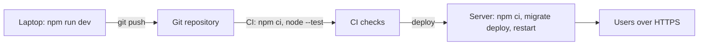
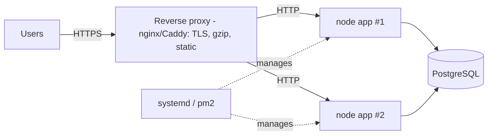
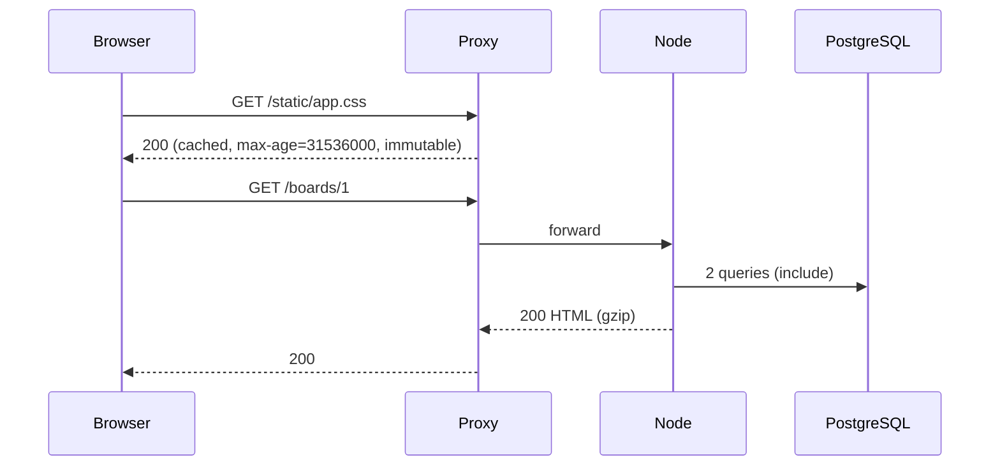
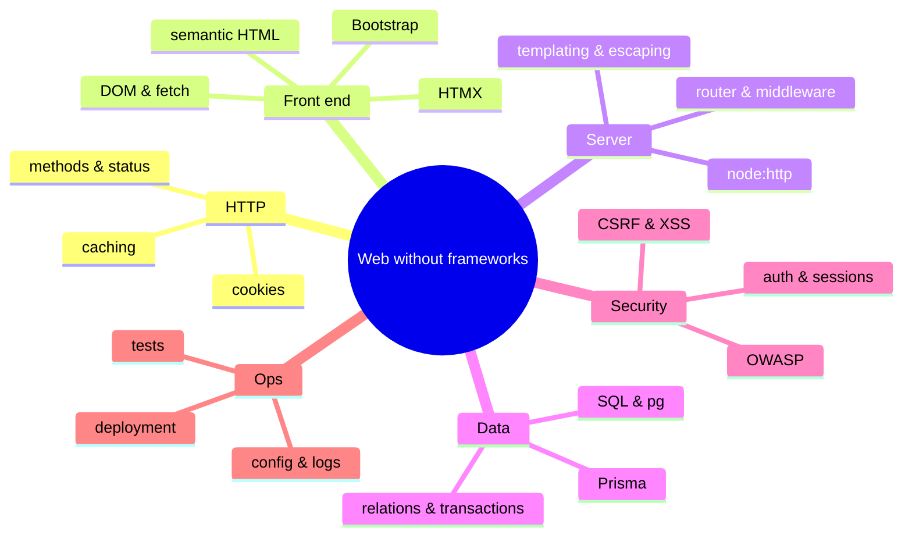
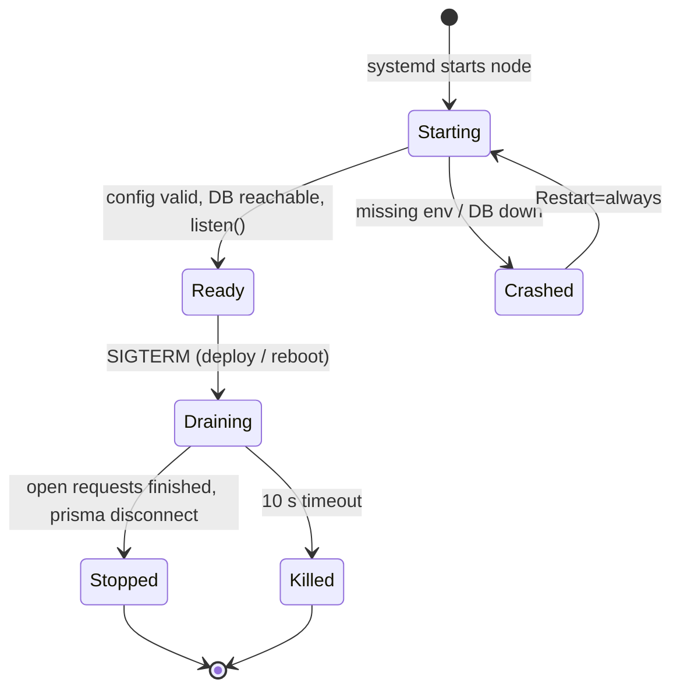
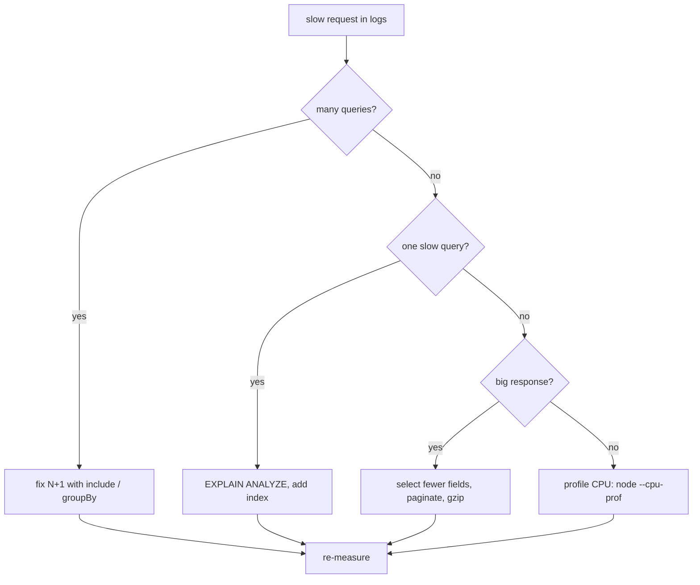

# Lecture 15 — Deployment, configuration, logging, performance, recap

**Goals:** run the app outside a laptop in a robust, observable, configurable way, and review the whole course.

### In plain words
Running the app on your laptop is like cooking at home. **Deployment** is opening a restaurant:
- The **recipe** (code) is the same, but the **ingredients list** (config: database address, secrets) comes from the environment, not from the recipe book.
- The **doorman** (reverse proxy such as nginx or Caddy) greets guests over HTTPS, hands out the menu (static files) and sends orders to the kitchen (Node).
- The **manager** (systemd/pm2) restarts a cook who faints (crashes).
- **Graceful shutdown** means finishing the meals already being cooked before closing the kitchen.
- **Logs** are the kitchen's order tickets. They show what happened and how long each order took.
- **Performance** work is finding which dish takes too long and why.

See the [glossary](../resources/glossary.md) for *environment variable*, *reverse proxy* and *TLS*.



### 1. Twelve-factor essentials
- **Config in the environment** (`DATABASE_URL`, `PORT`, `SESSION_SECRET`, `NODE_ENV`)
- **Stateless processes**: sessions are in PostgreSQL, not in memory
- **Disposability**: fast start, graceful shutdown
- **Dev/prod parity**: same PostgreSQL version
- **Logs as event streams**: write to stdout

```js
// src/config.js
const required = (k) => { const v = process.env[k]; if (!v) throw new Error(`Missing env ${k}`); return v; };
export const config = {
  port: Number(process.env.PORT ?? 3000),
  databaseUrl: required('DATABASE_URL'),
  sessionSecret: required('SESSION_SECRET'),
  isProd: process.env.NODE_ENV === 'production',
};
```

### 2. Production topology

Behind a proxy, trust `X-Forwarded-For`/`X-Forwarded-Proto` **only** from the proxy.

### 3. Deployment steps
```bash
git pull
npm ci --omit=dev          # needs prisma CLI → keep it in deps or run migrations from CI
npx prisma migrate deploy
NODE_ENV=production node --env-file=.env src/server.js
```
systemd unit:
```ini
[Service]
WorkingDirectory=/srv/task-board
EnvironmentFile=/srv/task-board/.env
ExecStart=/usr/bin/node src/server.js
Restart=always
User=taskboard
```

### 4. Graceful shutdown
```js
const shutdown = async () => {
  server.close(async () => { await prisma.$disconnect(); process.exit(0); });
  setTimeout(() => process.exit(1), 10_000).unref();
};
process.on('SIGTERM', shutdown); process.on('SIGINT', shutdown);
```

### 5. Logging
Structured, one JSON line per request:
```js
export const logger = async (ctx, next) => {
  const start = performance.now();
  try { await next(); }
  finally {
    console.log(JSON.stringify({ t: new Date().toISOString(), method: ctx.method, path: ctx.path,
      status: ctx.res.statusCode, ms: Math.round(performance.now() - start) }));
  }
};
```
Never log passwords, session ids or full tokens. Add a `/health` endpoint for the proxy and monitoring.

### 6. Performance
| Technique | Where |
|-----------|-------|
| Indexes (`@@index`) and `EXPLAIN ANALYZE` | DB |
| Avoid N+1, `select` only needed columns, paginate | Prisma |
| Connection pool size (`?connection_limit=`) | Prisma URL |
| gzip/brotli (`node:zlib` or proxy) | transport |
| `Cache-Control`, `ETag` for static files | HTTP |
| HTMX partials: small responses | UI |
| `node --cpu-prof`, `autocannon` load tests | profiling |



### 7. Course recap

Now you understand what a framework does for you. Choosing Express, Fastify, Django or Rails later is an informed decision rather than magic.

### 8. More theory: environments, secrets and process lifecycle
The same code runs in **development**, **test** and **production**. Only the *config* differs:

| Setting | development | test | production |
|---------|-------------|------|------------|
| `DATABASE_URL` | `taskboard_dev` | `taskboard_test` | managed DB, strong password |
| `NODE_ENV` | `development` | `test` | `production` |
| Cookie `Secure` | off (http://localhost) | off | **on** |
| Error pages | stack traces OK | stack traces OK | generic message only |
| Log level | debug | warn | info |

Secrets (`SESSION_SECRET`, DB password) live in `.env` on the server or in the hosting platform's secret store, **never** in git. Commit a `.env.example` with empty values instead.



### 9. Worked example: from a fresh server to a live app
```bash
# 1. Create an unprivileged user and fetch the code
sudo useradd --system --create-home taskboard
sudo -u taskboard git clone https://example.com/you/task-board.git /srv/task-board
cd /srv/task-board

# 2. Install exact dependency versions from package-lock.json
sudo -u taskboard npm ci

# 3. Write the config (readable only by the app user)
sudo -u taskboard cp .env.example .env
sudo -u taskboard nano .env          # DATABASE_URL=..., SESSION_SECRET=$(openssl rand -hex 32), NODE_ENV=production
sudo chmod 600 .env

# 4. Apply database migrations (never 'migrate dev' here)
sudo -u taskboard npx prisma migrate deploy

# 5. Install and start the systemd service (unit from section 3)
sudo cp deploy/task-board.service /etc/systemd/system/
sudo systemctl daemon-reload
sudo systemctl enable --now task-board

# 6. Check that it runs
systemctl status task-board
curl -s http://127.0.0.1:3000/health  # expect ok
journalctl -u task-board -f          # follow the JSON logs
```
Then put Caddy in front. A two-line `Caddyfile` gives you automatic HTTPS:
```text
taskboard.example.com {
  reverse_proxy 127.0.0.1:3000
}
```

### 10. Worked example: investigating a slow page
1. **Measure:** the logs show `{"path":"/boards/1","ms":812}`.
2. **Count queries:** temporarily enable `log: ['query']`. If you see 51 queries, you have N+1, so fix it with `include` (Lecture 11).
3. **Check one slow query:**
   ```sql
   EXPLAIN ANALYZE SELECT * FROM tasks WHERE board_id = 1 AND status = 'TODO' ORDER BY created_at DESC;
   -- "Seq Scan" on a big table => add @@index([boardId, status]) and migrate
   ```
4. **Shrink the payload:** `select` only the columns you render, paginate with `take`/`skip`.
5. **Re-measure** under load:
   ```bash
   npx autocannon -c 20 -d 10 http://127.0.0.1:3000/boards/1   # 20 connections for 10 s
   ```
6. Only *then* consider caching. Measure first, optimise second.



### Common beginner mistakes
- **Committing `.env`** or hard-coding secrets in the source.
- **Running `node src/server.js` in an SSH session** and closing the terminal, which kills the app. Use systemd/pm2.
- **Running the app as `root`.** Use a dedicated unprivileged user.
- **Running `prisma migrate dev` or `reset` on production**, which can drop data.
- **Using `npm install` instead of `npm ci`** on the server, so you get different versions than you tested.
- **Keeping sessions or rate-limit counters in memory with several instances.** Each instance then sees different data.
- **Logging passwords, cookies or full request bodies.**
- **Exposing Node directly on port 80/443 without TLS**, or trusting `X-Forwarded-*` from anyone.
- **Optimising before measuring.**

### Try it yourself
1. Start the app with `DATABASE_URL` unset and confirm it fails fast with a clear message.
2. Add a `.env.example` listing all required variables (no real values).
3. Send `SIGTERM` (`kill <pid>`) while a slow request is running and check that it still completes.
4. Pipe your JSON logs through `jq 'select(.ms > 100)'` to find slow requests.
5. Seed 10,000 tasks, run `EXPLAIN ANALYZE` with and without the index, and compare timings.
6. Run `autocannon` against `/health` and `/boards/1` and compare requests per second.
7. Write a short "deploy checklist" for your team project (env, migrations, restart, health check, rollback).

### Recap questions
1. Why must the app be stateless to run two instances behind a proxy?
2. What does `prisma migrate deploy` do differently from `migrate dev`?
3. Describe a graceful shutdown sequence.
4. Name three things you must never log.
5. How would you find out why `/boards/1` takes 800 ms?
6. Why use `npm ci` instead of `npm install` on the server?
7. Which settings should differ between development and production, and where do they come from?
