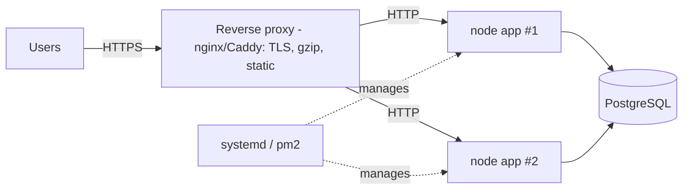
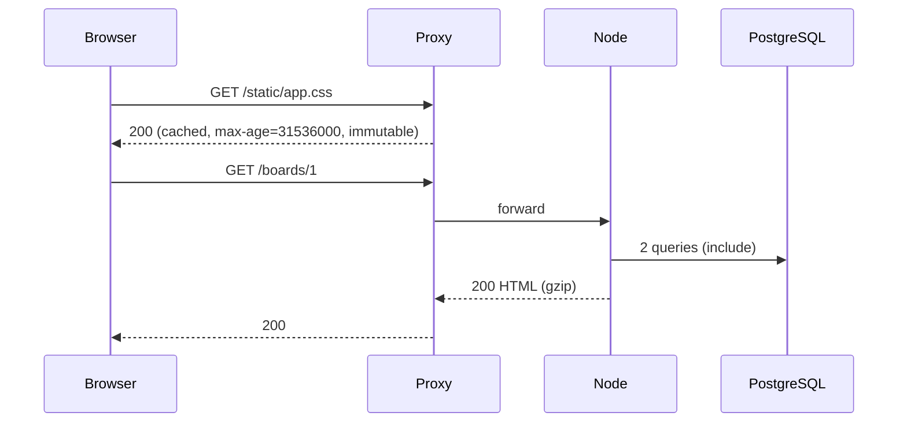

# Lecture 15 — Deployment, configuration, logging, performance, recap

**Goals:** run the app outside a laptop in a robust, observable, configurable way, and review the whole course.

### 1. Twelve-factor essentials
- **Config in the environment** (`DATABASE_URL`, `PORT`, `SESSION_SECRET`, `NODE_ENV`)
- **Stateless processes**: sessions are in PostgreSQL, not in memory
- **Disposability**: fast start, graceful shutdown
- **Dev/prod parity**: same PostgreSQL version
- **Logs as event streams**: write to stdout

```js
// src/config.js
const required = (k) => { const v = process.env[k]; if (!v) throw new Error(`Missing env ${k}`); return v; };
export const config = {
  port: Number(process.env.PORT ?? 3000),
  databaseUrl: required('DATABASE_URL'),
  sessionSecret: required('SESSION_SECRET'),
  isProd: process.env.NODE_ENV === 'production',
};
```

### 2. Production topology

Behind a proxy, trust `X-Forwarded-For`/`X-Forwarded-Proto` **only** from the proxy.

### 3. Deployment steps
```bash
git pull
npm ci --omit=dev          # needs prisma CLI → keep it in deps or run migrations from CI
npx prisma migrate deploy
NODE_ENV=production node --env-file=.env src/server.js
```
systemd unit:
```ini
[Service]
WorkingDirectory=/srv/task-board
EnvironmentFile=/srv/task-board/.env
ExecStart=/usr/bin/node src/server.js
Restart=always
User=taskboard
```

### 4. Graceful shutdown
```js
const shutdown = async () => {
  server.close(async () => { await prisma.$disconnect(); process.exit(0); });
  setTimeout(() => process.exit(1), 10_000).unref();
};
process.on('SIGTERM', shutdown); process.on('SIGINT', shutdown);
```

### 5. Logging
Structured, one JSON line per request:
```js
export const logger = async (ctx, next) => {
  const start = performance.now();
  try { await next(); }
  finally {
    console.log(JSON.stringify({ t: new Date().toISOString(), method: ctx.method, path: ctx.path,
      status: ctx.res.statusCode, ms: Math.round(performance.now() - start) }));
  }
};
```
Never log passwords, session ids or full tokens. Add a `/health` endpoint for the proxy and monitoring.

### 6. Performance
| Technique | Where |
|-----------|-------|
| Indexes (`@@index`) and `EXPLAIN ANALYZE` | DB |
| Avoid N+1, `select` only needed columns, paginate | Prisma |
| Connection pool size (`?connection_limit=`) | Prisma URL |
| gzip/brotli (`node:zlib` or proxy) | transport |
| `Cache-Control`, `ETag` for static files | HTTP |
| HTMX partials: small responses | UI |
| `node --cpu-prof`, `autocannon` load tests | profiling |



### 7. Course recap

```mermaid
mindmap
  root((Web without frameworks))
    HTTP
      methods & status
      cookies
      caching
    Front end
      semantic HTML
      Bootstrap
      DOM & fetch
      HTMX
    Server
      node:http
      router & middleware
      templating & escaping
    Data
      SQL & pg
      Prisma
      relations & transactions
    Security
      auth & sessions
      CSRF & XSS
      OWASP
    Ops
      tests
      config & logs
      deployment
```

Now you understand what a framework does for you. Choosing Express, Fastify, Django or Rails later is an informed decision rather than magic.

### Recap questions
1. Why must the app be stateless to run two instances behind a proxy?
2. What does `prisma migrate deploy` do differently from `migrate dev`?
3. Describe a graceful shutdown sequence.
4. Name three things you must never log.
5. How would you find out why `/boards/1` takes 800 ms?
