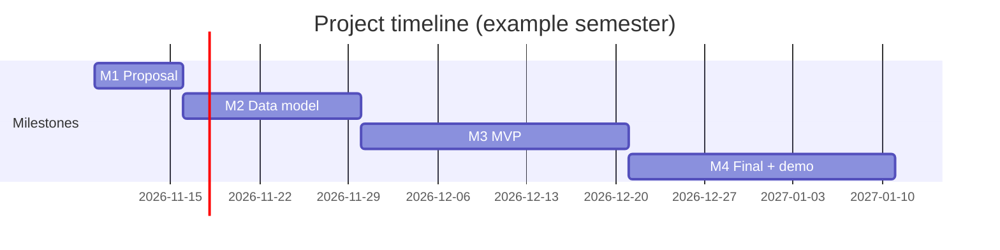

# Team project — a web application without a framework

**Workload:** 15 h per student · **Team:** 2–3 students · **Weight:** 40 % of the final grade

### Brief
Design and build your own server-rendered web application on the course stack:
**Node.js `node:http` + your own router/middleware + Prisma + PostgreSQL + Bootstrap 5 + HTMX**.
You may reuse the code you wrote in the labs (router, views, sessions…). You may **not** use web frameworks (Express, Fastify, Koa, Hapi, Nest, Next, …) or SPA frameworks (React, Vue, Svelte, Angular, …). Ask before adding any other dependency; small focused libraries such as `zod` are usually fine.

Ideas: [ideas.md](ideas.md). Your own idea is welcome.

### Minimum requirements (all are mandatory)
| # | Requirement |
|---|-------------|
| R1 | HTTP server on `node:http` with **your own** router and a middleware chain |
| R2 | ≥ 3 Prisma models with ≥ 2 relations (at least one 1–N; N–M is a bonus), committed migrations and an idempotent seed |
| R3 | Full CRUD on at least one main resource, with server-side validation and 422 error forms |
| R4 | Registration/login with hashed passwords (scrypt/bcrypt/argon2), DB sessions, logout |
| R5 | Authorization: users only see and modify their own (or shared) data, so other users' data gives 404/403 |
| R6 | ≥ 3 distinct HTMX interactions (e.g. inline edit, active search, delete without reload, OOB update) |
| R7 | Responsive Bootstrap 5 UI, semantic and accessible HTML (labels, headings, keyboard use) |
| R8 | Security: output escaping, CSRF protection, security headers, parameterised queries only |
| R9 | ≥ 10 automated tests with `node:test` (unit + at least 3 HTTP integration tests) |
| R10 | `README.md` with setup steps, an ER diagram and an architecture diagram in Mermaid |

### Milestones

| Milestone | Week | Deliverable | Points |
|-----------|------|-------------|--------|
| **M1 Proposal** | 6 | 1-page `PROPOSAL.md`: problem, users, 5–8 user stories, screens sketch, team roles | 5 |
| **M2 Data model** | 8 | `schema.prisma`, first migration, seed, ER diagram; review with the instructor | 10 |
| **M3 MVP** | 11 | Running app: auth + CRUD of the main resource; deployed on a lab machine or demoed locally | 15 |
| **M4 Final** | 15 | All requirements, tests, README, 10-minute demo + Q&A | 70 |

Late milestone: −20 % of that milestone's points per started week.

### Grading rubric (M4, 70 pts)
| Criterion | Excellent | Adequate | Insufficient | Pts |
|-----------|-----------|----------|--------------|-----|
| Architecture (R1) | clear router/middleware separation, error handling, config | works but tangled | framework used or no router → **project fails** | 10 |
| Data & Prisma (R2) | sound schema, relations, indexes, no N+1, transactions where needed | basic schema, some N+1 | < 3 models or no migrations | 12 |
| Features (R3, R6) | complete CRUD, polished HTMX interactions with fallbacks | CRUD works, HTMX minimal | broken core flows | 14 |
| Security (R4, R5, R8) | no XSS/CSRF/IDOR found by the reviewer, hashing, headers | minor issues | plain passwords, XSS or IDOR | 12 |
| UI & accessibility (R7) | responsive, consistent, keyboard-friendly, Lighthouse a11y ≥ 90 | usable | broken on mobile | 6 |
| Tests (R9) | ≥ 10 meaningful tests, CI script, DB tests | tests present | no tests | 8 |
| Documentation & demo (R10) | clear README/diagrams; every member answers code questions | partial | missing; member cannot explain own code | 8 |

**Individual grade:** the team score is multiplied by an individual factor (0.5–1.0) based on the Git history, a peer assessment and answers during the demo.

### Deliverables
- Git repository (instructor added as a collaborator) with a tag `final`
- `README.md` (setup: `npm ci`, `.env.example`, `npx prisma migrate deploy`, `npm run seed`, `npm start`)
- `PROPOSAL.md`, `docs/` with diagrams, and an optional short screencast
- `.env.example`, **never** a real `.env`

### Suggested work split (15 h per person)
| Hours | Activity |
|-------|----------|
| 1 | Proposal, user stories |
| 2 | Data model, migrations, seed |
| 6 | Features (routes, views, HTMX) |
| 2 | Auth & security review |
| 2 | Tests |
| 2 | Docs, polishing, demo prep |

### Academic integrity
Code from the course repository and your own labs may be reused. Any other source (including AI assistants) must be acknowledged in `README.md`, and every team member must be able to explain any part of the code.
