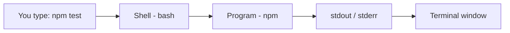
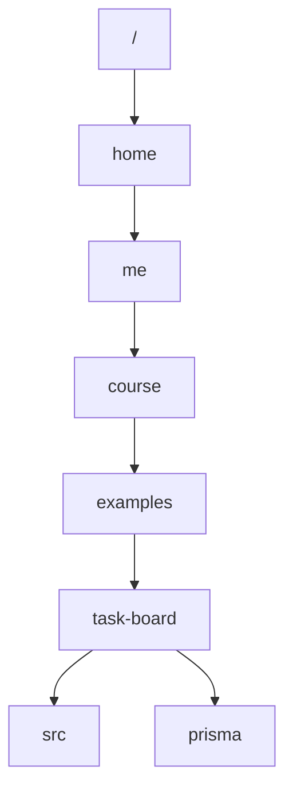

# Primer — The command line for web developers

You will use a terminal every week to run Node, npm, Prisma, `psql` and `curl`. This primer covers the 20 % you need 80 % of the time.

### 1. What is a shell?
A shell is a program that reads a command, runs it and prints the output. On Linux and macOS it is usually `bash` or `zsh`. On Windows, use *Git Bash* or WSL so that the commands below work unchanged.



### 2. Moving around
```bash
pwd                 # print working directory: where am I?
ls -la              # list files, including hidden ones such as .env
cd examples/task-board   # go into a folder (relative path)
cd ..               # go up one level
cd ~                # go to your home directory
```
**Paths:** `/home/me/app` is *absolute* (it starts at the root `/`). `src/server.js` is *relative* to the current folder.



### 3. Files
```bash
mkdir -p src/routes       # create folders (-p creates parents too)
touch src/server.js       # create an empty file
cp .env.example .env      # copy
mv old.js new.js          # move or rename
rm file.txt               # delete (there is no recycle bin!)
cat package.json          # print a file
```

### 4. Running programs
```bash
node src/server.js        # run a script
npm install               # install dependencies from package.json
npm run dev               # run the "dev" script defined in package.json
npx prisma migrate dev    # run a tool from node_modules/.bin
```
- **Ctrl+C** stops the running program (for example your server).
- **↑ / ↓** go through your command history, and **Tab** autocompletes.

### 5. Environment variables
```bash
echo $HOME
export PORT=4000          # valid for this terminal session
PORT=4000 node src/server.js   # valid for this one command only
node --env-file=.env src/server.js   # Node ≥ 20 loads .env for you
```

### 6. Talking HTTP from the terminal
```bash
curl http://localhost:3000/              # GET, print the body
curl -i http://localhost:3000/           # also show the response headers
curl -v http://localhost:3000/           # show everything (request + response)
curl -X POST -d 'title=Milk' http://localhost:3000/tasks   # send a form
```

### 7. Reading errors
| Message | Usual cause | Fix |
|---------|-------------|-----|
| `command not found` | The program isn't installed or isn't on your PATH | Install it, or check `which node` |
| `EADDRINUSE :3000` | Another server is already using the port | Stop the other one (Ctrl+C) or use a different `PORT` |
| `Cannot find module` | A typo in the import path, or `npm install` hasn't been run | Check the path and the `.js` extension |
| `ECONNREFUSED 5432` | PostgreSQL isn't running or is unreachable | Check `DATABASE_URL` |
| `permission denied` | No rights to that file or folder | Work inside your home directory |

**Tip:** read the *first* error line and the *first* stack line that points to *your* file.
