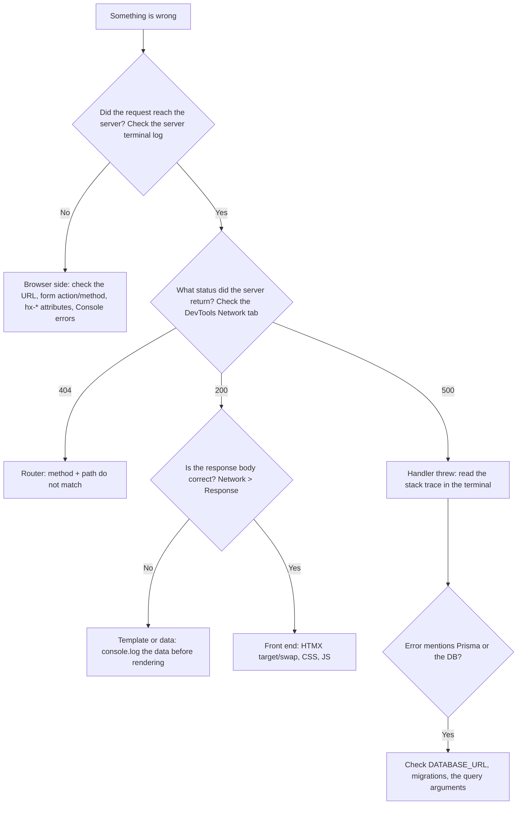

# Primer — How to debug a web application

Something is broken. Where do you look? A web app has several layers, and the bug lives in exactly one of them. Find the layer first.



### 1. Browser DevTools (F12)
| Tab | Use it to… |
|-----|------------|
| **Elements** | See the *current* DOM (after HTMX swaps) and try CSS changes live |
| **Console** | See JS errors, run `document.querySelector(...)` |
| **Network** | See every request: method, URL, status, request/response headers, form data, body. **This is the most useful tab in this course.** |
| **Application** | Inspect and delete cookies (session, CSRF) |

Tip: tick **Preserve log** in Network, so requests stay visible after redirects.

### 2. Server side
```js
console.log('body =', ctx.body);          // quick look at the data
console.dir(obj, { depth: null });        // print nested objects in full
console.time('query'); /* ... */ console.timeEnd('query');
```
Run with the debugger:
```bash
node --inspect --env-file=.env src/server.js   # then open chrome://inspect
```
In PyCharm/WebStorm, create a *Node.js* run configuration and click *Debug*. Then set breakpoints by clicking the line gutter.

### 3. Reading a stack trace
```
TypeError: Cannot read properties of undefined (reading 'title')
    at renderTask (file:///.../src/views/tasks.js:12:25)     <-- your code: start here
    at Array.map (<anonymous>)
    at listTasks (file:///.../src/routes/tasks.js:20:30)
```
The top line tells you *what* went wrong. The first line pointing at *your* file tells you *where*.

### 4. Isolate with curl
If the page "does nothing", call the endpoint directly:
```bash
curl -i -X POST -d 'title=x' http://localhost:3000/tasks
```
If curl works, the problem is in the browser or HTMX. If curl fails too, the problem is on the server.

### 5. Database
```bash
psql "$DATABASE_URL" -c 'SELECT id, title FROM tasks LIMIT 5;'
npx prisma studio          # a GUI for browsing your tables
```
To see the SQL that Prisma runs: `new PrismaClient({ log: ['query'] })`.

### 6. The scientific method
1. **Reproduce** the bug reliably.
2. **Form a hypothesis** ("the form doesn't send `title`").
3. **Test it** with *one* change or log line.
4. **Fix**, then add a test so the bug can't come back.

### 7. Asking for help (template)
> **What I did:** … **What I expected:** … **What happened (exact error, status code):** … **What I already tried:** …
