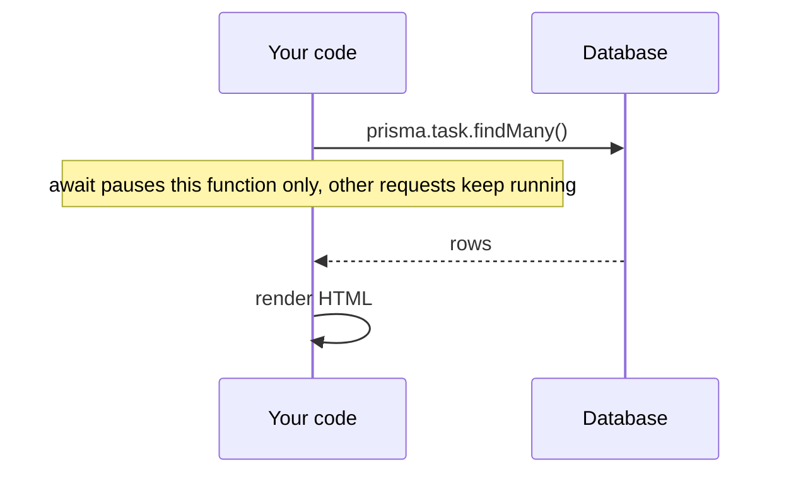
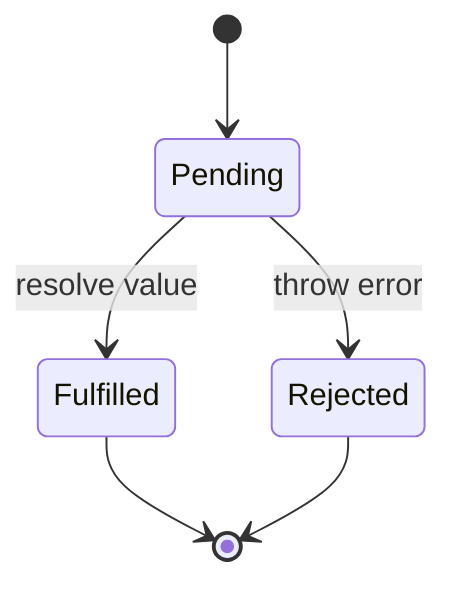

# Primer — JavaScript you need for this course

This assumes you already know *some* programming language. It covers only the JS features used in the lectures and in the reference app.

### 1. Values and variables
```js
const name = 'Ada';        // cannot be reassigned (use by default)
let count = 0;             // can be reassigned
count += 1;
// Types: string, number, boolean, null, undefined, object, array, function
typeof 42;        // 'number'
Array.isArray([]) // true
```
Always use `===` (strict equality). `'1' == 1` is `true`, but `'1' === 1` is `false`.

### 2. Objects and arrays
```js
const task = { id: 1, title: 'Buy milk', done: false };
task.title;            // 'Buy milk'
task['done'];          // false
const { id, title } = task;           // destructuring
const updated = { ...task, done: true }; // copy with one change

const tasks = [task, { id: 2, title: 'Code', done: true }];
tasks.map(t => t.title);          // ['Buy milk', 'Code']
tasks.filter(t => !t.done);       // only the open tasks
tasks.find(t => t.id === 2);      // a single item, or undefined
tasks.some(t => t.done);          // true
tasks.reduce((n, t) => n + (t.done ? 1 : 0), 0); // count the done tasks
```

### 3. Functions
```js
function add(a, b) { return a + b; }
const add2 = (a, b) => a + b;                 // arrow function
const greet = (name = 'guest') => `Hi ${name}`; // default parameter + template literal
```
Functions are values: you can pass them as arguments. That's exactly how handlers and middleware work:
```js
router.get('/tasks', listTasks);   // we pass the function itself; we don't call it
```

### 4. Modules (ESM)
```js
// math.js
export function square(x) { return x * x; }
export default function cube(x) { return x ** 3; }

// main.js
import cube, { square } from './math.js';   // the .js extension is required in Node ESM
```
`package.json` needs `"type": "module"`.

### 5. Asynchronous code
Slow work (network, disk, database) doesn't block. You get a **Promise**, which is a value that will arrive later.



```js
async function listTasks(ctx) {
  try {
    const tasks = await prisma.task.findMany(); // waits without blocking the server
    ctx.html(renderList(tasks));
  } catch (err) {
    console.error(err);
    ctx.status(500).text('Something went wrong');
  }
}
```
**Common mistake:** forgetting `await` leaves you with a Promise instead of data (`tasks.map is not a function`).



### 6. Classes (rarely needed)
```js
class HttpError extends Error {
  constructor(status, message) { super(message); this.status = status; }
}
throw new HttpError(404, 'Task not found');
```

### 7. Useful built-ins
```js
JSON.stringify({ a: 1 });   // '{"a":1}'
JSON.parse('{"a":1}');      // { a: 1 }
new URL('http://x/a?q=1').searchParams.get('q'); // '1'
Number('42'); String(42); parseInt('42px', 10);
Object.entries({ a: 1 });   // [['a', 1]]
```

### 8. Self-check
1. What is the difference between `const` and `let`?
2. What does `tasks.filter(t => t.done).length` return?
3. Why does `const data = fetch(url); data.json()` fail?
4. Rewrite `function (x) { return x * 2 }` as an arrow function.
